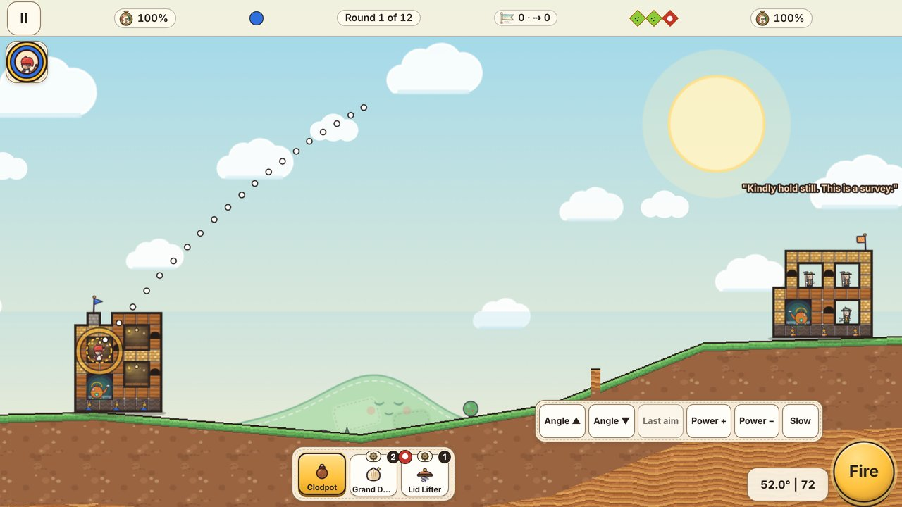
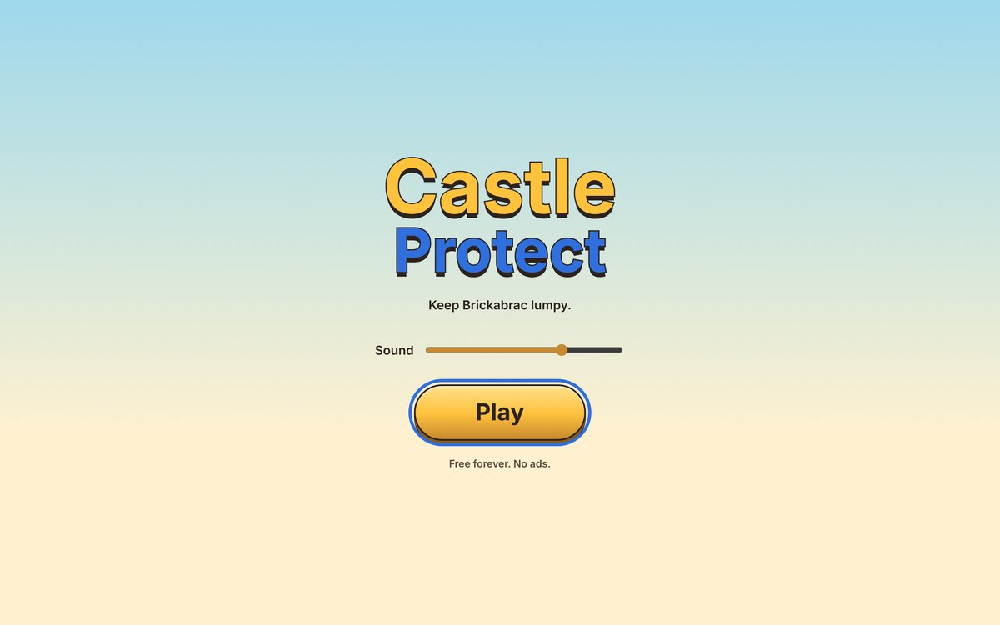
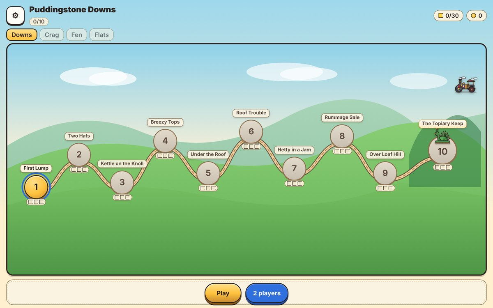
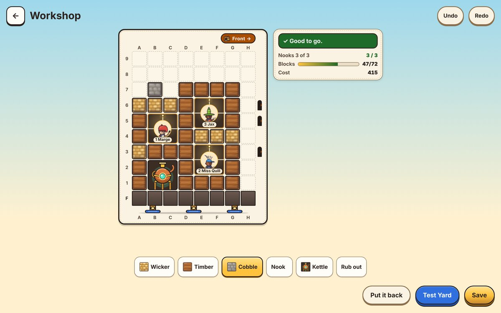
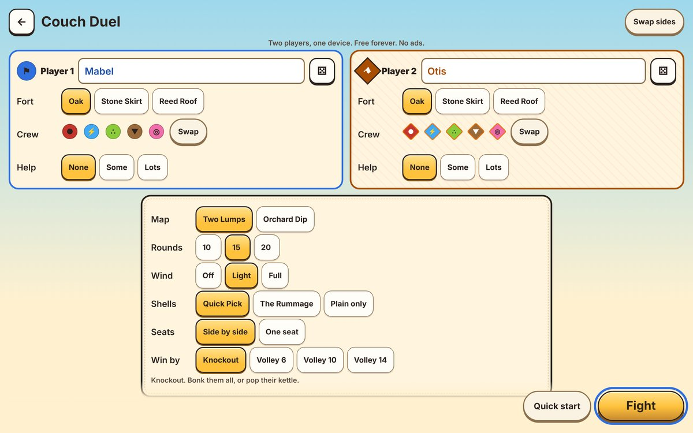
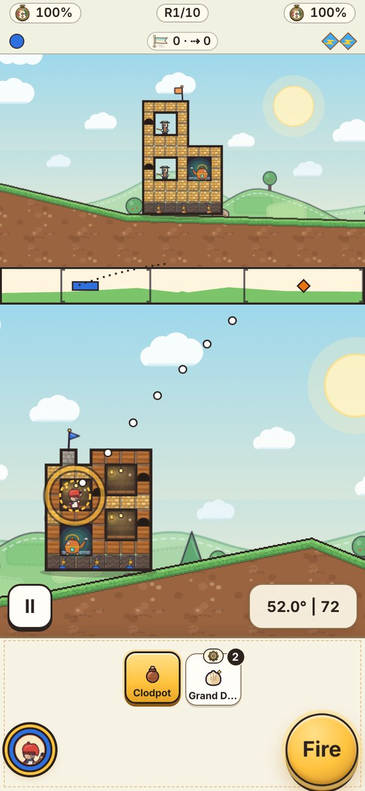
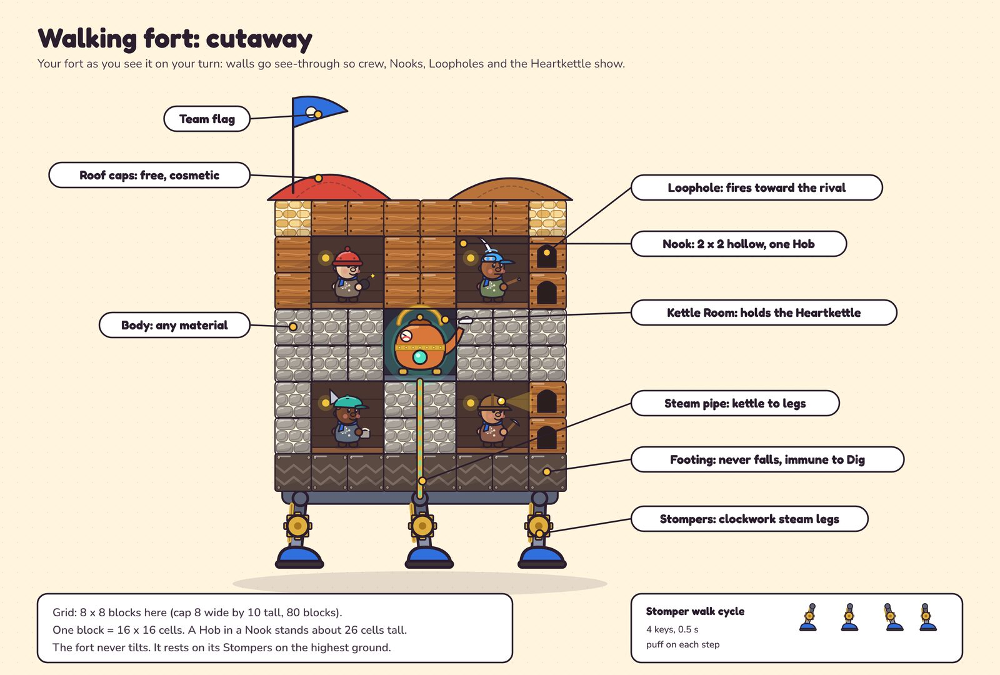
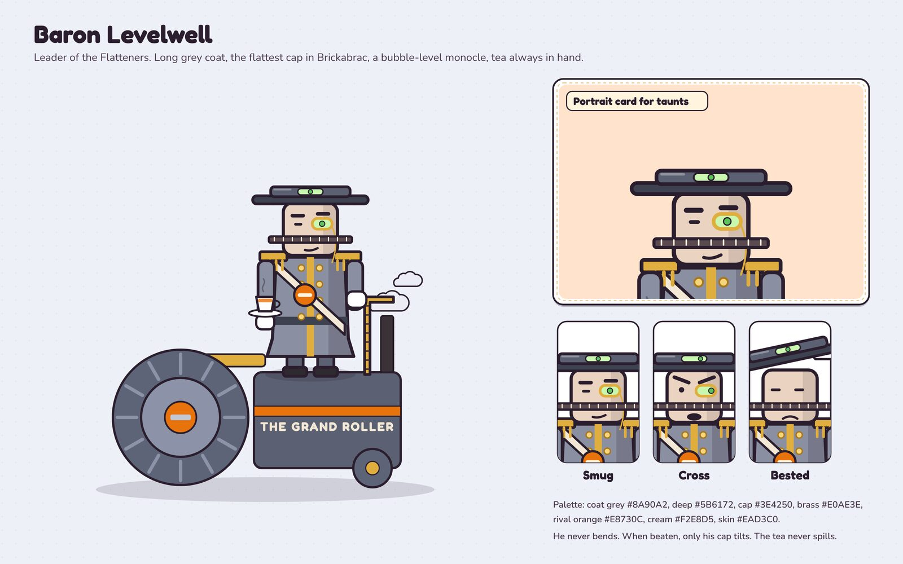
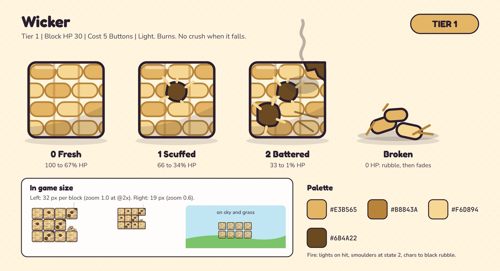
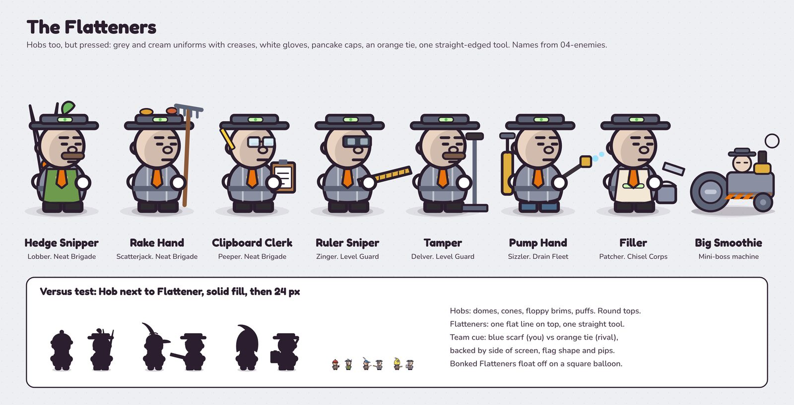

# Castle Protect

**Keep Brickabrac lumpy.**

A free turn-based castle artillery game for iPhone, iPad, Android and the web. Your crew of Hobs lives inside a walking fort you build yourself. Aim, fire, and break wood, stone and ground to bonk the enemy crew or pop the steam kettle at the heart of their fort.

**Play it now in your browser: https://njarrar.github.io/CastleProtectLive/**

- **Free.** No price, no purchases, no ads, no timers, no energy.
- **Offline.** Every mode works with no connection. The web build installs as an app.
- **1 or 2 players.** A campaign against AI Rivals, Skirmish, and Couch Duel for two players on one device.
- **Same game everywhere.** Swift for iOS, Kotlin for Android, TypeScript for web, all on one shared Rust rules core, so every platform plays the same.
- **Portrait and landscape.**

## Status

| Part | State |
|---|---|
| Design, art direction, reviews | Done (see `docs/`) |
| v0.1 build: Region 1 (10 levels), Skirmish, Couch Duel, Workshop | Playable on web, Android and iOS |
| Rules | Version 5 |
| Full launch scope (4 regions, 40 levels) | Planned, see [`docs/PLAN.md`](docs/PLAN.md) |

Every push builds and tests the rules core, the web app, the Android app and the iOS app on GitHub Actions, and the web build goes live on GitHub Pages. See [`docs/RELEASE.md`](docs/RELEASE.md).

## What it looks like now

These are from the current build. The art is a clean flat style for now; a human artist will paint the final art.

| | |
|---|---|
|  |  |
| Title screen | The Puddingstone Downs map: ten levels, up to three Pennants each, and the Topiary Keep at the end |
|  |  |
| The Workshop: build your fort block by block, with Nooks for your crew and a room for the kettle | Couch Duel setup: names, forts, crew, help, map, rounds, wind, shells and how to win |

In portrait the screen splits in two. The Rival's fort sits on top, a strip map in the middle shows where the shot will land, and your fort and every control sit at the bottom, in reach of one thumb.

In landscape the field fills the screen, with shot buttons along the bottom and fine aim buttons beside Fire.

Your Hobs wear red hats. Flatteners wear grey caps. Each Hob has its own idle pace, and the crew calls out lines as they work.

 

---

## The world

Brickabrac is a lumpy patchwork land. Small, stubborn **Hobs** claim hills and build walking forts from whatever they can stack. Every fort runs on a **Heartkettle**, a steam kettle that drives its clockwork legs. **Baron Levelwell** and his **Flatteners** want every hill rolled flat, because flat is tidy. You fight to keep Brickabrac lumpy, and every region you win back gets its hills back.

| | |
|---|---|
|  |  |
| A walking fort: clockwork Stompers, the Footing row that cannot be dug, crew rooms (Nooks), gun slots (Loopholes) and the Kettle Room | Baron Levelwell on the Grand Roller. The teacup stays |

The tone is bloodless slapstick. A Hob at 0 HP is **Bonked** and floats away on a Snooze Balloon.

## How a fight plays

| Part | Rule |
|---|---|
| Turns | You take turns. An optional **Walk** (costs Steam), then one **Action**. No turn clock |
| Aim | Drag to set angle and power, then press Fire. Fine aim buttons and exact numbers on screen |
| Aim help | The preview shows 30% of the arc. Your last shots stay as a **Ghost** with impact **Pins**. **Last aim** puts an old aim back once |
| Wind | Holds for 3 rounds (a Weather Front), with the next one shown ahead |
| Read the fort | Hold any block to see what would fall (**Lean Lines**). Weak blocks shimmer |
| Win | **Clean Sweep** (all enemy Hobs Bonked) or **Kettle Pop** (enemy kettle at 0) |
| The kettle | 200 HP. At half HP it cracks and the walls of its room get weaker |
| The Creaks | From round 10 the fort creaks: cracked blocks hold less, and loose ones fall. "Creaks next round" warns you first. The Creaks alone never Bonk a Hob or pop a kettle |
| No stalemates | "Squall in 3" warns before the round cap, then the **Sudden Squall** hits both forts until something pops |
| Fair rules | No lost turns. Self hits do 50% and never Bonk your own Hob. A buried Hob digs out (**Shove Off**) for 15 Steam. A gun slot a shot has threaded closes until the wind changes |

### Example turn

1. Miss Quill, your Zinger, sees the Rival's Lobber behind a gun slot.
2. You Walk your fort one step uphill to clear a hedge.
3. You drag to aim: 62.5 degrees, power 74. The preview arcs over the hedge, and last turn's Pin sits two blocks short.
4. You nudge power to 77 and press Fire. The Hatpin threads the gun slot and hits the Lobber.
5. That Loophole flaps shut to threads until the wind changes, so you cannot repeat the shot next turn.
6. The Rival answers with a lob that breaks the wall beside Hetty's room. The blocks above her lose support, but her Ridgepole keeps them standing.

## The crew

Each Hob has a class, a Plain Shot it can fire any turn, and one **Knack**: a big special shot.

| Class | What it does | Plain Shot |
|---|---|---|
| Lobber | Breaks walls | Clodpot |
| Zinger | Picks off Hobs | Hatpin |
| Scatterjack | Hits a wide patch | Gravel Sneeze |
| Digger | Digs under | Nibbler |
| Bouncer | Goes round corners | Jumping Bean |
| Patcher | Mends | Dollop |

Two more classes come later: the **Stoker** (fire and water) at launch, and the **Lookout** (finds hidden crew) in Update 2.

The eight Hobs in the build now:

| Hob | Class | Knack | Passive |
|---|---|---|---|
| Marge Dumpling | Lobber | Grand Dumpling | Steady Hands: a longer aim preview |
| Miss Quill | Zinger | Darning Needle | Threads gun slots more easily |
| Jax Pepper | Scatterjack | Pepper Rain | Fourth Stone: his Gravel Sneeze throws four stones |
| Grub Mudgett | Digger | Seed Potato | Broad Back: the Hob behind him keeps Cover even if their wall breaks |
| Bobbin Springheel | Bouncer | Roly-Poly | One More Hop: picks how many times his shots bounce |
| Hetty Mortarboard | Patcher | Barn Raising | Ridgepole: blocks above her room cannot fall while she stands |
| Old Thumper | Lobber | Tick-Tock Crock | Old Grudge: a bigger shot after a friend is Bonked |
| Nan | Scatterjack | Pan Parade | Dinner Bell: her neighbours hit 15% harder after she hits a Hob |

## Shots, blocks and the kettle

Before a fight you pick **Trick Shells** in **the Rummage**, or take a **Quick Pick**. The ones in the build: Suet Pudding, Lid Lifter, Bag of Marbles, Nosy Goose, Mole Mail, Old Turnip (a dud, and it says so) and Rubber Radish, with Barrow Load for heaping up dirt.

**Doodads** are kit you bring into a fight. Winning level 1-9 gives you the **Mend Bucket** (mends 3 of your blocks) and your first Doodad slot. The **Pot Lid** (the first shell into a room bounces off) and a second slot come at level 2-1.

| Block | HP | Cost (Buttons) |
|---|---|---|
| Wicker | 30 | 5 |
| Timber | 50 | 15 |
| Cobble | 80 | 35 |
| Brassbound | 110 | 70 |
| Mossbrick (Update 3, heals itself) | 140 | 150 |
| Footing | 400 | free, never falls |

| | | |
|---|---|---|
|  |  |  |

## The Rivals

The AI misses like a person (wide first, then closer), only sees what you see, and says it is AI. Each Rival has one **habit** you can plan around, its own crew, and its own pace. Every level has one odd map feature and its own Pennant goals, such as "Chase Fernsby off the knoll".

Region 1, Puddingstone Downs:

| Level | Name | Rival | Habit |
|---|---|---|---|
| 1-1 | First Lump | Sir Pudge | Shoots wide first. Then a bit closer |
| 1-2 | Two Hats | Private Tuft | Shoots your top Hob first |
| 1-3 | Kettle on the Knoll | Lance Corporal Fernsby | Hides his crew deep. Leaves the kettle near the wall |
| 1-4 | Breezy Tops | Corporal Dibber | Forgets the wind on his first shot of each front |
| 1-5 | Under the Roof | Sergeant Posy Rake | Goes for your hurt Hob |
| 1-6 | Roof Trouble | Warden Snedd | Aims at roofs |
| 1-7 | Hetty in a Jam | Corporal Fernsby | Plays it straight. Proud of his new stripe |
| 1-8 | Rummage Sale | Sergeant Posy Rake | Grabs the biggest shell in the Rummage. Fires it fast |
| 1-9 | Over Loaf Hill | Corporal Dibber | Slow to find his range. Starts over when you move |
| 1-10 | The Topiary Keep (boss) | Marshal Mowbray Trimm | Hedges regrow while the Sprinkler Root stands |

The Flattener crew are Hedgers, Rakers, Mowers and Pitchers. Bosses warn a turn before big attacks.

| | |
|---|---|
|  |  |
| The Flatteners: creased grey uniforms and pancake caps | The four launch boss forts |

## Campaign

| # | Region | New ideas | Boss |
|---|---|---|---|
| 1 | Puddingstone Downs (in the build) | Aim, crew, kettle, wind, Knacks, building, the Rummage, walking | Topiary Keep |
| 2 | Crag End | Height, falls, digging, bank shots, fire on wood | Sanding Stair |
| 3 | Soggy Bottom Fen | Water, mud, soaked, tide | Great Sump |
| 4 | The Flats | Raising and dropping ground, fighting machines | The Last Level |
| 5 (Update 2) | Nithering Heights | Strong wind, frost, ice, hidden crew | Glidehall |
| 6 (Update 3) | Wheal Clank | Ceilings, shock chains, magnets, Mossbrick | Stampmill |

## Building and progress

The **Workshop** is a free fort editor with undo, redo and a **Test Yard** to try your fort. Blocks sell back at full price. Your fort needs a Nook for each Hob and a room for the kettle before it is good to go.

You earn **Buttons** from every fight and **Pennants** (up to 3 per level). Pennants feed the **Tinker Tree**: 4 branches (Aim, Fort, Crew, Kit) with free resets. No level ever needs grinding.

## Skirmish and Couch Duel

**Skirmish** is a single fight against a named Rival on a map you pick, such as Two Lumps or Orchard Dip.

**Couch Duel** is two players on one device. Each player picks a name, a ready-made fort (Oak, Stone Skirt or Reed Roof) and a help level, which both players can see. You pick the map, rounds, wind and shells, and choose to sit side by side or pass one seat. A hand-off card between turns shows the last shot and a Ready button. Win by **Knockout** (Clean Sweep or Kettle Pop) or by **Volley Points** (a set number of shots each; the higher score wins).

## Art style

"Patchwork storybook": round chunky shapes, warm plum outlines, flat fill with one hard shade, stitched seams. Hobs are round; Flatteners are square. The 25 concept sheets are in [`docs/art/`](docs/art/) as SVG, with renders in `docs/art/png/`. The game sprites live in `assets/`. A human artist will paint the final art.

Sound is stereo, with separate cues for lid clangs, buried thuds, the boss-phase horn and the storm.

---

## Tech

| Layer | Choice |
|---|---|
| Shared core | Rust: rules, AI, content, saves. Q16.16 fixed point, so all apps give the same result |
| iPhone and iPad | Swift, SwiftUI, SpriteKit |
| Android | Kotlin, Jetpack Compose, Android canvas |
| Web | TypeScript, canvas, the core as WebAssembly, offline PWA |
| Text | One string table, `content/text.json`, read by all three apps |
| Builds | GitHub Actions for every platform |

## Repository map

| Folder | What is in it |
|---|---|
| `docs/BRIEF.md` | The original project brief |
| `docs/research/` | Market study, hands-on play, playtests of other artillery games, review study, tech stack studies |
| `docs/design/` | `00` core rules and numbers, `01` shots, `02` tech tree and economy, `03` crew, `04` enemies, bosses and AI, `05` campaign and maps, `06` art direction, `07` UX, UI and audio |
| `docs/review/` | Audits, reviews, rulings, naming decisions |
| `docs/qa/` | Playtest reports |
| `docs/art/`, `docs/plan-page/` | Concept art and the visual plan page |
| `docs/screens/` | Screenshots of the current build |
| `core/` | Shared Rust rules core |
| `content/` | Game data and all on-screen text, in JSON |
| `assets/` | Sprites and sound |
| `apps/web/`, `apps/android/`, `apps/ios/` | The three apps |
| `.github/workflows/` | Cloud builds |
| `tools/`, `scripts/` | Art tools and build scripts |

## Lessons we built on

- Drag-back aim with numbers feels right; we add a longer preview and shot markers.
- "Aim low, break the base" is the fun; Lean Lines make a collapse easy to read.
- No turn clocks, no fake players, no ad walls, no daily caps, no gadgets locked for hours.
- Self hits do half damage and never knock out your own Hob; buried crew always dig out.
- The AI misses like a person and says it is AI.

## License

MIT, see `LICENSE`.
