# Castle Protect: The Unflattening

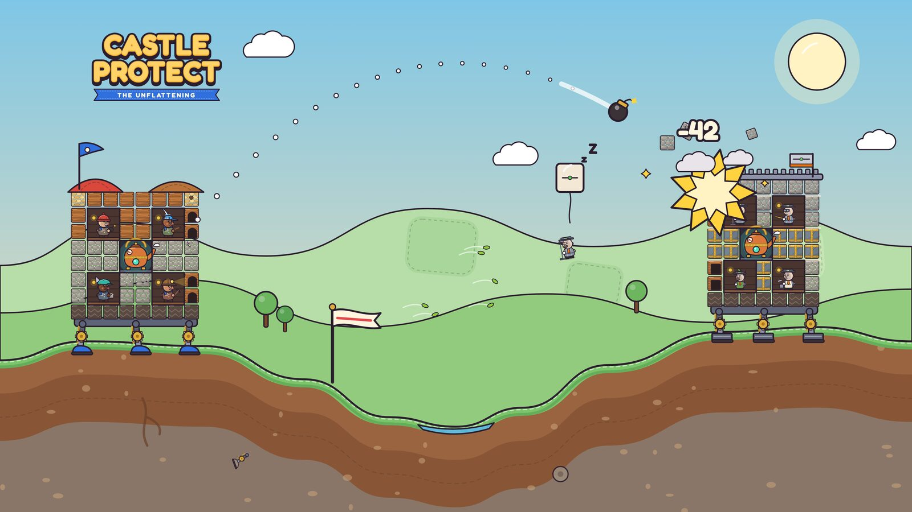

A free turn-based castle artillery game for iPhone, iPad, Android and the web. Your crew of Hobs lives inside a walking fort you build yourself. Break wood, stone and ground to bonk the enemy crew or pop the steam kettle at the heart of their fort.

- **Free.** No price, no purchases, no ads, no timers, no energy.
- **Offline.** Every mode works with no connection.
- **1 or 2 players.** A campaign against fair AI Rivals, plus Couch Duel for two players on one device.
- **Native apps.** Swift for iOS, Kotlin for Android, TypeScript for web, all on one shared Rust rules core so every platform plays the same.
- **Portrait and landscape.**

## Status

| Stage | State |
|---|---|
| Research, design, art direction, reviews | Done (see `docs/`) |
| v0.1 build (Region 1, Skirmish, Couch Duel, web, Android, iOS) | In progress, see [`docs/BUILD-WEEK-1.md`](docs/BUILD-WEEK-1.md) |
| Full launch scope (4 regions, 40 levels) | Planned, see [`docs/PLAN.md`](docs/PLAN.md) |

Builds run on GitHub Actions: the rules core, web app, Android APK and iOS simulator app build and test on every push. See [`docs/RELEASE.md`](docs/RELEASE.md).

## Start here

1. [`docs/PLAN.md`](docs/PLAN.md): the master plan, with every owner decision.
2. [`docs/plan-page/castle-protect-plan.html`](docs/plan-page/castle-protect-plan.html): the visual summary with all concept art.
3. [`docs/BUILD-WEEK-1.md`](docs/BUILD-WEEK-1.md): what the first build contains and how the code is laid out.

---

## The world

Brickabrac is a lumpy patchwork land. Small, stubborn **Hobs** claim hills and build walking forts from whatever they can stack. Every fort runs on a **Heartkettle**, a steam kettle that drives its clockwork legs. **Baron Levelwell** and his **Flatteners** want every hill rolled flat, because flat is tidy. You fight to keep Brickabrac lumpy, and every region you win back gets its hills back.

| | |
|---|---|
|  |  |
| A walking fort: clockwork Stompers, the Footing row that cannot be dug, crew rooms (Nooks), gun slots (Loopholes) and the Kettle Room | Baron Levelwell on the Grand Roller. The teacup stays |

Tone: bloodless slapstick. A Hob at 0 HP is **Bonked** and floats away on a Snooze Balloon.

## How a battle plays

| Part | Rule |
|---|---|
| Turns | Alternating turns. An optional **Walk** (costs Steam), then one **Action**. No turn clock |
| Aim | Drag to set angle and power, then press a separate Fire button. Fine Tune pad and exact numbers on screen |
| Aim help | The preview shows 30% of the arc. Your last two shots stay as a **Ghost** with impact **Pins**. **Recall** restores an old aim once |
| Wind | Holds for 3 rounds (a Weather Front), with the next one forecast |
| Read the fort | Hold any block to see what would fall (**Lean Lines**). Weak blocks shimmer |
| Win | **Clean Sweep** (all enemy Hobs Bonked) or **Kettle Pop** (enemy Heartkettle at 0) |
| No stalemates | "Squall in 3" warns before round 15, then the **Sudden Squall** crumbles both forts until something pops |
| Fair rules | No lost turns. Self hits do 50% and never Bonk your own Hob. A buried Hob digs out for 15 Steam. A threaded gun slot closes until the wind changes |

| Landscape | Portrait |
|---|---|
| 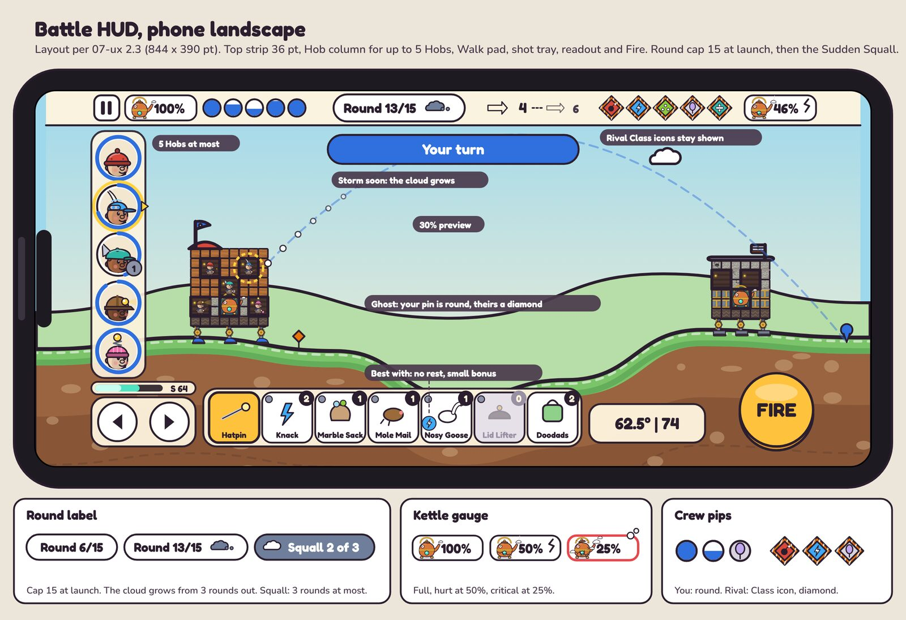 | 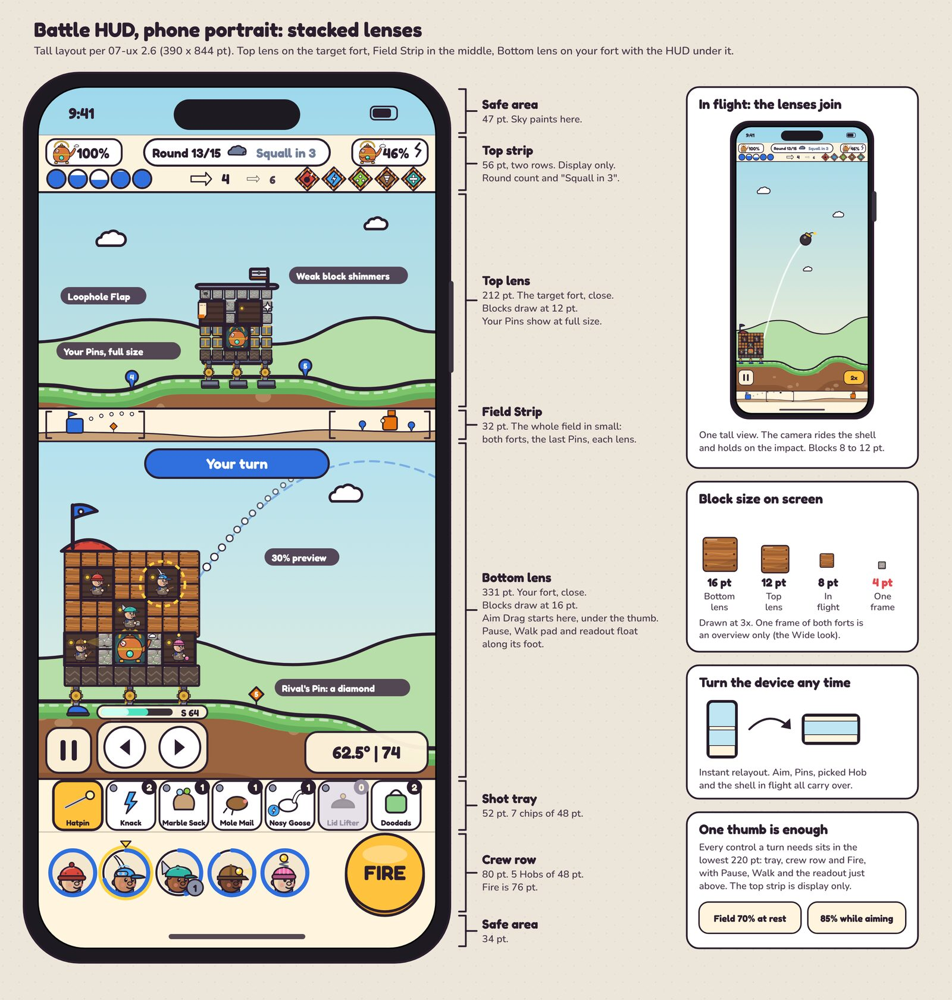 |
| The field keeps 71 to 85% of the screen | Stacked lenses: the target fort on top, a strip map in the middle, your fort and every control in reach of one thumb |

### Example turn

1. Quill, your Zinger, sees the Rival's Lobber behind a gun slot. The "No line" mark is off, so a shot can reach.
2. You Walk your fort one step uphill for 40 Steam to clear a hedge.
3. You drag to aim: 62.5 degrees, power 74. The 30% preview arcs over the hedge, and last turn's Pin sits two blocks short.
4. You Fine Tune power to 77 and press Fire. The Hatpin threads the gun slot and hits the Lobber for 48.
5. That Loophole flaps shut to threads until the wind changes, so you cannot repeat the shot next turn.
6. The Rival answers with a lob that breaks the wall beside Hetty's room. The blocks above her lose support, but her Ridgepole keeps them standing.

## The crew

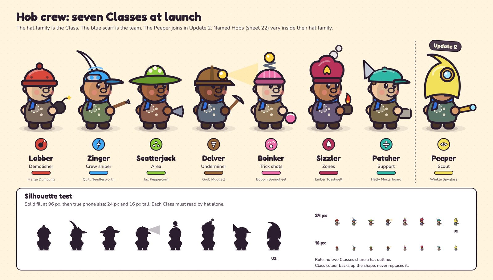

| Class | Role | Plain Shot | Launch Hobs (Knack) |
|---|---|---|---|
| Lobber | Wrecks walls | Clodpot | Marge (Grand Dumpling, Low Blow), Old Thumper (Tick-Tock Crock), Pip (Chimney Drop) |
| Zinger | Snipes crew | Hatpin | Quill (Sunspear), Dame Flicka (Long Skewer) |
| Scatterjack | Area spread | Gravel Sneeze | Jax (Pepper Rain), Nan (Pan Parade), Fizz (Rising Fizz) |
| Delver | Digs under | Nibbler | Grub (Burrowbomb), Truffle (Molehill Surprise) |
| Boinker | Bounces and rolls | Bouncebean | Bobbin (Rolypoly), Skip (Skimmerstone) |
| Sizzler | Fire and water | Emberpot | Ember (Scaldspill), Brine (Drenchbarrel) |
| Patcher | Repairs and shields | Mendglob | Hetty (Barn Raising), Poultice (Bubble Bonnet) |
| Peeper (Update 2) | Scouts hidden crew | Peep Pip | Arrives later |

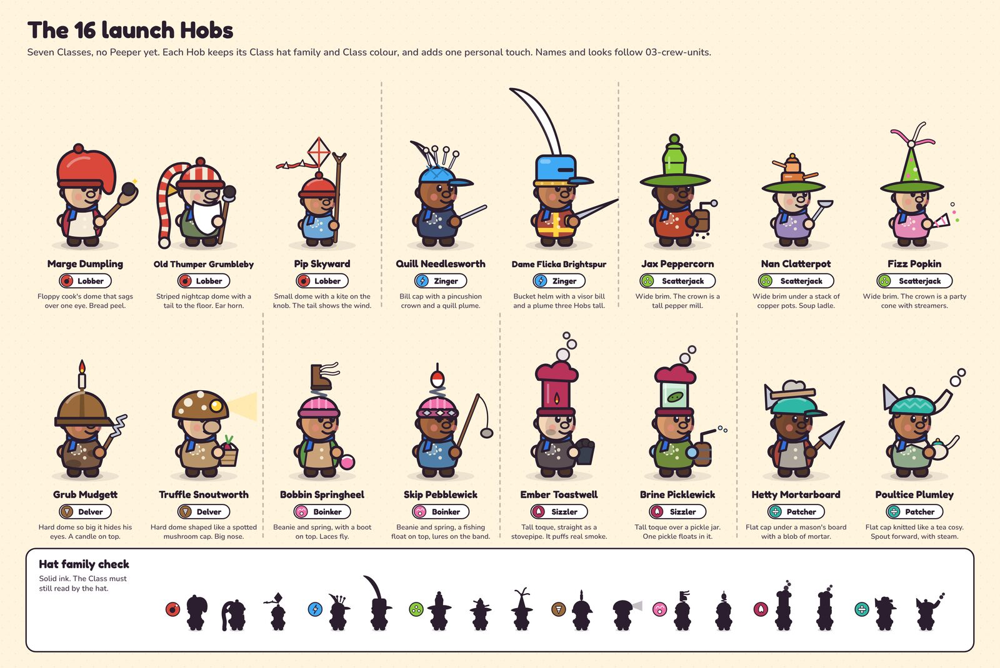

Passives that act on the Hobs **next door**:

| Hob | Passive | Role |
|---|---|---|
| Grub | Broad Back: the Hob behind him keeps Cover even if their wall breaks | Front tank |
| Hetty | Ridgepole: blocks above her room cannot fall while she stands | Column holder |
| Old Thumper | Old Grudge: a bigger shot after a neighbour is Bonked | Reacts to a loss |
| Nan | Clatter Call: neighbours hit 15% harder after she hits a Hob | Buffs neighbours |

## Weapons, blocks and the kettle

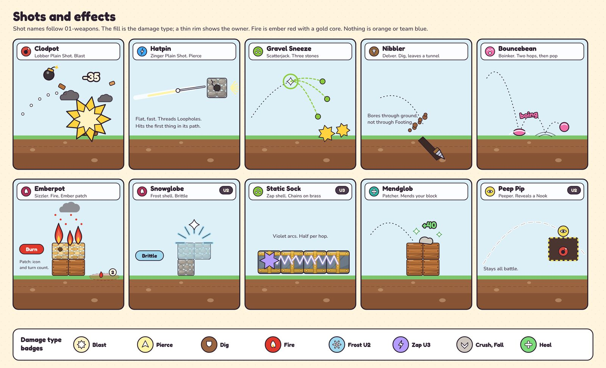

- 8 Plain Shots, 28 Knacks, 58 Trick Shells drafted before battle in the **Rummage**, 14 Doodads, 26 named combos.
- Every shot must change the picture and differ from the others by what it does, not by its numbers.

| Material | HP | Cost (Buttons) |
|---|---|---|
| Wicker | 30 | 5 |
| Timber | 50 | 15 |
| Cobble | 80 | 35 |
| Brassbound | 110 | 70 |
| Moonbrick (Update 3) | 140 | 150 |
| Footing | 400 | free, never falls |

| | | |
|---|---|---|
|  | 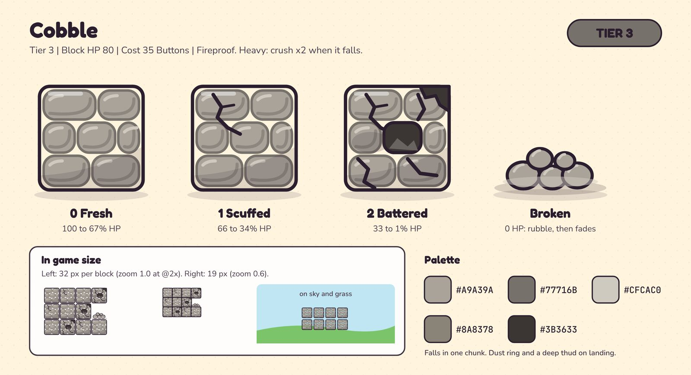 | 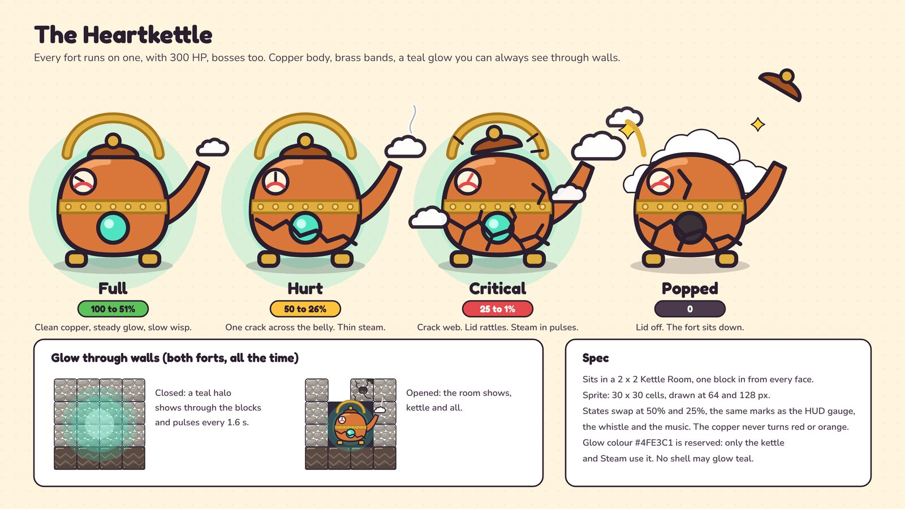 |

## Enemies and bosses

| | |
|---|---|
|  | 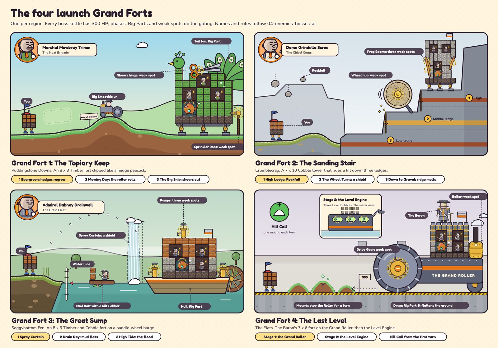 |
| The Flatteners: Hobs in creased grey uniforms and pancake caps | Four launch boss forts. Bosses warn a turn before big attacks and never heal past a phase line |

The AI misses like a person (wide first, then short, long, hit), only sees what you see, and says it is AI. Eight personalities, each Rival with one habit you can build against.

## Campaign

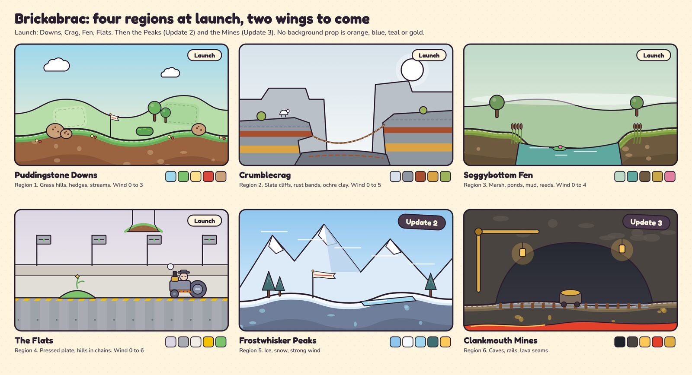

| # | Region | New idea taught | Boss |
|---|---|---|---|
| 1 | Puddingstone Downs | Aim, crew, kettle, wind, Knacks, building, draft, walking | Topiary Keep |
| 2 | Crumblecrag | Height, falls, digging, bank shots, fire on wood | Sanding Stair |
| 3 | Soggybottom Fen | Water, mud, soaked, tide | Great Sump |
| 4 | The Flats | Raising and dropping ground, fighting machines | The Last Level |
| 5 (Update 2) | Frostwhisker Peaks | Strong wind, frost, ice, hidden crew | Glidehall |
| 6 (Update 3) | Clankmouth Mines | Ceilings, shock chains, magnets, Moonbrick | Stampmill |

| | |
|---|---|
| 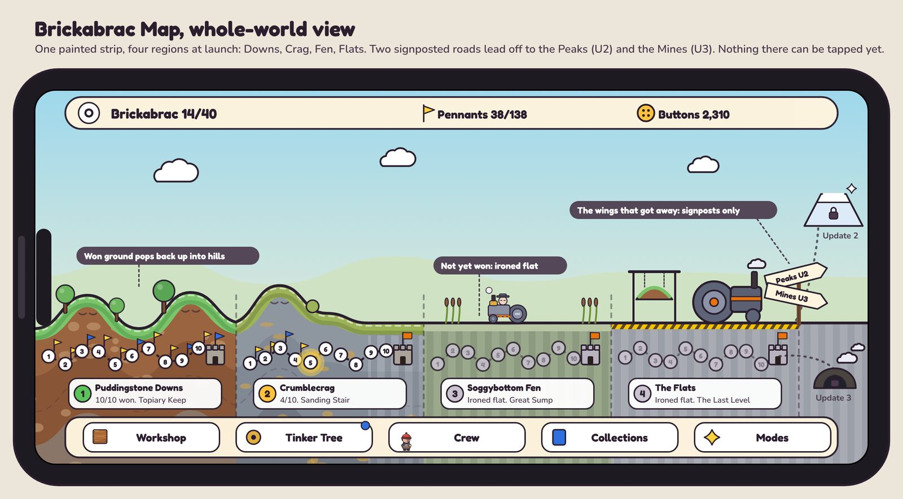 | 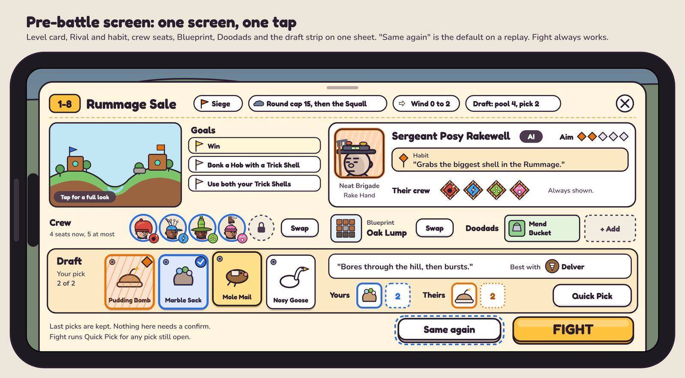 |
| The Brickabrac map | One pre-battle screen: level card, crew seats, draft strip, Doodads, then Fight |

## Building and progress

| | |
|---|---|
| 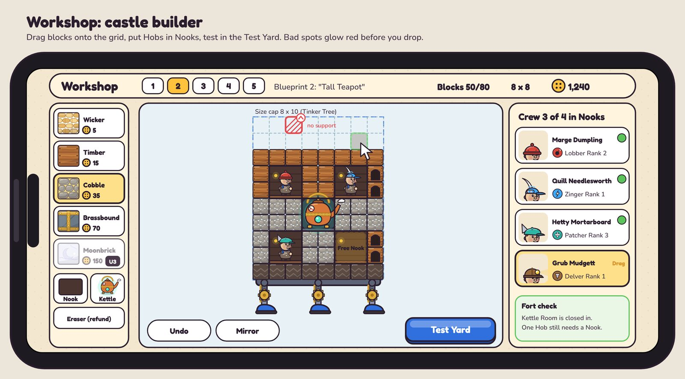 | 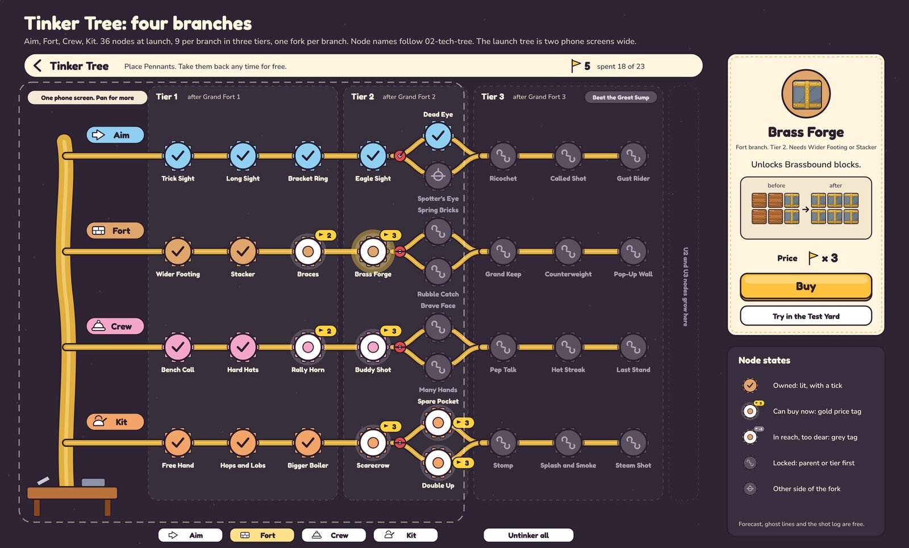 |
| The Workshop: a free fort editor with undo, mirror and test fire. Blocks sell back at full price | The Tinker Tree: 4 branches (Aim, Fort, Crew, Kit), free resets |

Two currencies: **Buttons** from every battle, and **Pennants** (up to 3 per level) for the Tinker Tree. A script checks that no level ever needs grinding.

## Couch Duel

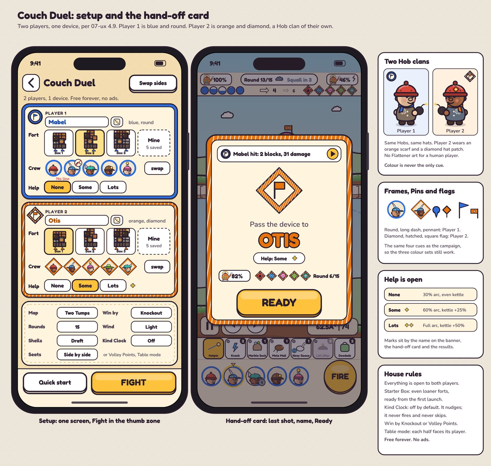

Two players, one device. Everything is open to both, help levels are shown openly, Starter Box forts are ready from the first launch, and a hand-off card between turns shows the last shot and a Ready button. An optional Kind Clock nudges but never fires. Win by knockout or by Volley Points.

## Art style

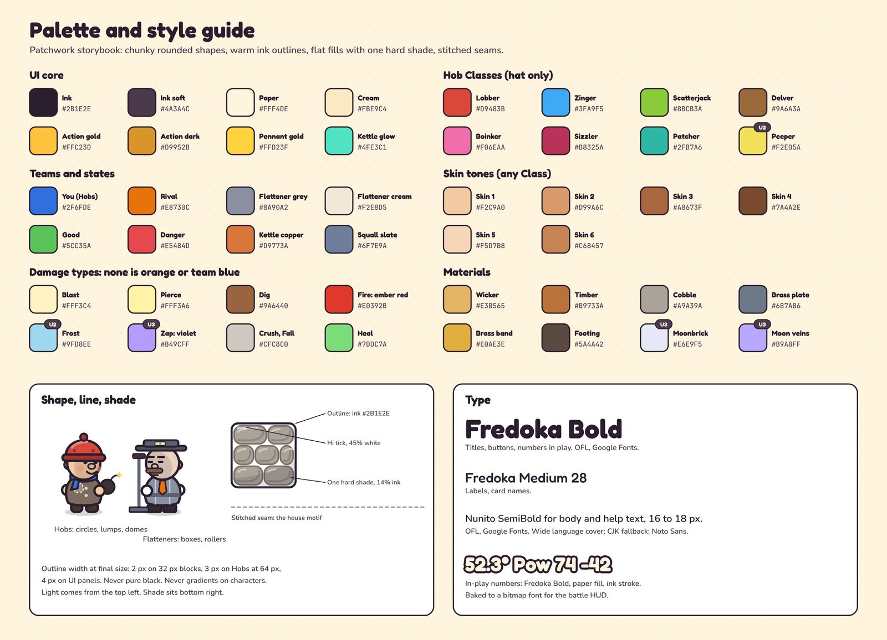

"Patchwork storybook": round chunky shapes, warm plum outlines, flat fill with one hard shade, stitched seams. Hobs are round; Flatteners are square. All 25 concept sheets are in [`docs/art/`](docs/art/) as SVG, with renders in `docs/art/png/`. Final art will be made by human artists.

---

## Tech

| Layer | Choice |
|---|---|
| Shared core | Rust: rules, AI, content, saves, the Daily, bots. Q16.16 fixed point, so all apps give the same result |
| iPhone and iPad | Swift, SwiftUI, Metal |
| Android | Kotlin, Jetpack Compose, OpenGL ES 3.0 |
| Web | TypeScript, WebGL2, core as WebAssembly, offline PWA |
| Builds | GitHub Actions for every platform |

## Repository map

| Folder | What is in it |
|---|---|
| `docs/BRIEF.md` | The original project brief |
| `docs/research/` | Market study (20 games), hands-on play, the Mac playtest of Castle Busters and Pocket Tanks, App Store review study (about 1,600 reviews), open source code survey, tech stack studies (`04` web-first, `04b` native) |
| `docs/design/` | `00` core rules and canonical numbers, `01` weapons, `02` tech tree and economy, `03` crew, `04` enemies, bosses and AI, `05` campaign and maps, `06` art direction, `07` UX, UI and audio |
| `docs/art/` | 25 concept art sheets |
| `docs/review/` | Consistency audit, fun and scope review, technical review, rulings, final checks, lessons from the reference games |
| `docs/plan-page/` | The visual summary page and its images |
| `core/` | Shared Rust rules core |
| `content/` | Game data in JSON |
| `assets/` | Game sprites |
| `apps/web/`, `apps/android/`, `apps/ios/` | The three apps |
| `.github/workflows/` | Cloud builds |
| `tools/`, `scripts/` | Art generator, build scripts |

## Lessons we built on

From the Mac playtest of Castle Busters and Pocket Tanks (`docs/research/02e`, `docs/review/06-learnings-decisions.md`):

- Pull-back aim with numbers feels right; we add a longer preview and shot markers.
- "Aim low, break the base" is the fun; we make collapse readable with Lean Lines.
- No turn clocks, no fake players, no ad walls, no daily caps, no gadgets locked for hours.
- Self hits do half damage and never knock out your own Hob; buried forts always dig out.
- The AI misses like a person and says it is AI.

## License

MIT, see `LICENSE`.
