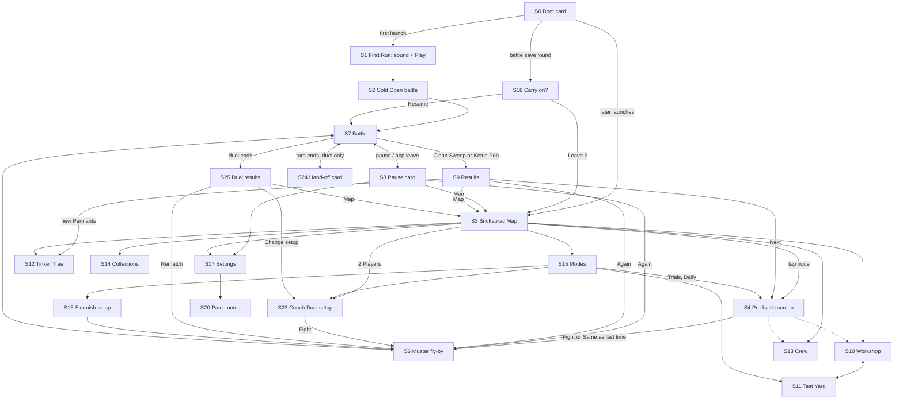

# 07. UX, UI and Audio

Status: revision 3, after the owner's decisions on orientation, Couch Duel and price. Date: 2026-11-22. Owner of this doc: UX lead and audio director.

This doc sets every screen, control, prompt, feedback rule and sound in Castle Protect. It builds on `00-core-game-design.md` and uses its bold terms as written. It applies `docs/review/04-rulings.md`; where a ruling and an older line of this doc clashed, the ruling won.

**Cites.** Same style as `00`: `[02 §5.7]` is `docs/research/02-reference-gameplay-teardown.md`, section 5, item 7. `[00 §2.3]` is the core design doc.

**Units.** `pt` means one iOS point, one Android dp or one CSS pixel. `cell` is one sim cell [00 §2.1]. `%W` and `%H` are shares of screen width and height.

**Numbers.** All sizes and timings are tuning targets unless marked "fixed".

**Phase tags.** `[Launch]`, `[U1]`, `[U2]`, `[U3]` follow the phased plan in `docs/review/04-rulings.md`, section A. `[rulings B15]` cites that file. Items marked **OWNER** are recommendations until the owner approves.

**Words on screen (naming pass).** Every line a player reads now comes from `content/text.json`, one string table shared by web, Android and iOS, and every display name comes from the content JSON. Where this doc quotes a line and the string table says something else, the string table wins. The voice rules are in `docs/review/naming-and-voice-review-fable.md` section 2, as fixed by `docs/review/naming-decisions.md`. In short: British spelling; sentence case; "Fight", never "battle", on screen (this doc still says battle in its own prose); "kettle" on screen; "!" only on Bonk!, Thump!, Drop!, Snip! and Kettle Pop!; errors are plain and say what is safe. The title line is **Keep Brickabrac lumpy.** Fatigue is now **the Creaks**, a Battered block is **Cracked**, a buried Loophole is **Dug in**, the Squall win is **Blown Out**, Siege Score is **Score**. On a loss Hetty gives a one-line verdict. On a campaign win the Rival signs off. The level card opens as a **Notice of Flattening**.

## Changes in revision 3 (owner decisions)

The owner has decided four things. They are binding, and this revision applies them.

1. **Portrait and landscape both ship at launch,** on phones, tablets and web. The battle gets a full portrait design, the **Tall layout** of stacked lenses [review 06 G1]: a Top lens on the target fort, a thin Field Strip of the whole field with the last Pins, and a Bottom lens on your fort with the HUD under it. The camera joins the lenses to follow the shell and holds on the impact (2.6). Blocks draw at 16 and 12 pt on a phone in portrait, larger than in landscape. Turning the device mid-battle relays the screen at once and loses nothing (2.6.6). Every screen in the screen map has a tall arrangement (4.10).
2. **Couch Duel ships at launch.** Entry from the map, a one-screen setup with the Starter Box, a hand-off card between turns, a named turn banner, open Help handicaps, an optional Kind Clock, Table mode, results and rematch (4.9). Player 1 is blue and round; Player 2 is orange and diamond.
3. **Everything is free.** There is no store, no trial, no unlock card and no purchase to restore. S19 is retired. Where it helps, one short line says **Free forever. No ads.** (First Run, Couch Duel setup, About).
4. **One-hand play is the natural state in portrait** (7.4), and **a quick click must work**: every button acts on release with no minimum press time (3.10) [02e §4].
5. Human-made final art is decided too; the art doc carries it [06 §13].
6. **Lessons from the reference games** [review 06, section A] are applied where they touch the screen: the **Squall in 3** banner and count (2.9, G4); **Lean Lines**, the shimmer on weakly held blocks and the **Drop!** callout (3.11, G5); the **Loophole Flap** mark (3.11, G6); the Rival's **wish glance** in the draft (4.1, G9); the **No line** mark on the pre-battle screen (4.1, G10); **Volley Points** in Skirmish and Couch Duel setup (4.7, 4.9, G11); and the Couch Duel house rules: the hand-off card, the Kind Clock, the Starter Box, open handicaps and Table mode (4.9, G2).

## Changes in revision 2

1. **One pre-battle screen, one tap to fight.** The level card, crew, Blueprint, the draft and Doodads are one screen. The Rummage is a draft strip on it. Last picks are kept, and "Same as last time" is the default on replays (4.1) [rulings B15].
2. **Onboarding slowed to 12 prompts at most in the first 10 minutes.** Levels 1-1 to 1-5 teach only aim, Hob pick, the kettle, wind and one Knack. The Workshop opens at level 6, the Rummage at level 8, Walk at level 9 and the Tinker Tree at level 10 (section 5) [rulings B14].
3. **Tinker Tree screen has four branches:** Aim, Fort, Crew, Kit. 36 nodes at launch, one real fork per branch. Forecast, Rival ghost lines, the shot log and the drift readout are free and are no longer nodes (4.4) [rulings B13].
4. **Sudden Squall HUD** replaces Last Bell, Final Volley and the tiebreak card (2.9) [rulings B5].
5. **"What broke you" replay** on the loss screen, and a habit tag on every Rival (4.6) [rulings B17].
6. **Kettle warnings are 50% and 25%** in the gauge, the whistle, the music and the art (2.4, 6.6, 9.2) [audit C84].
7. **Audio: the 14 MB Full plan with a 2.8 MB boot pack** is the recommendation, pending the owner. Launch uses about 9.7 MB of it (9.6) [rulings D5].
8. **Launch SFX are 75 events and launch barks are 100 clips.** The full lists stay, tagged by phase: 115 SFX events and 200 barks by U3 (9.3, 9.4).
9. ~~Landscape only at launch.~~ Replaced in revision 3: both orientations ship (2.6).
10. **Any Hob may fire any Trick Shell.** Grey cards, lock states, deny refunds and per-Class tags are gone from the tray, the cards and the draft. The matching Class shows a small "best with" badge (2.4, 4.1, 4.2) [rulings B6].
11. **Enemy crew is shown.** Rival Class icons stay on after the Muster. Hidden `?` pips return with the Lookout in U2 [rulings B10].
12. **No lost turns in the HUD.** A Tumbled Hob can still fire. A buried Loophole greys the Fire button with a "dug in" icon and never bursts a shot [rulings B9].
13. **One "needs a rest" cog** for every cause; one "patch" icon with a turn count for every ground effect [rulings B16].
14. **Pins fade after one reuse** (3.4) [rulings B11].
15. **Crew cap 5.** The Hob column holds 5 portraits at most. Hob growth is 3 ranks with a Quirk pick each; the Crew screen shows ranks, not levels [rulings B3, B8].
16. **Fire is ember red, not orange,** so no damage colour matches the Rival side (6.3) [audit C82].
17. **Smaller fixes:** duel gap 1000 to 1400 [rulings C4]; max zoom 1.25 [rulings D7]; Workshop counter x / 72 [audit C65]; Cold Open load cap 2 MB [audit C81]; resume after an update uses the new rules [03 review §8 item 5]; Raid Rehearsal is a Test Yard button; four regions on the map at launch.
18. **Cut items** moved to Appendix A, "Parked ideas".
19. **Final verification pass** [review 05]: the Sudden Squall hits both forts at once at each Squall round end, with one tick for both sides (2.9). Duds say **Dud** on the chip, with no `?` stamp (4.1). Rescue and Escort show a round limit with no Squall. The Crew screen shows Rank, not level. The weapons doc's three feel extras are in 6.4 and 6.5.

---

**Ten UX laws for this game (fixed).**

1. The field is the star. HUD covers at most 30% of the screen in battle, and far less while you aim.
2. Lifting a finger never fires. Only Fire fires [00 §2.3].
3. Every control is at least 48 x 48 pt to the touch. Fire is at least 72 x 72 pt.
4. No hint is longer than three words in English. Pictures first.
5. No confirm box in battle. Undo, not "Are you sure?".
6. Nothing ever waits on a network.
7. Colour never carries meaning alone. Shape, icon or number backs it.
8. Sound and volume are in reach before the first sound plays [02d §1.6.10].
9. Any screen is two taps or less from the Brickabrac Map.
10. A crash, a call or a dead battery never costs a battle [02d §1.6.8].

Two more, from the rulings: the game never takes a turn away from the player [rulings B9], and a replay is one tap from the map to the fight [rulings B15].

---

## 1. Screen map and flows

### 1.1 All screens

| # | Screen | Kind | Reached from |
|---|---|---|---|
| S0 | Boot card (studio mark, under 2 s, tap to skip) | Full | App start |
| S1 | First Run card (sound sliders, Play) | Full, first launch only | S0 |
| S2 | Cold Open battle | Battle | S1 |
| S3 | **Brickabrac Map** (home) | Full | S0 on every later launch |
| S4 | **Pre-battle screen** (Rival and habit, map, goals, crew, Blueprint, draft strip, Doodads) | Sheet over S3 | Map node |
| S5 | Retired. The Rummage is the draft strip on S4 (4.1) | | |
| S6 | **Muster** fly-by | In battle | S4 |
| S7 | Battle | Full | S6 |
| S8 | Pause card | Overlay on S7 | Pause button, app leave |
| S9 | Results, with the "what broke you" replay on a loss | Full | Battle end |
| S10 | **Workshop** (Build, Crew, Decor tabs). Opens at level 6 | Full | Map dock, S4 |
| S11 | **Test Yard**, with **Rehearse a raid** | Battle variant | S10, Modes |
| S12 | **Tinker Tree** (four branches). Opens at level 10 | Full | Map dock, S9 |
| S13 | Crew (roster, **Ranks**, **Quirks**, **Outfits**) | Full | Map dock |
| S14 | Collections (**Almanac**, **Curio Shelf**, **Brag Clips**, stats) | Full | Map dock |
| S15 | Modes. Launch: Couch Duel, Skirmish, Trials, Daily Dust-up, Test Yard. Later: Long Siege `[U1]`, Ironclad `[U2]`, Baron Rush `[U3]` | Full | Map dock |
| S16 | Skirmish setup (one card) | Sheet | S15 |
| S17 | Settings (Sound, Controls, Help, Comfort, Save, About) | Full, also inside S8 | Gear on every screen |
| S18 | Resume card ("Carry on?") | Overlay | S0 when a battle save exists |
| S19 | Retired. Everything is free, so there is no unlock card | | |
| S20 | Patch notes | Sheet | First launch after an update, About |
| S21 | Shell card (weapon card) | Popover | Long-press any shell chip, Almanac |
| S22 | Retired. Both orientations work, so there is no Rotate card (2.6) | | |
| S23 | **Couch Duel** setup (two player cards, rules row) | Full | **2 Players** pill on the map, Modes |
| S24 | Hand-off card ("Hand it to ...") | Overlay on S7 | End of each turn in a Couch Duel |
| S25 | Duel results | Full | Couch Duel end |

Every screen in this table works in the Wide layout and the Tall layout. Section 4.10 lists the tall arrangement of each.

### 1.2 Flow diagram



### 1.3 Cold start to first shot: 30 second budget (first launch)

| Clock | What runs | Budget |
|---|---|---|
| 0.0 s | App icon tap. Native splash is the first frame of the Boot card, so there is no white flash | 0 |
| 0.0 to 2.0 s | S0 Boot card. Core code, Cold Open map, core SFX sprite load behind it. Tap skips once loading is done | 2.0 s |
| 2.0 to 5.0 s | S1 First Run. Three sliders (Music, Sound, Voices) at 70%, one big Play, and one small line under it: **Free forever. No ads.** No sound has played yet. No account, no consent wall, no name entry | 3.0 s |
| 5.0 to 8.0 s | Play tapped. This tap unlocks web audio [04 §11]. Camera drops onto the Cold Open hill. Music fades in | 3.0 s |
| 8.0 to 12.0 s | Ghost hand shows one Aim Drag. Prompt: **Drag to aim** | 4.0 s |
| 12.0 to 22.0 s | Player drags. Full preview arc on this level only [00 §8.3] | 10.0 s |
| 22.0 to 25.0 s | Fire button pulses. Prompt: **Fire!** Player taps | 3.0 s |
| **25.0 s** | **First shot is in the air** | 5 s spare |

Rules that protect the budget:

- No language pick screen. We read the device language and fall back to English. The setting sits in S17.
- There is no store at all. No news, login or rating prompt shows before the first win.
- The budget is the same in both layouts. The Cold Open's one drag and one tap sit in the thumb zone in portrait.
- The Cold Open loads under 2 MB: one map, one Hob, one Rival prop, the core SFX sprite (about 1.2 MB with one music base stem) and the code [audit C81].
- If the player waits more than 6 s on S1, the Play button bounces once. Nothing else moves.

**Later launches.** S0 goes straight to S3 with the next level glowing [00 §4.3]. Target: icon tap to the map in 3 s, to a first shot of a replay or Skirmish rematch in 5 s more [00 §2.12]. The Results screen and S16 both offer **Rematch**, and the pre-battle screen offers **Same as last time**; both reuse the last setup.

---

## 2. Battle HUD

### 2.1 Platform matrix

| Platform | Orientation | Reference size | Layout |
|---|---|---|---|
| Phone | Landscape, both rotations | 844 x 390 pt (large), 667 x 375 pt (small) | Wide (2.3) |
| Phone | Portrait, upright | 390 x 844 pt (large), 375 x 667 pt (small) | Tall (2.6) |
| Tablet | Landscape, both rotations | 1180 x 820 pt | Wide (2.5) |
| Tablet | Portrait, both rotations | 820 x 1180 pt | Tall (2.6.5) |
| Desktop web | Any window from 320 x 480 pt up | 1280 x 720 pt | Wide when width is at least 1.2 times height, else Tall (2.6, 2.7) |
| Phone web browser | Either | as phone | As phone, with a full-screen ask on the Play tap |

All six rows are supported for every screen and every mode at launch. A battle may start in one layout and end in the other (2.6.6).

### 2.2 The Clear Rect

The HUD floats over the field. The field draws edge to edge under it. The **Clear Rect** is the largest box with no HUD on it. In the Wide layout the camera frames both castles inside the Clear Rect, not inside the screen, so no Hob ever sits under a button. In the Tall layout there are two clear boxes, the Bottom lens and the Top lens, and each frames one castle (2.6).

Field share is counted as screen area with no opaque HUD on it.

| Layout | Plan step, pad closed | Fine Tune pad open | During Aim Drag | During flight |
|---|---|---|---|---|
| Phone 844 x 390, 5 Hobs | 73% | 71% | 89% | 91% |
| Phone 667 x 375, 5 Hobs | 71% | 67% | 88% | 91% |
| Tablet 1180 x 820 (pad always open) | 84% | 84% | 93% | 95% |
| Desktop 1280 x 720 | 85% (pad always open) | 85% | 92% | 94% |
| Phone portrait 390 x 844, 5 Hobs | 70% | 67% | 85% | 90% |
| Small phone portrait 375 x 667, 5 Hobs | 65% | 61% | 83% | 89% |
| Tablet portrait 820 x 1180 (pad always open) | 76% | 76% | 91% | 93% |

The phone rows were measured with a column of 6 Hobs. The crew cap is now 5 [rulings B3], so the real share is a little better. All layouts beat the 60% floor from `[02 §6.6]`. The 70% target in `[00 §3]` holds at rest on every phone in landscape and on the large phone in portrait; the small phone in portrait rests at 65% (2.6.4). The one dip (67%, small phone, pad open) lasts only while the pad is up; the pad folds away 4 s after the last nudge.

### 2.3 Phone landscape (844 x 390 pt)

Safe areas: 47 pt left and right for the notch, 21 pt at the bottom for the home bar. Nothing you can tap sits inside them. The top strip paints into them but holds no controls there.

**Zones.**

| Zone | Place | Size | Share of screen |
|---|---|---|---|
| Top strip | Full width, top | 844 x 36 pt drawn; tap areas reach 48 pt down | 9.2% |
| Hob column | Left edge, under the strip | 56 x 256 pt (5 Hobs, the cap); 56 x 204 pt (4 Hobs) | 4.4% |
| Walk pad | Bottom left, right of the Hob column | 108 x 52 pt | 1.7% |
| Shot tray | Bottom centre | 392 x 60 pt (7 chips) | 7.1% |
| Aim cluster | Bottom right | Fire 76 x 76 pt, readout 120 x 40 pt | 3.2% |
| Fine Tune pad | Left of Fire, on demand | four 48 x 48 pt keys | 2.8% |
| Clear Rect | The rest | about 622 x 290 pt | 73% at rest |

**Thumb zones.** With the phone held in two hands, each thumb sweeps an arc of about 180 pt from its lower corner. Left thumb owns: Hob column, Walk pad, Pause. Right thumb owns: Fire, Fine Tune, readout. Either thumb reaches the shot tray. The centre of the field is for Aim Drag and belongs to whichever thumb is free. No control you need in a turn sits in the top centre, which is the hardest spot to reach.

**Wireframe, Plan step.**

```
+------------------------------------------------------------------------------------+
|[II] [K 100%] (o)(o)(o)(o)      Round 6/15    ~> 4  .>6       (#)(#)(?)(?) [K 82%]  |  36 pt
+----+                                                                          -----+
|(L) |                                                                               |
|(Z)*|                         . . . .                                               |
|(S) |                    . .          .                         /\                  |
|(P)@|      _[]_       .                                        |##|_                |
|    |     |o|o |  . '                         __               |#?|#|               |
|    |     |[K] |           ___               /  \___           |K |#|               |
|    |  ___|_==_|__________/   \_____________/       \__________|==|#|______         |
+----+--------+                                                    +--------+ +------+
|[<][>] S 64  | [Plain][Knack*2][Sh1][Sh2][Sh3][Sh4][Doo 2]        | 62.5 74| | FIRE |
+-------------+----------------------------------------------------+--------+ +------+
 Hob col  Walk pad                 Shot tray                         readout   76 pt
```

Key: `[II]` pause. `[K 100%]` Heartkettle HP. `(o)` your Hob pips, `(#)` Rival crew pips. At launch every Rival pip shows its Class icon all battle [rulings B10]; read each `(?)` in these drawings as a Class icon. Hidden `(?)` pips return with the Lookout in U2. `~> 4` wind arrow and number. `.>6` forecast for the next Weather Front. `(L)(Z)(S)(P)` Hob portraits with Class letters. `*` selected. `@` rest cog. `S 64` Steam left.

**Wireframe, during Aim Drag.** Tray, Hob column and Walk pad fade to 25% and stop taking taps. The readout grows and moves next to the Loophole so the numbers sit where the eyes are.

```
+------------------------------------------------------------------------------------+
|[II] [K 100%] (o)(o)(o)(o)      Round 6/15    ~> 4  .>6       (#)(#)(?)(?) [K 82%]  |
+------------------------------------------------------------------------------------+
|                                                                                    |
|             [62.5 deg | 74]   . . .                                                |
|                    . .   '          '                          /\                  |
|      _[]_      . '                    (30% preview ends)      |##|_                |
|     |o|o>  . '                               __               |#?|#|               |
|     |[K] |    \                             /  \___           |K |#|               |
|  ___|_==_|_____\_________/   \_____________/       \__________|==|#|______         |
|                 \                                                                  |
|                  (x)  <- finger, pull-back band                           [ FIRE ] |
+------------------------------------------------------------------------------------+
```

**Wireframe, Fine Tune pad open.**

```
                                               +------+--------+------+ +------+
                                               | ang- | 62.5   | ang+ | |      |
                                               +------+  74    +------+ | FIRE |
                                               | pow- | [R]    | pow+ | |      |
                                               +------+--------+------+ +------+
                                                 48     64 wide   48      76
```

### 2.4 Every battle control

Sizes are tap sizes. A control may draw smaller than it taps.

| Control | Phone size | Tablet size | Desktop size | States | Notes |
|---|---|---|---|---|---|
| Pause | 48 x 48 | 56 x 56 | 40 x 40, key Esc | idle, pressed | Top left. Pauses at once, mid-flight too |
| Kettle gauge (yours, rival) | 64 x 36, taps 64 x 48 | 80 x 44 | 80 x 40 | full, hurt (50% or less, crack icon), critical (25% or less, steam puffs), popped. The same two marks drive the whistle, the music and the kettle art | Tap: camera looks at that kettle for 1.5 s |
| Hob pips | 24 x 24 each, group taps 48 high | 30 x 30 | 28 x 28 | full, hurt (pie fill), Bonked (balloon icon). Rival pips show the Class icon in a diamond frame at all times. Hidden (`?`) and revealed states are `[U2]` | Tap the group: a 2 s label row shows names and HP |
| Round label | 96 x 36 | 120 x 44 | 120 x 40 | normal, **Squall in 3**, in 2, in 1 (cloud icon grows, count shown), Sudden Squall (slate plate, Squall round count). See 2.9 | Reads `Round 6/15` [00 §2.2]. The second number is the round cap; the Squall follows it |
| Wind arrow | 64 x 36 | 80 x 44 | 80 x 40 | calm (dot, `0`), left, right; arrow length in 3 steps (1 to 3, 4 to 6, 7 to 10) | Number always shown. Leaves drift on the field at wind speed |
| Forecast icon | 40 x 36 | 48 x 44 | 48 x 40 | shown on every level, free; pulses in the last round of a front | Smaller arrow with a dotted tail. Never a Tinker node [rulings B13] |
| Turn banner | 260 x 44, centre, 1.2 s | 320 x 56 | 320 x 56 | **Your turn**, **[Rival] aims**, **Squall in 3**, **Sudden Squall**. Couch Duel: **[Name]'s turn** | Slides in, never blocks taps |
| Hob portrait | 48 x 48, 4 pt gap | 64 x 64 | 52 x 52, key Tab | ready, selected (ring plus notch), needs a rest (one cog and a number, at most 1 extra turn), Tumbled (dizzy stars; can still fire), dug in (dirt icon; Dug in), Bonked (grey, balloon) | Tap picks the Hob. Long-press: Hob card. HP ring around the face. Five portraits at most |
| Walk left, Walk right | 48 x 48 each | 56 x 56 | 44 x 44, keys A and D | ready, held, out of Steam, turn cap hit (40), blocked (cliff or water), spent (after firing) | Hold to walk. A ghost outline shows where the castle would stop [00 §2.14] |
| Steam gauge | 108 x 12 bar plus number | 130 x 14 | 120 x 12 | full, this-turn span marked, empty | The part you can still spend this turn is brighter |
| Shot chip (Plain, Knack, Trick Shell) | 52 x 52, 4 pt gap | 64 x 64 | 56 x 56, keys 1 to 9 | ready, selected, out of uses, blocked by first-turn Heavy rule, Hob needs a rest | Shows icon, uses left, Weight cogs (0, 1 or 2) and a small "best with" badge when the picked Hob's Class matches (no rest, small bonus). Any Hob may fire any shell, so there is no lock state [rulings B6]. Long-press or right-click: Shell card |
| Doodads chip | 52 x 52 | 64 x 64 | 56 x 56, key Q | ready (count badge), open (two chips fan up), spent | Using one costs the Action, so the Fire button turns into **Use** |
| Readout strip | 120 x 40, taps 120 x 48 | 140 x 48 | 150 x 44 | no aim yet (`--`), set, being dragged | Angle to 0.1, power 0 to 100. Drag on it: 1/5 gain. Tap: opens Fine Tune |
| Fine Tune keys | 48 x 48 each | 56 x 56 | 40 x 40, arrow keys | idle, pressed, repeating, at limit | Tap: 0.1 deg or 1 power. Hold: repeat after 350 ms, ramp to 20 steps a second |
| Recall key `[R]` | 48 x 48 | 56 x 56 | 40 x 40, key R | no ghost, 1 ghost, 2 ghosts | Steps through: last aim, the one before, back to current |
| Fire | 76 x 76 | 96 x 96 | 88 x 56, Space | locked (no shot picked), **dug in** (grey, dirt icon: the picked Hob's Loophole is buried), ready (slow pulse), pressed, flight (hidden), **Use** (Doodad), **2x** (during Resolve) | Fires on finger up inside the button. 150 ms guard after an Aim Drag ends. A dug-in shot can never be fired, so it can never burst in the player's face [rulings B9] |
| Look toggle | 48 x 48, only in One-hand mode | 56 x 56 | none | off, on | When on, one finger pans the camera instead of aiming |
| Re-frame | 40 drawn, taps 48, appears only after a manual pan or zoom | 56 | key F | hidden, shown | Top right under the strip. One tap returns to auto-frame |
| Impact Pin | 20 drawn, taps 44 | 24 drawn, taps 48 | 20 drawn, click 28 | yours (round head), rival's (diamond head), recalled (filled), spent (outline only, after one reuse) | Tap: Recall, once. Lives to the end of the round |

**Colour and shape of sides.** Your side: blue, round shapes, flag points left. Rival: orange, diamond shapes, flag points right. See 7.1. In a Couch Duel, Player 1 takes the blue cues and Player 2 the orange ones (4.9).

**Tall layout.** Every control in this table keeps its phone or tablet size in portrait, with two changes: shot chips are 48 x 48 pt on phones so seven fit across 390 pt, and the Hob column becomes a row (2.6.1). Pause floats at the bottom left of the Bottom lens.

### 2.5 Tablet landscape (1180 x 820 pt)

Same parts, same order. Changes:

- Controls grow by about 1.25x (see the table). Text grows by 1.15x.
- Tablets are held at the lower corners or lie flat. All turn controls stay inside a 260 pt arc from each lower corner. The Hob column hangs from the bottom left, not from the top strip.
- The shot tray sits bottom centre and shows names under the chips.
- The Fine Tune pad stays open at all times; there is room.
- Split view and slide-over: a window narrower than 1.2 to 1 uses the Tall layout (2.6). The battle carries on through the change (2.6.6).

```
+----------------------------------------------------------------------------------------------+
|[II] [K 100%] (o)(o)(o)(o)(o)       Round 6/15     ~> 4   .>6        (#)(#)(?)(?)(?) [K 82%]  | 44 pt
+----------------------------------------------------------------------------------------------+
|                                                                                              |
|                                                                                              |
|                                  field, 84% of screen                                        |
|                                                                                              |
|                                                                                              |
|                                                                                              |
|(L) |                                                                                         |
|(Z)*|                                                                                         |
|(S) |                                                                                         |
|(P) |                                                                                         |
|(B) |                                                              +-----+-------+-----+      |
|    +----------+                                                   |ang- | 62.5  |ang+ | +---+|
|[<][>] S 64    |   [Plain][Knack][Sh1][Sh2][Sh3][Sh4][Doo]         |pow- |74 [R] |pow+ | |FIRE|
+---------------+---------------------------------------------------+-----+-------+-----+ +---+|
+----------------------------------------------------------------------------------------------+
```

### 2.6 Portrait battle: the Tall layout

**Decided by the owner: portrait and landscape both ship at launch, on phones, tablets and web.** This section replaces the old "landscape only" advice. The old worry was real: if one frame holds both forts on a 390 pt wide screen, a block draws at about 4 pt and a Hob at about 6 pt. So the Tall layout never tries to hold both forts in one frame while you plan. It shows each fort in its own lens, at a size you can read, and joins the lenses only to follow a shell.

**The idea: stacked lenses** [review 06 G1].

1. **Top lens.** The target fort, close up. Your Pins and the other crew show here at full size.
2. **Field Strip.** One thin map of the whole field, in the middle: both forts, the ground between, the last Pins, each lens's edges and the shell in flight.
3. **Bottom lens.** Your fort, close up, with the HUD under it. You aim here, with your thumb.
4. **Follow.** On Fire the two lenses join into one tall view. The camera rides with the shell from your fort to where it lands and holds on the impact. Then the lenses part again.

The sim does not know any of this. It is the same battle in either layout.

The same close view, crew row and follow camera worked in the reference game we played in a tablet window [02e §2.1 items 4 to 6]. We add the Top lens and the Field Strip so the player is never blind to the target, and we keep the miss marker that game lacked [02e §6].

**Words.** The **Wide layout** is the landscape HUD of 2.3, 2.5 and 2.7. The **Tall layout** is this one. The game picks by window shape: Wide when the width is at least 1.2 times the height, Tall when it is less. To stop a window resize from flapping, the switch to Tall happens under 1.15 and the switch back to Wide over 1.25.

#### 2.6.1 Phone portrait (390 x 844 pt)

Safe areas: 47 pt at the top, 34 pt at the bottom. The sky paints into the top one. Nothing you can tap sits inside either.

**Zones, top to bottom.**

| Zone | Size | What it holds | Share of screen |
|---|---|---|---|
| Top safe area | 390 x 47 pt | Sky. The system clock and battery sit here | field |
| Top strip | 390 x 56 pt, two rows | Row 1: your kettle, round label, Rival kettle. Row 2: your pips, wind and forecast, Rival Class icons. Display only | 6.6% |
| Top lens | 390 x 212 pt | The target fort and the ground round it | field |
| Field Strip | 390 x 32 pt drawn, taps 48 pt | The whole field in small, with the last Pins | 3.8% |
| Bottom lens | 390 x 331 pt | Your fort and the first part of the arc. Three floats sit along its bottom edge: Pause (48 x 48 pt) and the Walk pad (108 x 52 pt) on the left, the readout (120 x 40 pt) on the right | field, less 3.9% for the floats |
| Shot tray | 390 x 52 pt | 7 chips, 48 x 48 pt each, 4 pt gaps | 6.2% |
| Crew row | 390 x 80 pt | 5 Hob portraits, 48 x 48 pt each, on the left. Fire, 76 x 76 pt, on the right | 9.5% |
| Bottom safe area | 390 x 34 pt | Ground paints here | field |

The rows add up: 47 + 56 + 212 + 32 + 331 + 52 + 80 + 34 = 844 pt.

**Wireframe, Plan step.**

```
+-----------------------------------------------+
|  9:41                                  [batt] |  47 pt  safe area, sky
+-----------------------------------------------+
| [K 100%]          Round 6/15         [K 82%]  |  56 pt  top strip, two rows,
| (o)(o)(o)(o)(o)    ~> 4  .>6   <L><Z><S><D><P>|         display only
+-----------------------------------------------+
|                                               |
|                       /\                      |  212 pt TOP LENS
|       (x)2           |##|_         <>1        |         target fort, block 12 pt
|                      |#L|#|                   |         Pins at full size
|     ___              |K |#|                   |
| ___/   \_____________|==|#|_________________  |
+-----------------------------------------------+
| [#] . ' ' . (x)               <> (x)   [<#>]  |  32 pt  FIELD STRIP
+-----------------------------------------------+
|                                               |
|     _[]_          . ' ' .                     |  331 pt BOTTOM LENS
|    |o|o>|     . '         ' (30% ends)        |         your fort, block 16 pt
|    |o|o |  '                                  |         Aim Drag starts here
|    |[K] |                                     |
|  __|_==_|______________                       |
|                        \____________________  |
| [II] [<][>] S 64                 [62.5 | 74]  |         Pause, Walk pad, readout
+-----------------------------------------------+
| [Plain][Knack*2][Sh1][Sh2][Sh3][Sh4][Doo 2]   |  52 pt  shot tray
+-----------------------------------------------+
| (L) (Z)* (S) (P)@ (D)                +------+ |  80 pt  crew row and Fire
|                                      | FIRE | |
+-----------------------------------------------+
|                    _____                      |  34 pt  safe area
+-----------------------------------------------+
```

Key as in 2.3. `(x)` is your Pin (round head) and `<>` is the Rival's (diamond head); the small number is the round. `<L>` is a Rival Class icon in its diamond frame. On the Field Strip `[#]` is your fort, `[<#>]` is the Rival's, and the dots are the 30% preview.

**Thumb zone.** A phone held upright in one hand gives the thumb the lower 40% of the screen with ease. Every control a turn needs sits in the lowest 220 pt: the tray, the crew row and Fire, with Pause, the Walk pad, the readout and the Fine Tune pad floating just above them. Aim Drag starts anywhere in the Bottom lens. The Field Strip sits mid-screen; it is a help for looking round, and no turn needs it. The top strip holds no control you need: a tap on a kettle gauge or a pip group still works as in 2.4, but it is a bonus.

**Wireframe, Fine Tune pad open.** The pad takes the readout's place, bottom right of the Bottom lens, right above the tray and Fire. It folds away 4 s after the last nudge.

```
|                        +------+--------+------+ |
|                        | ang- |  62.5  | ang+ | |   48 pt keys, 64 pt readout
| [II] [<][>] S 64       | pow- | 74 [R] | pow+ | |   pad 160 x 96 pt
+------------------------+------+--------+------+-+
| [Plain][Knack*2][Sh1][Sh2][Sh3][Sh4][Doo 2]     |
```

**Wireframe, during Aim Drag.** The tray, the crew row and the Walk pad fade to 25% and stop taking taps. The big readout sits by the Loophole. The Top lens does not change: the preview is 30% of the path and never reaches it.

```
| ___/   \_____________|==|#|_________________  |
+-----------------------------------------------+
| [#] . ' ' .                   <> (x)   [<#>]  |
+-----------------------------------------------+
|        [62.5 deg | 74]                        |
|     _[]_          . ' ' .                     |
|    |o|o>|     . '         '                   |
|    |o|o | \                                   |
|    |[K] |  \                                  |
|  __|_==_|___\__________                       |
|              \         \____________________  |
| [II]         (x)  <- finger, pull-back band   |
+-----------------------------------------------+
|  (tray at 25%)                                |
|  (crew row at 25%)                   [ FIRE ] |
```

**Wireframe, flight.** In 200 ms the two lenses become one, 390 x 675 pt, and the Field Strip slides down to its foot. The tray and the crew row slide off. The top strip stays.

```
+-----------------------------------------------+
| [K 100%]          Round 6/15         [K 82%]  |
| (o)(o)(o)(o)(o)    ~> 4  .>6   <L><Z><S><D><P>|
+-----------------------------------------------+
|                    . - .                      |
|                 .         (o)  <- shell       |
|              .                 .              |  one lens, 675 pt tall
|            .                     .            |  block 8 to 12 pt
|          .                         /\         |  the camera rides the shell
|         .                         |##|_       |  and holds on the impact
|     _[]_                          |#L|#|      |
|    |o|o>|                         |K |#|      |
|  __|_==_|___       ___        ____|==|#|____  |
|             \_____/   \______/                |
| [II]                                   [ 2x ] |
+-----------------------------------------------+
| [#]      . ' (o)                 <>    [<#>]  |
+-----------------------------------------------+
```

#### 2.6.2 Sizes on screen: the answer to "3 pt blocks"

A block is 16 cells wide [00 §2.7]. The table gives its drawn width.

| View | Phone 390 x 844 | Small phone 375 x 667 | Tablet 820 x 1180 | For scale: Wide layout, phone, at the zoom floor |
|---|---|---|---|---|
| Bottom lens, default | **16 pt** | 16 pt | 24 pt | about 8 pt |
| Bottom lens, range by pinch | 12 to 18 pt | 12 to 18 pt | 18 to 24 pt | |
| Top lens, default | **12 pt** | 10 pt | 20 pt | about 8 pt |
| Top lens, range by pinch | 10 to 18 pt | 8 to 18 pt | 14 to 24 pt | |
| Joined lens in flight | 8 to 12 pt | 8 to 12 pt | 12 to 20 pt | about 8 pt |
| Smallest block in any view you aim or read by | **10 pt** (Top lens, pinched out) | 8 pt | 14 pt | about 8 pt |
| Hob height (about 1.6 blocks) at the default | 26 pt near, 19 pt far | 26 pt, 16 pt | 38 pt, 32 pt | about 13 pt |
| Wide look (2.6.3), an overview only | about 4 pt | about 4 pt | about 8 pt | |

- So a phone in portrait draws blocks **larger** than the same phone in landscape: 16 and 12 pt against about 8 pt. The price is that you see one fort per lens.
- The largest block on any portrait screen is 18 pt on phones and 24 pt on tablets. That matches the Wide layout at zoom 1.25 [rulings D7], so portrait needs no new sprite scale [06 §4.4].
- The 3 pt case from the old doc now exists only as the **Wide look**, which is a map, not a play view.

**What each lens frames.**

- **Bottom lens.** Your fort sits in the left 40% (the right 40% for the fort on the right). At 16 pt a phone shows 24 blocks across and 20 up: the whole 8 x 10 fort with its Footing and Stompers, 6 blocks of sky, and 14 blocks of open air for the first part of the arc. If your fort walks, the lens walks with it.
- **Top lens.** The other fort sits in the middle. At 12 pt a phone shows 32 blocks across and 17 up. That is the fort plus 12 blocks of ground on each side, which is where most misses land. A Pin outside the frame shows as a small arrow on the lens edge; tap it and the lens slides there.
- **Small phone (375 x 667 pt).** The top strip drops to one row of 44 pt (pips tuck under the kettle gauges) and the crew row to 76 pt. Lenses: top 172 pt, bottom 271 pt. The Top lens opens at 10 pt blocks so a full-height fort still fits.

#### 2.6.3 Camera and zoom rules in the Tall layout

| State | Top lens | Bottom lens |
|---|---|---|
| Plan, your turn | Rival fort and the last Pins | Your fort, see-through, default size |
| Aim Drag | Holds still | Holds still. No camera move while a finger aims |
| Fire and flight | The lenses join. The camera follows the shell with lookahead, dead zone the middle 30%. It starts at the Bottom lens's size, eases out to no less than 8 pt blocks at the top of the arc, and eases in to 12 pt as the shell comes down | (joined) |
| Impact | Holds on the hit for 0.6 s, then widens to show the collapse settle, as in 3.5 | (joined) |
| Return | The lenses part in 300 ms. The Top lens keeps the impact in frame | Back on your fort |
| Rival's turn | The Rival's think pose, then the join and follow, this time down to your fort | Stays on your fort, so you see what is about to be hit |

- **Pinch** in a lens zooms that lens only, inside the ranges in 2.6.2.
- **One finger in the Top lens** pans it. There is nothing to aim there, so no Look toggle is needed.
- **One finger in the Bottom lens** is always an Aim Drag on your turn. Two fingers pan it.
- **Double tap** in a lens: toggles between its default and its largest size on the tapped spot.
- **Field Strip.** Tap a spot: the Top lens looks there. Drag along it: the Top lens scrubs. Two small brackets on the strip show what each lens frames. Pins draw on the strip as 6 pt heads, round and diamond, for show only; you Recall from the Top lens, where a Pin is 20 pt drawn with a 44 pt tap, or with `[R]`.
- **Wide look.** Double tap the Field Strip. The Top lens zooms out to frame both forts and all the ground between, for as long as you like. Blocks are about 4 pt, so this is for reading hills and distance, not crew. Tap the lens or the strip to return. It never opens by itself.
- **Re-frame** chip (2.4) shows in a lens after a manual pan or zoom, top right of that lens.
- The Field Strip always shows the 30% preview in small, both forts in their side's colour and shape, and the shell as a dot in flight. It never shows more of the path than the preview rule allows [00 §2.4].
- **Reduce motion:** the lenses never join. The shell shows in whichever lens it is in, the strip tracks it as a dot, and each lens cuts, not sweeps.
- **Tall maps and long maps** (gap up to 1800 cells) need no special case: each lens frames one fort, and the joined lens travels.

#### 2.6.4 Field share in the Tall layout

Counted as in 2.2: screen area with no opaque HUD on it. Whole rows count as HUD, which is strict.

| Layout | Plan step, pad closed | Fine Tune pad open | During Aim Drag | During flight |
|---|---|---|---|---|
| Phone 390 x 844, 5 Hobs | 70% | 67% | 85% | 89% |
| Small phone 375 x 667, 5 Hobs | 64% | 60% | 83% | 88% |
| Tablet 820 x 1180 (pad always open) | 76% | 76% | 91% | 93% |

- The large phone meets the 70% target of `[00 §3]` at rest. The small phone does not; it meets the 60% floor of `[02 §6.6]`. The core doc's "70% on every phone" line should read "70% on the reference phones, 64% on the small phone in portrait". Flagged for the owner of `00`.
- Before level 1-8 the tray holds two chips and before 1-9 there is no Walk pad, so new players see more field than this table says.
- The HUD share law (30% at most) holds at rest on the large phone: 29.9%.

#### 2.6.5 Tablet portrait (820 x 1180 pt)

Same parts, same order, 1.25x controls. Safe areas: 24 pt top, 20 pt bottom.

| Zone | Size |
|---|---|
| Top strip | 820 x 44 pt, one row (there is room) |
| Top lens | 820 x 340 pt, block 20 pt |
| Field Strip | 820 x 40 pt |
| Bottom lens | 820 x 524 pt, block 24 pt. Pause (56 pt) and the Walk pad (130 x 60 pt) float bottom left |
| Shot tray | 820 x 76 pt, 64 pt chips with names, hung from the left edge so Plain and Knack sit under the left thumb |
| Crew row | 820 x 112 pt: 5 portraits of 64 pt on the left; Fine Tune pad (always open, 56 pt keys) and Fire (96 pt) on the right |

The rows add up: 24 + 44 + 340 + 40 + 524 + 76 + 112 + 20 = 1180 pt.

```
+----------------------------------------------------------------+
| [K 100%] (o)(o)(o)(o)(o)  Round 6/15  ~> 4 .>6  <L><Z><S><D><P> [K 82%] |  44 pt
+----------------------------------------------------------------+
|                                                                |
|                 TOP LENS  820 x 340 pt, block 20 pt            |
|                                                                |
+----------------------------------------------------------------+
|  Field Strip, 40 pt                                            |
+----------------------------------------------------------------+
|                                                                |
|                                                                |
|                 BOTTOM LENS  820 x 524 pt, block 24 pt         |
|                                                                |
|                                                                |
| [II] [<][>] S 64                                               |
+----------------------------------------------------------------+
| [Plain][Knack][Sh1][Sh2][Sh3][Sh4][Doo]                        |  76 pt
+----------------------------------------------------------------+
| (L) (Z)* (S) (P) (D)               |ang-| 62.5 |ang+|  +-----+ |  112 pt
|                                    |pow-|74 [R]|pow+|  |FIRE | |
+----------------------------------------------------------------+
```

- A tablet held upright is gripped at the lower corners. Fire, the pad and the crew row sit inside a 260 pt arc from each lower corner.
- **One lens option (tablets and desktop only).** At 820 pt wide, one frame of both forts draws blocks at about 8 pt, the same as a phone in landscape. So Settings, Controls offers **Portrait view: Two lenses (default) or One lens**. One lens uses the Wide layout's camera rules in a tall frame. Phones do not get this option.
- **Web, tall window.** A browser window taller than wide uses this layout, scaled by window width, with key caps as in 2.7. The smallest window we lay out for is 320 x 480 pt; under that the whole view scales down.

#### 2.6.6 Turning the device mid-battle

Turning is safe at every moment. The rule for code: **layout is a pure function of the window size, the safe areas and the settings. It is never saved and it never touches the sim.**

| Moment of the turn | What happens |
|---|---|
| Plan step | The HUD relays in one frame. The camera eases to the new layout's frame in 250 ms (a cut with Reduce motion). The picked Hob, the shot, the aim, the Steam walked, open ghosts and Pins all stay |
| During an Aim Drag | The drag ends as if the finger lifted: the aim so far is kept. Nothing fires, even with Quick Fire on. The player drags again or uses Fine Tune |
| Flight and Resolve | The sim runs on. The camera picks the shell up again in the new frame. No pause, no replay |
| Rival's turn | Same as flight |
| A card or sheet is open (Shell card, Pause, pre-battle, hand-off card) | It stays open and reflows. Scroll spots keep the same item at the top. Typed text keeps its focus |
| The draft strip | Picks so far stay. The focused chip stays focused |
| Workshop | Grid, armed tile, undo stack and unsaved edits stay |

- **Time budget:** relayout in under 100 ms on a low-end phone, with no asset load. Both layouts use the same UI atlas.
- **No state is lost and none is made.** Aim is stored as angle and power, never as screen points. Camera is stored as "what it frames", never as pixels. The battle save does not know the orientation, so a battle saved in one and resumed in the other is the same battle.
- **Who decides.** The game follows the device and the system rotation lock. Settings, Controls adds **Rotation: Follow device (default), Stay wide, Stay tall**, for players who lie on a sofa. On the web the window shape decides.
- **Phones upside down:** not supported in portrait, as on the home screen. Tablets support all four ways.
- **Sound** does not stop, restart or duck on a turn of the device.
- **Test.** CI turns the window at every turn step of a scripted battle, 100 times, and checks that the sim state hash matches a run that never turned (section 11).

### 2.7 Desktop web (1280 x 720 pt and up)

- Same layout as tablet, scaled by window height. UI scale steps: 100% and 125%. A window taller than wide uses the Tall layout (2.6.5).
- Windows wider than 21:9 show the field wider; HUD clusters stay within 1100 pt of the centre so the eyes do not travel.
- Every control shows its key in a small cap at its corner [00 §2.3, 02c §4.2]. A setting hides the caps.
- Hover gives a tooltip after 400 ms. Right-click on a shot chip opens its Shell card.
- The cursor changes by state: aim (crosshair), pan (hand), locked (plain arrow).
- The Fine Tune pad is always open. The readout takes typed numbers: click it, type `62.5`, Tab, type `74`, Enter.

```
+----------------------------------------------------------------------------------------------+
|[Esc] [K 100%] (o)(o)(o)(o)        Round 6/15     ~> 4   .>6          (#)(#)(?)(?) [K 82%]    | 40 pt
+----------------------------------------------------------------------------------------------+
|(L)Tab|                                                                          [F] re-frame |
|(Z)*  |                                                                                       |
|(S)   |                            field, 85% of window                                       |
|(P)   |                                                                                       |
|      |                                                                                       |
|      +--------+                                                 +-----+--------+-----+       |
|[A][D] S 64    | [1][2][3][4][5][6][Q]                           | <-  | 62.5   | ->  | [FIRE]|
|               | Plain Knack Sh1 Sh2 Sh3 Sh4 Doodads             | Dn  | 74 [R] | Up  | Space |
+---------------+-------------------------------------------------+-----+--------+-----+-------+
```

### 2.8 HUD behaviour over a turn

| Turn step [00 §2.2] | HUD |
|---|---|
| Start | Banner 1.2 s. Top strip tints to the active side's colour and shows its shape. Chime. No taps blocked |
| Plan | Everything live. Own castle see-through. Last aim for the picked Hob is already set, so Fire is ready at once |
| Aim Drag | Tray, Hob column, Walk pad fade to 25%. Big readout by the Loophole |
| Fire | Clusters slide off in 150 ms. Only the top strip stays |
| Resolve | Fire spot shows **2x**. Tap anywhere also speeds up. Damage numbers and pins appear |
| End | Clusters slide back in 150 ms. Save tick (a tiny quill icon, 0.5 s) in the top strip. In a Couch Duel the hand-off card follows (4.9) |
| Rival turn | Your clusters stay off. Top strip tints orange. Pill: **[Rival] aims** for its 0.8 to 1.5 s think pose [rulings C3]. You may pan, zoom and open Shell cards. From Region 2 on, Rival resolves play at 2x by default (a setting) |

### 2.9 Sudden Squall HUD

After the level's round cap (15 by default) a storm starts. The wind grows at each Squall round start, and at each Squall round end, after both sides have acted, both kettles and all blocks lose HP at once. Any fight ends by the end of the third Squall round; if both kettles pop on the same hit, the side with more total HP left wins [rulings B5; 00 §2.11 owns the numbers]. There is no tiebreak, no score sum and no "Final Volley". The HUD's job is to make the storm plain three rounds early, with a banner and a count, and to stay out of the way once it starts.

```
 before:   [ Round 13/15  Squall in 3 (cloud .) ]   two rounds before the cap: banner and count
           [ Round 15/15  Squall in 1 (cloud ...)]  the count drops and the cloud grows each round
 Squall:   [ SQUALL  2 of 3  (cloud) ]     label turns slate; counts Squall rounds
           ~>> 7  (wind number ticks up, arrow gains a second chevron)
           [K 41%] -6                      a small "-n" drifts off each kettle and block row on the tick
```

| Part | Before the Squall | In the Squall |
|---|---|---|
| Round label | `Round 12/15`. Two rounds before the cap it widens to hold a count: `Round 13/15  Squall in 3`, then `in 2`, then `in 1`. The cloud icon grows one puff per round [review 06 G4] | `Squall 2 of 3`. Slate plate, white text, cloud icon. Shape and word carry it; colour is a bonus |
| Turn banner | One banner, 1.2 s, two rounds before the cap, when three rounds remain: **Squall in 3**. It shows once; the label keeps the count after that | One banner, 1.2 s, when it starts: **Sudden Squall**. Never again that battle |
| Wind arrow | Normal | Gains a second chevron while the Squall adds wind. The number is the real wind, as always |
| Forecast icon | Shows the next front | Shows the next Squall wind, so the player can still plan one round ahead |
| Squall tick | | At each Squall round end, on both forts at once: sky tint, one grit shiver on all blocks, one `-n` on each kettle gauge and one summed `-n` for each side's blocks, a low rumble (`wx_squall_loop`). Under 0.8 s. No slow-mo. On a double pop, the result card shows both sides' total HP |
| Kettle gauges | Normal states at 50% and 25% | Same. The storm adds no new state |
| Pre-battle screen and Pause card | Show "15 rounds, then the Squall" under Rules | Same |
| Preview arc | Uses the current wind | Uses the current wind. The storm never hides or shortens the preview |

Rules:

- The Squall never takes a turn away and never changes controls. Both sides fire as normal.
- The **Squall in 3** banner is standing HUD, the same on every level, so it is not a prompt and costs nothing from the onboarding budget. In the Tall layout the count sits in row 1 of the top strip.
- Sound cue caption: `[storm in 3 rounds]`, then `[squall]`.
- **Reduce motion:** no streaks and no shiver; the label, the banner and the numbers carry it.
- **Screen reader live region:** "Sudden Squall, 1 of 3. Wind 7 right." At the round end: "Squall hits. Both kettles lose 50. All blocks lose 10."
- Level 1-1 has no Squall [05 §3.3, 00 §2.11]. Demolition, Puzzle, Rescue and Escort levels show their own round or shot limit in the same label, with a flag icon, not a cloud.

---

## 3. Aim interaction spec

### 3.1 Touch: Aim Drag, step by step

1. **Touch down** on the field (any spot that is not HUD). In the Tall layout, that means the Bottom lens; a finger in the Top lens pans it (2.6.3). Nothing shows yet.
2. **Move 8 pt.** The touch becomes an Aim Drag. The spot where the finger went down is the **anchor**. The aim reads the finger's offset from the anchor, not from the Hob, so the finger never has to cover the castle.
3. **Band appears.** A stretchy band draws from the anchor to the finger. A matching arrow draws at the Loophole. HUD clusters fade. The big readout shows by the Loophole.
4. **Angle** is the direction from finger to anchor in pull-back mode (default), or from anchor to finger in point mode. Angle snaps to 0.5 degree steps while dragging; Fine Tune gives 0.1.
5. **Power** is the offset length. 40% of the screen's short side is power 100 [00 §2.3]: the height in landscape, the width in portrait. On the 390 pt phone that is 156 pt either way, about 1.5 pt per power point, so a drag feels the same after a turn of the device. Power snaps to whole numbers. Past 100 the band stops stretching and the readout shows `100` with a soft tick haptic.
6. **Preview** redraws on each change in angle or power [00 §2.4].
7. **Edge help.** If the finger nears a screen edge and power is under 100, the anchor slides away from the edge so the drag can go on.
8. **Finger up.** The aim is set. Nothing fires. The band fades. Clusters return. The Fine Tune pad opens. Fire pulses.
9. **Cancel.** Bring the finger back within 12 pt of the anchor and lift, or put a second finger down. The aim returns to what it was before the drag.
10. **Drag again** any time. A new drag starts from scratch at its own anchor; it does not add to the old aim. To make a small change, use Fine Tune.

**Slow Drag.** A drag that starts on the readout strip uses 1/5 gain: 5 pt per power point, 5 pt per 0.5 degree across. Up and down change power, left and right change angle.

**Quick Fire** (off by default) [00 §2.3]: let go to shoot. When it is on, the band turns red past the 12 pt cancel ring so the player sees the shot is armed.

### 3.2 Fine Tune

- Opens after any Aim Drag, on a tap of the readout, or on Recall. Folds away 4 s after the last nudge on phones.
- Keys: angle minus, angle plus, power minus, power plus, Recall.
- Tap: 0.1 degree or 1 power. Light tick haptic on each step.
- Hold: first repeat at 350 ms, then 8 steps a second, rising to 20 a second after 1 s. A setting swaps hold for tap-only [00 §8.2].
- At a limit (0 or 180 degrees, 0 or 100 power) the key dims and gives a dull tick.
- The preview updates on each step.

### 3.3 Fire

- Fire is locked until a Hob, a shot and an aim exist. From turn 2 on that is true at turn start, since the last aim is kept per Hob [00 §2.3].
- Fire acts on finger up inside the button. Sliding off cancels.
- A 150 ms guard after an Aim Drag ends stops a stray lift from landing on Fire.
- No confirm box, even for Heavy shots. The Fire button shows the shot's Weight cogs so the rest cost is plain before the tap.
- On fire: camera snaps back to auto-frame, clusters slide off, the launch sound plays within 50 ms.
- **Take Back** (part of the Cosy preset, [00 §8.1]): after the Resolve step a rewind chip sits by the round label for 5 s. One tap undoes the shot.

### 3.4 Ghost, Pins and Recall

- **Ghost.** The last two shots of the picked Hob draw as thin lines in your side's colour. Newest: 40% opacity, long dashes. Older: 20% opacity, short dashes. Each line ends at a Pin.
- **Pins.** Your Pin has a round head. The Rival's Pin has a diamond head. A Pin shows a tiny number tag: the round it was made in.
- **Recall by Pin.** Tap a Pin of your picked Hob. Angle and power jump to that shot. The readout flashes once. The Fine Tune pad opens. The Pin fills solid.
- **Pins fade after one reuse** [rulings B11]. Once a recalled aim has been fired, that Pin turns to an outline and no longer recalls. Its Ghost line still shows, so the player can aim near it by hand. This breaks the "tap the pin, Fire, repeat" lock without hiding any data. The AI does its half: it walks out of a bracket after two hits from the same aim.
- **Recall by key.** `[R]` on the pad, R on the keyboard, left-stick click on a pad. Steps through: last shot, shot before, current aim.
- **Crowded Pins.** If two or more Pins sit within 24 pt, a tap fans them out into a row of 48 pt chips. Tap one.
- **Other Hobs' Pins.** Tap a Pin from another Hob of yours: that Hob is picked and its aim recalled. One tap, two jobs.
- **Rival Pins and ghost lines.** The Rival's last two shots draw as thin dot-dash lines in its colour, for free on every level [rulings B13]. Tap a Rival Pin: the camera looks at it and a label shows which Rival Hob fired. Rival Pins never Recall.
- **Shot log and drift readout** are free too: a long-press on the readout lists this Hob's last five shots with angle, power, wind and miss distance.
- **Aim snap** (assist): during an Aim Drag the aim sticks lightly to the last Ghost within 1.5 degrees and 3 power.
- **Wind note.** If the wind has changed since a Ghost was made, its line shows a small wind tag with the old number, so the player knows why the same aim will land elsewhere.

### 3.5 Camera

States follow `[03 §12]`. This table is the Wide layout. The Tall layout uses the same states with two lenses; its rules are in 2.6.3.

| State | Rule |
|---|---|
| Auto-frame (Plan) | Fits the active castle and the rival castle in the Clear Rect, with a bias of 55/45 toward the rival. Never zooms below 0.6 [00 §2.6] |
| Manual | After any pan or zoom. Re-frame chip shows. Holds until Fire or Re-frame |
| Flight | Follows the shell with lookahead. Dead zone: middle 30% of the Clear Rect. Zooms out as needed to keep the shell and the likely target in view |
| Impact | Holds on the hit for 0.6 s, then widens to show the collapse settle |
| Return | Eases to the next side's auto-frame in 400 ms |

**Touch camera.**

- **Pinch:** zoom, 0.6 to 1.25, centred between the fingers. 1.25 is the recommended max zoom [rulings D7].
- **Two-finger drag:** pan. Works with pinch in one move.
- **Double tap** on the field: toggles between auto-frame and 1.25x on the tapped spot.
- **Tap a kettle gauge or a Hob portrait twice:** camera looks at it.
- A second finger landing during an Aim Drag cancels the drag and starts a pinch. Lifting back to one finger does not start a new drag; the player must lift and touch again. This stops stray aims.
- Pan limits: the map edge plus 10% slack. The camera eases back from the slack.
- During the Rival's turn and during Resolve, the player may pan and zoom freely. The first manual move stops the follow for that flight.
- **Reduce motion** on: the camera cuts or cross-fades instead of sweeping, and flight follow uses a wide fixed frame.

### 3.6 Mouse (web and desktop)

| Action | Drag mode (default) | Point mode (optional) |
|---|---|---|
| Aim | Left-drag on the field, same as touch | Barrel follows the cursor; no button held |
| Power | Drag length | Wheel: 2 per notch. Shift+wheel: 1 per notch |
| Set aim | Release | Left-click on the field locks the angle; click again to unlock |
| Fire | Click Fire, or Space | Click Fire, or Space |
| Zoom | Wheel | Ctrl+wheel |
| Pan | Right-drag or middle-drag | Right-drag or middle-drag |
| Shell card | Right-click a chip | Right-click a chip |
| Recall | Click a Pin | Click a Pin |
| Pick a Hob | Click its portrait or click it in the castle | Same |

### 3.7 Keyboard

Core keys are fixed by `[00 §2.3]`. This doc adds camera and menu keys. All can be remapped (7.8).

| Key | Action |
|---|---|
| Left, Right | Angle, 1 degree per press. With Shift: 0.1 |
| Up, Down | Power, 5 per press. With Shift: 1 |
| A, D | Walk left, right (hold) |
| Tab, Shift+Tab | Next Hob, last Hob |
| 1 to 9 | Pick a shot in tray order |
| Q | Doodads |
| Space or Enter | Fire. During Resolve: 2x |
| R | Recall (steps through Ghosts) |
| G | Show or hide Ghosts |
| F | Re-frame camera |
| Plus, Minus | Zoom in, out |
| V + arrows | Pan the camera while V is held |
| I | Shell card for the picked shot |
| T | Take Back (if on) |
| Esc or P | Pause |
| M | Mute |

In menus: arrows move focus, Enter picks, Esc goes back. Focus always shows as a thick ring with a notch, never colour alone.

### 3.8 Gamepad (web, and phones with a paired pad)

Uses the standard pad layout from the browser Gamepad API. Button names below are Xbox style; the HUD swaps glyphs to match the pad it sees.

| Input | Action |
|---|---|
| Left stick left, right | Angle, speed by tilt: 2 to 40 degrees a second |
| Left stick up, down | Power, speed by tilt: 2 to 40 a second |
| D-pad left, right | Angle 0.1 per press, hold to repeat |
| D-pad up, down | Power 1 per press, hold to repeat |
| A | Fire. During Resolve: 2x. In menus: pick |
| B | Back, cancel. In battle: close an open card |
| X | Next shot in the tray. Hold: Shell card |
| Y | Doodads |
| LB, RB | Last Hob, next Hob |
| LT, RT | Walk left, right. Trigger depth sets walk speed |
| Right stick | Pan camera |
| Right stick click | Zoom steps: auto-frame, 1.0, 1.25 |
| Left stick click | Recall (steps through Ghosts) |
| Start | Pause |
| View / Select | Hold: label overlay (names, HP, last-known icons) |

Stick dead zone 0.2. Sticks never fire. Rumble maps to the haptic table in 6.5 where the browser allows it.

### 3.9 Input edge cases

- **Palm and edge touches.** Touches that start inside the safe-area insets are dropped.
- **Three or more fingers.** Ignored.
- **Touch during the Rival's turn.** One finger pans (there is nothing to aim).
- **Pointer lost** (call, alert, window blur) during an Aim Drag: the drag cancels and the old aim returns.
- **Mixed input.** The HUD shows hints for the last device used and swaps within one frame. Touch on a laptop works beside the mouse.
- **Angle past straight up.** Dragging through 90 degrees flips the barrel to face the other way without a jump. Legal range stays 0 to 180 [00 §9.1].
- **Device turned or window resized.** See 2.6.6. An Aim Drag in progress ends with its aim kept; nothing fires.

### 3.10 Clicks, taps and holds

Our playtest of two reference games on a desktop found that a normal mouse click did nothing in either. Only a press held for about 0.2 s and then let go was read, and a press could stick if the window lost focus mid-drag [02e §4]. Ten minutes of play were lost to it. That must never happen here, least of all on the web, where the mouse is the main input.

Rules (fixed):

1. **Every button acts on release, with no minimum press time.** A click with 0 ms between down and up counts. So does a 16 ms tap from a fast finger, a pen tap, a trackpad tap and a click from a screen reader or a switch device.
2. **A tap is never told from a hold by a timer the tap must outlast.** Holds are extra: hold-to-repeat on Fine Tune and Walk, long-press for a card. Each has a tap twin (repeat taps, the `i` key, right-click), and the **Tap-only** assist turns holds off (7.5).
3. **One input path.** All touch, mouse and pen input goes through Pointer Events. No handler listens only for touch. There is no 300 ms tap delay and no double-tap zoom by the browser on the game canvas.
4. **A button hit is tested where the pointer went down and where it came up.** Both must be inside the button's tap area. Fire keeps its extra rules (3.3): release inside, and the 150 ms guard after an Aim Drag.
5. **A drag needs 8 pt of travel, not time** (3.1). A quick flick is a drag. A still press of any length is not.
6. **Nothing sticks.** If the pointer is lost (focus change, alert, the pointer leaves the window, `pointercancel`), any drag or press in progress ends cleanly: the aim returns, a held Walk key stops, a held Fine Tune key stops repeating. On return there is no press to clear.
7. **Hover is never needed.** Tooltips on hover are a bonus on desktop; every one has a tap or key path.

Tests: a robot clicks every button in every screen with a 0 ms press, with a mouse, a touch and a pen pointer, in both layouts, and each must act (section 11). A second test drops focus in the middle of an Aim Drag, a Walk hold and a Workshop block drag, and checks that nothing is stuck.

### 3.11 Reading a fort: Lean Lines, shimmer, Drop! and the Loophole Flap

"Aim low, break the base" was the best moment in the reference game [02e §6]. Ours must be something the player can read before the shot, not a hidden bonus [review 06 G5].

**Lean Lines.**

- **Hold any block,** on either fort, in the Plan step or on the Rival's turn. After 350 ms the block gets a gold outline, and every block that would fall if it broke gets a dashed outline and a small down chevron. Thin lines, the Lean Lines, run from the held block up through what it carries. A count tag reads `falls: 6`.
- Hobs that would Drop or Tumble show a small down arrow over the head. The kettle shows one if its floor would go.
- It is the real support check [00 §2.7], run on a copy. It shows what falls, not how much HP the block has left.
- Lift the finger and it clears. It costs nothing and uses no turn. A hold is not an Aim Drag, since the finger has not moved 8 pt (3.10, rule 5).
- **Twins for the hold:** right-click on desktop; the L key with a block in focus; with Tap-only on, a small Lean key (48 x 48 pt) beside Pause toggles "tap a block to see its Lean Lines".
- In the Tall layout it works in both lenses. It also works in the Workshop, where it is the single-block form of X-ray (4.3).
- Screen reader: "Cobble, row 2, column 3. Carries 6 blocks and 1 Hob."

**Shimmer on weakly held blocks.**

- A block that hangs by its weakest legal support (one side link, or one block below that is under half HP) shimmers: a slow glint crosses it every 3 s. The player learns to look for the glint, then hold to check.
- It shows on both forts, always, with no setting to buy.
- **Reduce motion:** no glint; the block carries a still dotted outline. **Reduce flashes:** the glint is capped at 30% brightness.
- Shimmer is view only and uses the cosmetic clock.

**Drop! callout.**

- The first time in a battle that one hit makes 6 or more blocks fall, the hit word **Drop!** pops at the base of the fall, in the same style as **Bonk!** (6.3), with the summed number under it. Later big falls in that battle show the number only.
- It is a hit word, not a prompt, so it does not count against the onboarding budget.
- Sound cue caption: `[wall drops]`.

**Loophole Flap** [review 06 G6].

- After a thread shot passes through a Loophole, that Loophole closes to threads until the Weather Front changes. The fort shows it: a small canvas flap hangs over the Loophole, in the fort's own team colour, with a tiny wind-vane tag that shows how many rounds are left in the front.
- The Hob behind it can still fire out; the flap lifts for its shot.
- Tap the flap: a 2 s label, **Flap: 2 rounds**. The Rival's flaps show in the Top lens and as a dot on the Field Strip's fort mark.
- The preview arc and the Ghost of a threading aim end in a small flap icon while the flap is down, so a kept aim never looks like it will thread again.
- When the front changes, the flaps roll up with the wind whoosh (6.6).

---

## 4. Screens outside the battle

### 4.1 The pre-battle screen (S4), with the draft strip

One screen holds everything between a map node and the first shot: the Rival, the map, the goals, the crew, the Blueprint, the draft and the Doodads [rulings B15]. It slides up over the lower 85% of the map. There is no separate Rummage screen and no seat check screen.

Target: one tap and under 3 s to the Muster on a replay; 20 to 40 s on a first visit with a full draft.

```
+------------------------------------------------------------------------------------+
| 1-8  Rummage Sale                 Siege           Round cap 15            [x]      |
+----------------------------+-------------------------------------------------------+
| [map thumb, both forts]    | (#) Sgt Posy Rake (AI)   Aim 2 of 5               |
|                            | <> "Grabs the biggest shell in the Rummage."          |
| Goals: [flag] Win          | Their crew:  <L> <Z> <S> <B>                          |
|  [shell] Bonk with a shell | Wind 0 to 2                                           |
|  [two] Use both shells     +-------------------------------------------------------+
+----------------------------+ Crew: (L)(Z)(S)(D) [swap]   Blueprint: Oak Lump [swap]|
| Draft  you 1 of 2          | Doodads: none yet (first slot after 1-9)             |
| [sh][sh][sh][sh]   yours: [S1][  ]   theirs: [S1][  ]         [Quick Pick]         |
|  "Splits in three at the top."   Best with (S)                                     |
+------------------------------------------------------------------------------------+
|                                        [ Same as last time ]     [   Fight   ]     |
+------------------------------------------------------------------------------------+
```

**Top half: the level.**

- Level name, type icon and word, and the rule line: the round cap or the mission's limit, wind range, and any value the level changes (pool size, Steam) [05 §3.9].
- Map thumb with both forts. Tap it for a full-screen look; tap again to return.
- **Rival block.** Portrait, name, **(AI)**, aim rating, and the **habit tag**: a cream tag with the diamond pin and one line in the Rival's words [rulings B17]. On the first level with a habit (1-6) the tag pulses once.
- **Their crew.** The Rival's Class icons in diamond frames. They are always shown [rulings B10].
- Goals show as icon plus a short label. Earned goals show a filled Pennant.

**Middle: your side.**

- **No line** [review 06 G10]. A Hob whose shots cannot reach the enemy fort on this map from this Blueprint's Nook gets a small mark on its portrait in the crew row: an arc with a bar through it, and the words **No line** under the portrait. The check uses the Hob's Plain Shot and Knack at every legal angle and power, with wind at zero. Tap the mark: one line says why ("Hill in the way", "Too far for a flat shot") and offers **swap**. The mark never blocks the pick; the player may know better, or plan to Walk. It also shows in the swap picker, and in Couch Duel setup for both players.
- **Crew** row with a **swap** key. Swap opens a small picker in place, not a new screen. Seating is kept from the Blueprint; a tap on the Blueprint thumb opens the Workshop's Crew tab if the player wants to move Hobs.
- **Blueprint** with a swap key, and **Doodads** (two slots at launch).

**The draft strip.**

- The pool sits in one row of chips, 64 x 72 pt on phones: 4 chips in 1-8, 10 from Region 2 on (the strip then scrolls sideways, five to a view). Chip face: icon, name, Weight cogs.
- **Pick flow:** tap a chip to focus it. The line under the strip shows a five-word hint and the Class that fires it best. Tap the chip again, or tap the empty slot in **yours**, to take it. A taken shell flies to your hand.
- **Any Hob can fire any shell** [rulings B6]. So no chip is ever grey and there is nothing to deny. The "best with" badge is a small Class icon: that Class, the shell's Match, fires it with Rest 0 and +10% [00 §2.15].
- **Rival picks** take 0.4 s each: the chip flips to the Rival's colour and flies to **theirs**.
- **The Rival's wish** [review 06 G9]. While you pick, the Rival's portrait glances at the one shell it wants most: its eyes turn that way and a small diamond eye tag sits on that chip's corner. The wish is real; the AI takes that chip next if it is still there. So the draft is a read on the opponent: take it, or leave it and take your own. One wish shows at a time, and a new one shows after each Rival pick. Screen reader: "Rake wants Bag of Marbles." Reduce motion: the tag alone.
- **Long-press** a chip: its Shell card with the looping clip (4.2).
- **Dud:** every Dud says **Dud** on its chip and card, for both sides, always. No stamp and no hidden Dud [01 §1.9]. Quick Pick never takes one for the player.
- **Quick Pick** fills both hands at once with a 1 s shuffle [04 §6.15].
- **Pool lock** levels show a padlock on the strip and both hands already filled.
- Levels before 1-8, and modes with no draft, do not show the strip at all. The screen is shorter and nothing about the draft is hinted.

**Bottom: one tap to fight.**

- **Fight** (gold, 160 x 56 pt, default focus) starts the Muster. If the draft is not done, Fight runs Quick Pick for the picks that are left. So one tap always works.
- **Same as last time** shows only on a replay or a retry. It reuses the last crew, Blueprint, Doodads and drafted hand for this level, and is then the default focus. The pool is the same on a replay of a campaign level, so the same hand is always legal.
- **Last picks are kept.** On a new level the crew, Blueprint and Doodads default to what the player used last. The draft is new, since the pool is new.
- Nothing on this screen needs a confirm. Every choice can be changed until Fight.
- **Keyboard:** arrows move, Enter takes or fights, I opens the card, Q is Quick Pick, S is Same as last time.

The count against the old flow: level card, seat check, Rummage screen, Doodad pick and Muster took five steps and 60 to 90 s per level. Now it is one screen and one tap, then the Muster.

### 4.2 Shell cards (weapon cards)

One card format for every Plain Shot, Knack, Trick Shell and Doodad. It opens from the tray, the Rummage, the Almanac and the Tinker Tree.

```
+--------------------------------------+
| [icon]  SHELL NAME          Medium @ |
|         Best with: Scatterjack       |
| +----------------------------------+ |
| |   looping clip, 3 to 4 s, muted  | |
| +----------------------------------+ |
| Splits in three at the top.          |
| Dmg [Standard]  Blast [Small] x3     |
| Type: Blast (#)   Wind: 1.0          |
| Good vs: Wicker, crowds              |
| Weak vs: Cobble, Footing             |
| Any Hob can fire it     Uses: 1      |
|                       [Try in Yard]  |
+--------------------------------------+
```

- Size: 300 x 360 pt on phones (fits beside the tray without hiding both castles [00 §3]), 360 x 420 on tablet and desktop.
- The clip is a real sim replay drawn small, not a video file. It costs no download.
- One line of plain words, 8 words at most. Then icons and bands, never raw formulas.
- **Best with** names the shell's Match Class, which fires it with Rest 0 and +10% [00 §2.15]. There is no rarity, no family tag and no lock [rulings B6, B16]. A Dud's card says **Dud** in its title.
- A shot that leaves a patch shows the patch icon and its turn count.
- Damage and blast use the band names from `[00 §9.3]` with a 5-step bar.
- **Try in Yard** opens the Test Yard with that shot loaded. Hidden during a battle.
- Opens in 100 ms. Tap outside to close. In battle the game is not paused, since nothing runs on your turn.

### 4.3 Workshop editor

Three tabs at the top: **Build**, **Crew**, **Decor**. Blueprint slots (5) sit along the right edge. The Workshop opens at level 6 [rulings B14].

```
+------------------------------------------------------------------------------------+
| [<] Workshop   [Build] [Crew] [Decor]      Buttons 1,240   Blocks 31/72  [Undo][Redo]
+--------+-------------------------------------------------------------+-------------+
| Wicker |          8 x 10 grid (size per the tech tree doc)           | Blueprints  |
| Timber |        . . . . . . . .                                      | [1 Oak Lump]|
| Cobble |        . . # # # . . .        > rival side                  | [2 Tall Tom]|
| Brass  |        . # N N # # . .                                      | [3  +     ] |
| (U3)   |        . # N N K K . .        # block   N Nook              | [4  +     ] |
| ------ |        . # # # K K # .        K Kettle Room                 | [5  +     ] |
| Nook   |        = = = = = = = =        = Footing (auto)              |             |
| Kettle |        o-o       o-o          Stompers                      | Cost  +180  |
| ------ |                                                             | Refund  -40 |
| Erase  |  [Mirror: off] [Paint: off] [X-ray]                         | [Test Yard] |
+--------+-------------------------------------------------------------+-------------+
```

**Build tab.**

- **First visit.** The player has 3 free Cobble blocks and two spots glow: over the top Nook and over the Kettle Room. Either is a good answer to the next Rival, who "aims at roofs" [05 §3.3]. One prompt: **Drag a block**. This is a real choice, not one block in one gap.
- **Counter.** The header shows the Block Budget as `x / 72`; the grid cap is 80 cells with Footing [audit C65].
- **Materials.** Wicker, Timber, Cobble and Brassbound at launch. Mossbrick joins the palette in U3.
- **Grid.** Shows the current size cap; cells beyond the cap show a lock with what opens them. Grid growth that seats the crew is a free campaign gift and never shows a price [rulings B3]. Default fit draws cells at 30 pt on a phone. Pinch zooms the grid up to 56 pt cells. Grid cells are not buttons; precision comes from the loupe, snapping and undo.
- **Drag a block.** Press a palette tile (56 x 56 pt), drag onto the grid. The block floats 40 pt above the finger so the finger does not hide the cell. A loupe shows the target cell at 2x. The block snaps to the cell under it. Green outline: legal. Hatched outline with a small icon: not legal, and the icon says why (no support, over budget, out of Buttons, kettle too near an edge).
- **Tap to place.** Tap a palette tile to arm it, then tap cells. Good for single blocks.
- **Paint.** With Paint on, drag across cells to fill them with the armed tile.
- **Move.** Drag a placed block or room to a new cell. Rooms move as one 2 x 2 piece.
- **Erase.** Arm Erase and tap or paint, or drag a block off the grid. Each removal refunds 100% [00 §3].
- **Swap material.** Arm a material and tap a placed block. The cost shows as the difference.
- **Undo, Redo.** 48 x 48 pt each, top right. 50 steps, kept until you leave the Workshop. Two-finger tap also undoes. Keys: Ctrl+Z, Ctrl+Y.
- **Mirror.** A toggle. With it on, each place, erase or swap also acts on the cell mirrored across the grid's centre line. Loopholes are not mirrored; they always face the rival. A dashed line marks the axis. Mirror never spends Buttons you lack: if the pair costs too much, neither places.
- **X-ray.** Shows support paths as thin lines and tints any block that would fall if one neighbour broke. Teaches the support rule [00 §2.7] without words.
- **Live rules.** The Footing row draws itself and resizes with the castle's width. The Kettle Room refuses cells that touch an outer face. Unsupported blocks cannot be placed. The header counts blocks and Nooks against their caps.
- **Cost line.** Shows this session's spend and refund as you go. Buttons leave your purse only when you tap **Save**. **Revert** drops all changes since the last save.
- **Empty state.** A new slot offers three starter shapes (Stubby, Tall, Wide) or **Blank**.

**Crew tab.**

- Hob portraits sit in a row at the bottom. Drag one into a Nook. Dropping onto a seated Hob swaps the two.
- Each Nook shows what its Loophole can see: a faint fan of the angles it can fire. Height and cover do the work; there are no seat words and no perks to read [rulings B7].
- **Auto-seat** fills empty Nooks: flat shooters high, lobbers anywhere, the toughest Hob lowest. One tap, undoable.
- The validator runs live: every saved Blueprint must pass it, as every Rival fort does [rulings B3].

**Decor tab.** Flags, roof shapes, paint, Stomper styles, Curio Shelf keepsakes. Cosmetic only. Tap to apply, tap again to remove.

**Test fire.**

- **Test Yard** button (bottom right, 120 x 48 pt) loads the working castle, saved or not, into the Test Yard in under 1 s.
- In the yard: any unlocked shot, endless uses, wind slider, full preview arc on a toggle [00 §4.5].
- **Swap sides** lets you fire at your own castle as a Rival would, or fire from it at a dummy.
- **Back** returns to the editor. A **Wear map** toggle then tints the blocks that broke in the yard, darkest for the first to fall. This turns a test into a fix.
- **Rehearse a raid** (a button in the yard): a beaten Rival attacks the working castle at Fair while the Drill Sergeant AI defends it. It ends with the "what broke you" replay (4.6). This replaces the old Raid Rehearsal mode [rulings B16].
- Nothing in the yard costs or earns anything, apart from 50 Buttons for the first rehearsal.

### 4.4 Tinker Tree

The tech tree doc owns the nodes, prices and tiers [02]. This section owns the screen.

```
+------------------------------------------------------------------------------------+
| [<] Tinker Tree                                   Pennants  7   (spent 14 of 21)   |
+------------------------------------------------------------------------------------+
|  [bench]==+==(o)==(o)==(o)==<  (o)==(o)  >==(o)==(o)==(o)      AIM   arrowhead     |
|           |                  \ (o)==(o)  /                                          |
|           +==(o)==(o)==<  (o)==(o)  >==(o)==(o)==(o)==(o)      FORT  brick         |
|           |             \ (o)==(o)  /                                               |
|           +==(o)==(o)==(o)==(o)==<  (o)  >==(o)==(o)==(o)      CREW  hat           |
|           |                      \ (o)  /                                           |
|           +==(o)==(o)==(o)==<  (o)==(o)  >==(o)==(o)==(o)      KIT   kettle        |
+------------------------------------------------------------------------------------+
| [Aim]  [Fort]  [Crew]  [Kit]                                   [Untinker all]      |
+------------------------------------------------------------------------------------+
```

- **Look.** A crooked brass pipe tree growing out of a workbench. **Four branches:** Aim, Fort, Crew, Kit [rulings B13]. Kit holds shells, Doodads and Steam. Each branch has its own leaf shape and icon (arrowhead, brick, hat, kettle), so colour is not needed to tell them apart.
- **Size.** 36 nodes at launch, 9 per branch in three tiers. U2 and U3 add 12 each, 60 in all. New nodes grow at the right-hand end of each branch with the update's name on a small tag.
- **Layout.** The bench sits at the left; the four branches run right in four rows. On a phone the whole launch tree fits two screens wide. The view pans sideways and pinches from 0.7 to 1.25. A branch rail at the bottom (four 96 x 48 pt tabs) jumps to each branch.
- **Forks.** Each branch has one real fork, in Tier 2: the pipe splits in two through a two-way valve and joins again. The player owns one side at a time. The valve shows which side is open. Tapping the other side offers a free swap.
- **Nodes.** 56 x 56 pt to the tap, 44 pt drawn, at least 16 pt apart.

| Node state | Look |
|---|---|
| Owned | Lit, solid ring, small tick |
| Can buy now | Bright, slow bob, price tag with a Pennant icon |
| In reach, too dear | Bright outline, price tag in grey with how many more you need (`-2`) |
| Locked (parent not owned, or tier not open) | Dim outline, small chain icon; a tier lock shows the Grand Fort that opens it |
| Other side of a fork | Dim, with a small valve icon |
| Comes in an update | Not drawn until the update is installed |

- **Tap a node:** a card slides in from the right (300 pt wide). It holds the name, one line of plain words, a looping before-and-after clip, the price, and **Buy**. No hold-to-confirm and no pop-up; the card is the confirm.
- **Buy:** the Pennants fly from the purse to the node, the branch grows a leaf, a chime plays. The card stays open on the next node of that branch.
- **Pennant purse** sits top right with the count and `spent of earned`.
- **Untinker.** Respec is free [02, audit C52]. The card of any owned node has **Untinker**, which gives back that node and anything that needs it. **Untinker all** sits on the rail. Neither needs a confirm; **Undo** shows for 5 s.
- **What is not here.** The forecast, the Rival's ghost lines, the shot log and the drift readout are free on every level and are not nodes. The tree never sells a readout. There are no saved Tinker Plans; free respec does that job.
- **First visit.** The tree opens at level 10, as the reward for the first win over the Topiary Keep [05 §6.4]. All Tier 1 nodes are buyable. The first visit spotlights **Trick Sight**, a node that changes the very next shot [02 §1]; every branch opens with a new verb, not a number. One prompt: **Spend your Pennants**. Every node can be tried for free in the Test Yard first.
- **Results link.** When a battle earns Pennants that make a new node affordable, the Results screen shows a small **New in Tinker Tree** chip.
- **Keyboard and pad:** arrows walk the pipes; Enter opens the card; B or Esc closes it.

### 4.5 Brickabrac Map (campaign map, home screen)

```
+------------------------------------------------------------------------------------+
| [gear]   Puddingstone Downs  7/10   Pennants 17/30        Buttons 1,240   P 6      |
+------------------------------------------------------------------------------------+
|                                    (T)                                             |
|        (1)===(2)===(3)                \                           ~~ roller ~~     |
|        ***   **-   ***  \             (T)          (8)---(9)---[GRAND FORT]        |
|                         (4)===(5)===(6)===((7))--- /                               |
|                         ***   *--   **-    glow                                    |
|                                                                                    |
+------------------------------------------------------------------------------------+
| [Workshop]   [Tinker Tree *]   [Crew]   [Collections]   [Modes]                    |
+------------------------------------------------------------------------------------+
```

- **One long painted strip** of four regions at launch, left to right: Downs, Crag, Fen, Flats. Drag to pan; the view snaps softly to a region. Pinch out for a whole-world view with the region plates. After the Baron falls, two signposted roads lead off the strip to the Heights `[U2]` and the Mines `[U3]`; each update adds its region as a spur [05 §8].
- **Nodes** are 56 pt to the tap. A level node shows its number and three Pennant slots under it (`***`). A Trial node is a small tower `(T)` on a side path. A Grand Fort is a large fort icon.
- **Node states:** done (flag up, hills risen around it), next (glows and bobs, the camera opens on it), open but not done, locked (fogged, flat ground, a tiny roller parked on it). No node is ever locked behind a purchase.
- **Un-flattening.** When a level is won, the land round its node pops up into hills. When a region is won, the whole region rises in a 3 s scene (skippable), and stays lumpy. Regions not yet won look ironed flat.
- **Baron's roller** idles at the far edge of the next region and rumbles now and then.
- **Tap a node:** the pre-battle screen (S4, section 4.1) slides up.
- **Dock** along the bottom: five tabs, each 96 x 56 pt on phones. A small dot marks a tab with something new to do. Dots clear on visit. No red number badges, no nags.
- **Top bar:** gear, region name and progress, Pennants, Buttons.
- **2 Players** pill (120 x 48 pt) sits just above the dock on the right, from the first visit. It opens Couch Duel setup (4.9).
- **Tall layout:** the same strip at full height, with a region rail under the top bar (4.10).

**Dock by level.** The dock grows as things open, so a new player sees one button, not five: Play only through 1-5; Modes after 1-5, when Skirmish opens [00 §6]; Workshop from level 6; Crew from 1-7; Tinker Tree from the first win at 1-10. Collections sits behind the gear until 1-3.

### 4.6 Results screen

```
+------------------------------------------------------------------------------------+
|                         CLEAN SWEEP!            Round 7 of 12                      |
|                                                                                    |
|            [P]              [P]               [ ]                                  |
|            Win           By Round 8       Kettle > 50%  (yours: 41%)               |
|                                                                                    |
|   Score 2,340      Buttons +250            Also works: Kettle Pop [icon]     |
|   Best shot: Zinger, 62.5 / 74, 118 dmg  [Play] [Save clip]                        |
|                                                                                    |
|   [New in Tinker Tree]                 [Map]   [Again]   [ Next ]                  |
+------------------------------------------------------------------------------------+
```

Timeline (skippable with one tap at any point):

| Time | Beat |
|---|---|
| 0.0 s | Title: **Clean Sweep!**, **Kettle Pop!** or **Flattened** (loss). A win in the Squall adds a small storm-cloud tag. Your castle stands (or sits) behind the panel |
| 0.4 s | Pennant 1 stamps in with a thud and a horn note |
| 0.9 s | Pennant 2 stamps in, a note higher. A missed goal shows an empty slot and how close you came |
| 1.4 s | Pennant 3. Three out of three adds a short fanfare and confetti |
| 1.9 s | Score and Buttons count up for 0.8 s |
| 2.7 s | Buttons live. **Next** is the default focus |

- **Missed goals** always show your number against the target, so a retry has a clear aim.
- **Also works** names the win path you did not use, through level 10 only [00 §8.3].
- **Best shot** replays the top-damage shot in a small window. **Save clip** adds it to Brag Clips.
- **Loss screen:** title by cause (**Kettle popped**, **Swept**, **Blown over**; **Flattened** if none fits), one line from Hetty about the fort, **+40 Buttons**, and the "what broke you" replay. Buttons: **Again** (default), **Fix it** (Workshop), **Map**. No red, and no comfort line.

**"What broke you" replay** [rulings B17]. After every loss the game shows the player why, in under 6 seconds, so the Workshop has a voice.

```
+------------------------------------------------------------------------------------+
|  FLATTENED                                                  +40 Buttons            |
|  +-----------------------------------------------+                                 |
|  |  your Blueprint, 60% grey                     |   "Your loft had one leg."      |
|  |     [1]                                       |                                 |
|  |    #[2]#   . . . <>   <- Rake, Round 6    |   <> Habit: "Aims at roofs."    |
|  |    #N N#[3]                                   |                                 |
|  |    ==K K==                                    |   [Play again]  [Skip]          |
|  +-----------------------------------------------+                                 |
|                              [ Again ]     [ Fix it ]     [ Map ]                  |
+------------------------------------------------------------------------------------+
```

- **What plays.** The one shot that did the most harm: by default the shot whose hit and collapse removed the most block HP and Hob HP together; if a Kettle Pop ended it, the shot that first opened the kettle's wall. It plays at 0.4x over the player's fort, 3 to 5 s, from the sim replay. It costs no download.
- **What is marked.** The first three blocks to break get a gold outline and an order tag, `1 2 3`. The shell's path is a dotted line that ends in the Rival's diamond Pin, with the Rival's name and the round.
- **One line of plain words,** eight words at most, picked from about 20 causes: "Your loft had one leg." "The kettle sat one block in." "All your crew shared one wall." "Wood on the fire side." "He walked; you did not." The line names a thing the player can change.
- **The habit tag** shows again beside it when the Rival has one, so the player links the loss to the build.
- **Fix it** opens the Workshop with those three blocks tinted. **Again** goes to the pre-battle screen with **Same as last time** in focus.
- The replay starts by itself 0.8 s after the title. One tap skips it. **Play again** repeats it. It never plays after a win; wins keep **Best shot**.
- Reduce motion: three still frames (before, hit, after) in place of the slow motion.
- In a loss with no clear cause (a slow trade of shots), the line reads "A close one. Nothing broke first." and no blocks are marked. The game never invents a cause.
- **Again** costs nothing and goes straight to the Muster with the same hand (it is **Same as last time**). Hold the button to open the pre-battle screen and change things.
- First clear of a region plays the un-flattening scene, then lands on the map.

### 4.7 Other screens in brief

- **Crew (S13).** Grid of Hob cards (Class icon, Rank, HP). Tap: a sheet with the Hob's Plain Shot and Knack cards, its **Rank** (up to 3), a **Training** button with the Button price of the next Rank, the **Quirk** pick for each Rank (two cards side by side, tap to swap, free), and **Outfits**. There are no HP levels and no Knack tiers [rulings B8]. Training is instant, with a short hat-toss. 16 Hobs in 7 Classes at launch.
- **Collections (S14).** Four tabs. **Almanac:** grid of shells, Hobs and Rivals; unseen entries show as outlines with a hint of where to find them. **Curio Shelf:** a real shelf; tap a keepsake to hear its story bark. **Brag Clips:** last 20 replays, play, save, share as a file. **Stats:** local only.
- **Modes (S15).** One row per mode with its unlock rule in plain sight [00 §6]. Locked modes say how to open them in five words or less. Launch rows: Couch Duel, Skirmish, Trials, Daily Dust-up, Test Yard. Long Siege, Ironclad and Baron Rush add rows when their updates are installed; they are not shown as locked teasers before that.
- **Daily Dust-up** is a seeded Skirmish: its card is the pre-battle screen with a date stamp, the day's modifier and a loan crew, and no draft choice beyond the day's pool [05 §5.4].
- **Skirmish setup (S16).** One card: map, Rival, difficulty, round cap, wind range, shell rules, **Win by**, **Start** [02 §5.24]. Remembers the last setup. **Win by** has two choices: **Knockout** (default: Clean Sweep or Kettle Pop) and **Volley Points** (a fixed number of shots each; the highest Score wins) [review 06 G11]. In Volley Points the round label reads `Shot 4 of 10`, each side's Score sits beside its kettle gauge, and there is no Squall.
- **Pause card (S8).** **Keep fighting** (default), **Again**, **Settings**, **Map**. Shows the level goals and both win paths. Leaving to the map keeps the battle save, so **Carry on?** greets the player next time.
- **No store, ever.** The game has no price, no purchase, no ad and no unlock card. Nothing in any menu sells anything. Buttons and Pennants are earned by play only and cannot be bought.

### 4.8 Settings (S17)

Six tabs. Every change applies at once; there is no Apply button.

| Tab | Items |
|---|---|
| **Sound** | Music, Sound, Voices sliders (0 to 100). Mute all. Subtitles on or off. Play in background mix (lets the player's own music carry on). Mono audio |
| **Controls** | Rotation: Follow device, Stay wide, Stay tall. Portrait view on tablets and desktop: Two lenses or One lens (2.6.5). Drag mode: Pull-back or Point. Quick Fire. Rival turns at 2x. Left-hand layout. Move Fire and clusters (drag them in a preview of the HUD). One-hand mode. Hold-to-repeat or tap-only. Mouse: Drag or Point mode. Show key caps. Remap keys. Remap pad |
| **Help** | Difficulty preset (Cosy, Fair, Stubborn). Training Arc. Aim snap. Slow-mo on impact. Extra Steam. Wind off. Take Back is part of Cosy; there is no Brisk timer toggle |
| **Comfort** | Colour set (3). Text size (3). UI scale (2). Reduce shake (100, 50, 0). Reduce flashes. Reduce motion. High-contrast HUD. Haptics (Off, Light, Full). Screen reader hints. Battery mode (30 fps) |
| **Save** | Export save (code or file). Import save. Download all regions (web). Reset progress (type the word to confirm) |
| **About** | Language. Patch notes. Credits. Privacy: "We collect nothing." One line: **Free forever. No ads. Nothing to buy.** One small version line, "Version 0.1 (rules 0.2.0)". No save counter |

In battle the Pause card opens the same Settings; changes apply to the live battle.

### 4.9 Couch Duel (S23, S24, S25)

**Decided by the owner: Couch Duel ships at launch.** Two people, one device, no AI, no network. The core doc owns the rules and what each player may bring [00 §6]; the house rules follow [review 06 G2]. This section owns the screens. Every one works in both layouts.

**Entry.**

- A **2 Players** pill (120 x 48 pt, two hats: one in a round frame, one in a diamond) sits on the Brickabrac Map from the first visit, just above the dock on the right. It needs no campaign progress. Two friends can be in a duel about 20 s after the Cold Open.
- The same mode is the first row in Modes (S15).
- A Skirmish or Couch Duel result offers **Rematch**, so the second duel is one tap.

**Sides (fixed).** Player 1 is the left fort: blue, round shapes, flag points left. Player 2 is the right fort: orange, diamond shapes, flag points right. These are the same four cues as 7.1, so the three colour sets and every colour-blind rule carry over with no new work. Player 2 is a Hob clan, not Flatteners: same Hobs, orange scarves, a diamond patch on each hat [06 §5.5]. **Swap sides** on the setup screen trades the two players' seats, names and picks in one tap.

#### Setup (S23): one screen

Target: under 30 s for a first duel with the defaults, one tap for a rematch.

Wide layout:

```
+------------------------------------------------------------------------------------+
| [<] Couch Duel            Two players, one device.                       [Swap sides]|
+-----------------------------------------+------------------------------------------+
| (o) PLAYER 1   [ Mabel          ] [dice]| <> PLAYER 2   [ Otis           ] [dice]  |
| Fort:  [Box 1] [Box 2]* [Box 3] [mine >]| Fort:  [Box 1]* [Box 2] [Box 3] [mine >] |
| Crew:  (L)(Z)(S)(P)(D)  [swap]          | Crew:  <L><Z><B><S><P>  [swap]           |
| Help:  [None]* [Some] [Lots]            | Help:  [None] [Some]* [Lots]             |
+-----------------------------------------+------------------------------------------+
| Map [Two Tumps >]  Win by [Knockout]  Rounds [15]  Wind [Light]  Shells [Draft]         |
| Seats [Side by side]   Kind Clock [Off]                                                 |
+------------------------------------------------------------------------------------+
|                                   [ Quick start ]                 [   Fight   ]    |
+------------------------------------------------------------------------------------+
```

Tall layout: the two player cards stack, Player 1 on top; the rules row wraps to two lines; **Fight** stays pinned at the bottom, in the thumb zone.

```
+-------------------------------------+
| [<] Couch Duel        [Swap sides]  |
+-------------------------------------+
| (o) PLAYER 1  [ Mabel      ] [dice] |
| Fort [Box 1][Box 2]*[Box 3][mine >] |
| Crew (L)(Z)(S)(P)(D)        [swap]  |
| Help [None]* [Some] [Lots]          |
+-------------------------------------+
| <> PLAYER 2   [ Otis       ] [dice] |
| Fort [Box 1]*[Box 2][Box 3][mine >] |
| Crew <L><Z><B><S><P>        [swap]  |
| Help [None] [Some]* [Lots]          |
+-------------------------------------+
| Map [Two Tumps >] Win by [Knockout] |
| Rounds [15]  Wind [Light]           |
| Shells [Draft]  Kind Clock [Off]    |
| Seats [Side by side]                |
+-------------------------------------+
| [ Quick start ]      [   Fight   ]  |
+-------------------------------------+
```

- **Names.** Defaults are **Player 1** and **Player 2**. Tap the name to type up to 12 letters, or tap the dice for a silly name from a list of 40 ("Mabel", "Captain Crumb"). No keyboard is ever forced. Names stay on this device; the last two are kept.
- **Colour and shape** are set by the seat, not picked, so the cues never clash. The card's edge, the crest and the name plate use the side's colour and shape. A player who wants the other colour uses **Swap sides**.
- **Fort.** The **Starter Box**: a small set of even loaner forts, each with a crew that fits it, playable from the first launch with no campaign progress [review 06 G2; 00 §6 owns the list]. The device's saved Blueprints sit behind `mine`. Both players may pick the same fort. The fort on the right is mirrored so its Loopholes face left. A fort from `mine` shows a small tag with its block count and material mix, so the other player sees what they face.
- **Crew.** Up to 5 Hobs from the duel pool [00 §6]. **swap** opens the same small picker as the pre-battle screen. Both players may pick the same Hob; each side gets its own copy in its own scarf.
- **Help** is the handicap, per player (below).
- **Rules row**, for both players: map, **Win by**, round cap, wind (Off, Light, Full), shells (Draft, Quick Pick, Plain only), seats and the Kind Clock.
- **Win by:** **Knockout** (default) or **Volley Points**: a fixed number of shots each (5, 10 or 15), and the highest Score wins [review 06 G11]. In Volley Points the round label reads `Shot 4 of 10`, each player's Score sits beside their kettle gauge, the hand-off card shows both scores, and there is no Squall.
- **Kind Clock** (Off by default; 45 s or 90 s) [review 06 G2]. It nudges a slow player and nothing more. When it runs down, the turn banner slides in again (**Otis, your go**), Fire bobs and a soft chime plays; it repeats every 20 s. It never fires, never skips a turn and never picks for anyone. It shows as a thin ring round the active player's crest, with no numbers and no red.
- **No line** marks (4.1) show on both crews.
- **Quick start** fills everything left with fair picks and goes. **Fight** (gold, default focus) goes with what is set. Neither needs a confirm.
- **The draft**, when on, uses the draft strip from 4.1 on a hand-off card of its own: players pick in turn, the chip flies to the picker's side, and the one who picks second fires first.
- Nothing here is locked, priced or teased. The header says so once: **Free forever, no ads.**

**Handicaps ("Help").** One three-step switch per player, so a parent and a child, or an old hand and a first-timer, can both enjoy the same match. The numbers are tuning targets; the core doc owns the final values.

| Help | Preview arc | Heartkettle | Take Back |
|---|---|---|---|
| **None** | 30% | 100% | none |
| **Some** | 60% | 125% | 1 per battle |
| **Lots** | Full arc | 150% | 3 per battle |

- **Handicaps are shown openly** [review 06 G2]. A player's Help step shows as small gold plus marks beside the name (none for None, one for Some, two for Lots) on the turn banner, the hand-off card and the results. Help is never hidden and never shamed.
- A long-press, or the `i` key, on the Help switch opens the three parts so each can be set alone.
- Help changes nothing in the sim's rules for the other player.

#### In battle

- **Turn banner:** **Mabel's turn**, in the side's colour with its shape, 1.2 s. The top strip tints to match. With default names it reads **Player 1's turn**.
- **The HUD belongs to whoever's turn it is.** The crew column or row, the tray, Steam, the Ghosts and the Fine Tune values swap to the active player. The controls do not mirror: both players hold the device the same way, and Fire stays where it is.
- **Wide layout:** forts stay put, blue on the left, orange on the right. The active fort goes see-through.
- **Tall layout:** the active player's fort is always the Bottom lens, so each player aims with their own fort under their thumb. The Field Strip never flips: blue is always at its left end.
- **Everything is open** [review 06 G2]. There is no hidden aim, crew or hand in a duel. Items that hide from the AI's side in the campaign, such as a buried mine, show to both players with their owner's shape on them. Rules that help only the player in the campaign apply to both sides. So the hand-off card is not there to hide the screen.
- **Pause** adds **Give up** for the player whose turn it is. It shows **Undo** for 5 s, then the other player wins.
- No turn clock. Nobody loses a turn by waiting [rulings B9].

#### Hand-off card (S24)

It shows after each turn has resolved and saved, over the settled field, dimmed to 40%.

```
+----------------------------------------------+
|                                              |
|        Mabel hit: 2 blocks, 31 damage        |    last shot, one line
|                                              |
|                  <>  <>  <>                  |
|             Hand it to                       |
|                   OTIS                       |    name in the side's colour,
|                Help: Some +                  |    with its shape on both sides
|                                              |
|     [K 82%] <L><Z><B><S><P>   Round 6/15     |    that player's kettle and crew
|                                              |
|               [    READY    ]                |    96 x 72 pt at least
+----------------------------------------------+
```

- **Why it exists:** to mark the handover, to stop the last player's stray thumb from acting on the next turn, and in the Tall layout to cover the swap of the two lenses.
- **Ready** is the only control. It ignores input for the first 400 ms, so a tap meant for the old turn cannot close it. Space, Enter and pad A also work.
- The card is paper with a wide edge in the next player's colour and a big crest in their shape: a round crest for Player 1, a diamond crest for Player 2. A blue card and an orange card never look alike, even in the Ink set.
- It takes one tap and under a second. Total cost per round: two taps.
- **Seats** setting. **Side by side** (default): the hand-off card as above. **One seat** (one person plays both sides, or the device sits on a stand): no hand-off card, only the turn banner. **Table mode**: below.
- The card never shows after the last shot of a battle. The results follow at once.
- The card's first line is the last shot: who fired, what it hit and the damage. A small **Replay** key beside it plays that shot again at 2x.
- If the app is left on a hand-off card, the battle save holds it. **Carry on?** (S18) then reads **Round 6, Otis's turn**.
- Screen reader: "Hand it to Otis. Ready, button."

#### Table mode (portrait)

For a device lying flat between two players who sit at its two short ends [review 06 G2]. The screen splits so each player reads their own side the right way up.

```
+-------------------------------------+
|  (Player 2's half, turned 180        |
|   degrees so it reads from the far   |
|   end: Fire, crew row, tray, then    |   Player 2's HUD, 132 pt
|   their lens on the orange fort)     |   Player 2's lens, 225 pt
+-------------------------------------+
| [K 82%] <>  Round 6/15  ~> 4  (o) [K 100%] |   Field Strip band, 48 pt:
| [#] . ' ' . (x)          <> (x)  [<#>] |   round, wind, both kettles, the field
+-------------------------------------+
|                                     |
|   Player 1's lens on the blue fort  |   Player 1's lens, 225 pt
|                                     |
| [Plain][Knack][Sh1][Sh2][Sh3][Doo]  |   Player 1's HUD, 132 pt
| (L) (Z)* (S) (P) (D)        [FIRE]  |
+-------------------------------------+
```

- Each half holds that player's fort lens (block 12 pt on a phone, 20 pt on a tablet), tray, crew row and Fire. Only the active half takes input; the other half dims its HUD to 40% but its lens stays live, so both players watch every shot.
- The middle band is shared and reads from both ends: icons and numbers only, with the round label drawn twice, once each way up.
- On Fire the two lenses join as in 2.6.3, the right way up for the player who is being shot at, since they have the most to read. A setting flips that.
- There is no hand-off card in Table mode. The turn banner shows in the active half, the right way up for that player.
- Turning the device to landscape leaves Table mode and shows the Wide layout with the hand-off card. Nothing is lost (2.6.6).
- Phones may use it; it is best on tablets. Sizes: phone halves are 47 + 132 + 225 + 48 + 225 + 132 + 34 = 843 pt, with 1 pt of slack.

#### Duel results (S25)

```
+------------------------------------------------------------------------------------+
|                 <>  OTIS WINS!   Kettle Pop, Round 9      Help: Some +             |
|                                                                                    |
|        (o) Mabel                              <> Otis                              |
|        Shots 9   Hits 5                       Shots 8   Hits 6                     |
|        Blocks broken 14                       Blocks broken 19                     |
|        Kettle left 0%                         Kettle left 41%                      |
|                                                                                    |
|        Best shot: Otis, Round 7, 118 dmg   [Play] [Save clip]                      |
|        Tonight:  Mabel 1  :  2 Otis                                                |
|                                                                                    |
|        [Map]    [Change setup]    [Swap sides]    [   REMATCH   ]                  |
+------------------------------------------------------------------------------------+
```

- Title: **[Name] wins!** with the winner's shape and colour, and the win path: Clean Sweep, Kettle Pop, Sudden Squall or Volley Points (with both Scores). A double pop in the Squall shows both totals, as in 2.9.
- Both players' numbers sit side by side (stacked in the Tall layout, winner on top). No Pennants, no Score, no "what broke you" replay; **Best shot** plays for whoever made it.
- **Tonight** is the running score since the players opened Couch Duel. It clears when they leave to the map. Nothing about a duel is kept in the campaign save except Brag Clips the players choose to save.
- **Rematch** (gold, default focus) reuses the whole setup; the loser fires first. **Swap sides** trades seats and starts. **Change setup** returns to S23 with everything filled in.
- The loser's side gets the same warm line of Hob-speak as a campaign loss. No red, no shame.
- Help marks show beside each name here too, so a win with Help reads as what it was.

#### Checks for Couch Duel

- Every duel screen passes the 48 pt rule and the mirror layer of 7.7.
- The hand-off card is covered by the click rule in 3.10 and the turn test in 2.6.6.
- Sound: the turn chime `turn_yours` plays at its normal pitch for Player 1 and a tone lower for Player 2, and the hand-off card uses `ui_sheet_open`. No new sound events (9.3).

### 4.10 Every screen in portrait

Each screen in the screen map (1.1) was checked at 390 x 844 pt and 820 x 1180 pt. The rule for all of them: **one content model, two arrangements.** Wide screens put things side by side; tall screens stack them and pin the main button to the bottom, in the thumb zone. No screen has portrait-only or landscape-only content.

| # | Screen | Tall layout | Notes |
|---|---|---|---|
| S0 | Boot card | Logo centred on the sky | One logo file serves both |
| S1 | First Run | Three sliders stacked, Play under them, then one small line: **Free forever. No ads.** | Same 30 s budget (1.3) |
| S2, S7, S11 | Battles | The Tall layout (2.6) | Test Yard adds its wind slider under the Field Strip |
| S3 | Brickabrac Map | Below | |
| S4 | Pre-battle screen | Below | |
| S6 | Muster | The joined lens pans from the Rival fort to yours at 12 pt blocks, then parts | |
| S8 | Pause card | One column of four buttons, 358 pt wide | |
| S9 | Results | One column: title, three Pennants in a row, score, best shot, then the buttons in a row at the bottom. The loss replay is full width, 358 x 200 pt, with the cause line under it | |
| S10 | Workshop | Below | |
| S12 | Tinker Tree | Below | |
| S13 | Crew | Hob cards two to a row. The Hob sheet rises from the bottom, 85% of the height | |
| S14 | Collections | Tabs become a scroll row. Grids are three to a row | |
| S15, S16 | Modes, Skirmish setup | Lists. They are tall by nature | |
| S17 | Settings | The six tabs become a scroll row of chips at the top; items are one column | |
| S18, S20 | Resume card, patch notes | Sheets, 358 pt wide | |
| S21 | Shell card | 300 x 360 pt, centred over the Top lens. Your own fort stays in view | In menus it is a bottom sheet |
| S23 to S25 | Couch Duel | Section 4.9 | |

**Brickabrac Map (S3), tall.**

```
+-------------------------------------+
| [gear]  Puddingstone Downs  7/10    |  top bar, 48 pt
| Pennants 17/30      Buttons 1,240   |  second line, 28 pt
+-------------------------------------+
| [Downs]* [Crag] [Fen] [Flats]       |  region rail, 44 pt
+-------------------------------------+
|                  (T)                |
|   (4)===(5)===(6)   \               |
|   ***   *--   **-    ((7))---(8)    |  the painted strip at full height,
|                       glow          |  about one third of a region
|                                     |  per screen. Drag sideways
|                                     |
|                      [ 2 Players ]  |
+-------------------------------------+
| Workshop  Tinker  Crew  Shelf  Modes|  dock: 5 tabs, 74 x 64 pt,
+-------------------------------------+  icon over label
```

- The map is the same painting in both layouts [06 §11]. In portrait it shows at full height and pans sideways. The view opens centred on the glowing next node, so the common case needs no pan.
- A **region rail** (four plates, 88 x 44 pt) jumps between regions, since a region is about three screens wide here. Pinch out still gives the whole-world view, now as four stacked bands.
- The dock holds the same five tabs, each 74 x 64 pt with the icon over the label. It still grows as things open (4.5). Labels may wrap to two lines (10.2).

**Pre-battle screen (S4), tall.**

```
+-------------------------------------+
| 1-8  Rummage Sale      Siege   [x]  |
| Round cap 15           Wind 0 to 2  |
+-------------------------------------+
| (#) Sgt Posy Rake (AI)  Aim 2/5 |
| <> "Grabs the biggest shell."       |
| Their crew: <L> <Z> <S> <B>         |
+-------------------------------------+
| [ map thumb, both forts, 358 x 96 ] |
| Goals: [flag] [shell] [two]         |
+-------------------------------------+
| Crew (L)(Z)(S)(D)           [swap]  |
| Blueprint: Oak Lump         [swap]  |
| Doodads: none yet                   |
+-------------------------------------+
| Draft  you 1 of 2      [Quick Pick] |
| [sh][sh][sh][sh][sh]  >             |  5 chips of 64 pt to a view
| yours [S1][ ]      theirs [S1][ ]   |
| "Splits in three."  Best with (S)   |
+-------------------------------------+
| [ Same as last time ]  [  Fight  ] |  pinned, thumb zone
+-------------------------------------+
```

The sheet scrolls if the text step is Large; the bottom bar never scrolls away. One tap to fight still holds.

**Workshop (S10), tall.** The grid is 8 wide and 10 high, so it suits a tall screen better than a wide one: cells draw at 40 pt on a phone, against 30 pt in landscape.

```
+-------------------------------------+
| [<] Workshop        [Undo] [Redo]   |  48 pt
| [Build] [Crew] [Decor]   31/72  1,240|  44 pt
+-------------------------------------+
|                                     |
|     . . . . . . . .                 |
|     . . # # # . . .                 |
|     . # N N # # . .                 |  grid 320 x 480 pt
|     . # N N K K . .                 |  (8 x 10 cells, Footing row
|     . # # # K K # .                 |  and Stompers), 40 pt cells
|     = = = = = = = =                 |
|     o-o         o-o                 |
+-------------------------------------+
| [Mirror] [Paint] [X-ray] [Erase]    |  tools, 48 pt
+-------------------------------------+
| [Wick][Timb][Cobb][Bras][Nook][Kett]|  palette, 56 pt tiles, one row
+-------------------------------------+
| [Blueprints 2/5 ^]  +180  [Test Yard]|  56 pt, thumb zone
+-------------------------------------+
```

- The palette is a row under the grid, under the thumb, so a drag goes up onto the grid and the hand never covers the target. The 40 pt float and the loupe stay.
- The five Blueprint slots fold into a **Blueprints** sheet that rises from the bottom bar.
- The cost line and **Test Yard** stay in view at all times.
- Crew tab: the Hob row takes the palette's place. Decor tab: the same.

**Tinker Tree (S12), tall.** The tree grows up, as a tree should. The bench sits at the bottom; the four branches rise as four columns; tiers read from bottom to top.

```
+-------------------------------------+
| [<] Tinker Tree    Pennants 7 (14/21)|
+-------------------------------------+
|   AIM       FORT      CREW     KIT  |
|   (o)       (o)       (o)      (o)  |  Tier 3
|   (o)       (o)       (o)      (o)  |
|   (o)       (o)       (o)      (o)  |
|  (o)(o)    (o)(o)    (o)(o)  (o)(o) |  Tier 2: the fork,
|  (o)(o)    (o)(o)    (o)(o)  (o)(o) |  two sides of a valve
|   (o)       (o)       (o)      (o)  |
|   (o)       (o)       (o)      (o)  |  Tier 1
|   (o)       (o)       (o)      (o)  |
|    +=========+=========+========+   |
|            [ bench ]                |
+-------------------------------------+
| [Aim] [Fort] [Crew] [Kit] [Untinker]|
+-------------------------------------+
```

- Each column is 128 pt wide, so a fork's two nodes keep their 56 pt taps and 16 pt gap. Three columns show at once; the view pans sideways and snaps to a branch. The rail tabs (72 x 48 pt) jump to a branch.
- Eight rows of 72 pt and the bench fit the height of the large phone with no vertical scroll.
- The node card rises from the bottom (358 pt wide, up to 45% of the height) in place of sliding in from the right.
- The art is the same pipe kit laid out by code in either direction [06 §8].

---

## 5. Onboarding: the first 10 minutes and the first region

The lesson order is fixed by the rulings [rulings B14] and laid out level by level in the campaign doc [05 §6.4]. This section adds the exact words and the prompt budget.

**The budget (fixed).** At most 12 prompts in the first 10 minutes. The old plan had 31. After the first 10 minutes, at most 2 new prompts per level.

**What counts as a prompt.** A tag with a pointer that names a thing the player has not used yet. The First Run labels, the turn banners and hit words such as **Bonk!** are part of the standing HUD and do not count; they are the same on level 40.

Rules:

- Three words at most per prompt in English (five in other languages).
- One prompt on screen at a time. It sits in a small tag with a pointer, near the thing it means.
- Each prompt goes away the moment the player does the thing. It never needs a tap to dismiss.
- A ghost hand shows gestures. It loops twice, then waits 6 s before it shows again.
- No prompt ever pauses the game or dims the screen.
- Each prompt shows once per save. **Replay hints** in Settings brings them back.
- Nothing in the HUD is hidden to make room for a lesson, but controls the player has no use for yet are not drawn: no Walk pad before 1-9, no shell chips before 1-8, no Knack chip before 1-5, no Hob column in 1-1.
- **Both layouts teach the same 11 prompts with the same words.** A prompt points at the control wherever the layout has put it. In the Tall layout the Cold Open shows one lens on your fort until the first shot is in the air; the Top lens and the Field Strip arrive with the follow camera, with no words. Turning the device never repeats a prompt and never skips one.
- Couch Duel has no prompts of its own. The hand-off card and the turn banner say all it needs.

### 5.1 The first 10 minutes: 11 prompts

A new player takes about 10 minutes to reach the end of level 1-3 [02 review §1.1]. Clock times are for a median new player.

| # | Clock | Where | What shows | Exact words |
|---|---|---|---|---|
| | 0:02 | S1 First Run | Three sliders, big button (labels, not prompts) | Music / Sound / Voices / Play |
| 1 | 0:08 | Cold Open | Ghost hand drags back from the Lobber | **Drag to aim** |
| 2 | 0:22 | Cold Open | Fire pulses, pointer on it | **Fire!** |
| 3 | 0:30 | After a miss | Pointer on the Ghost line and Pin | **Last shot** |
| 4 | 0:32 | Next aim, after a miss | Pin bobs | **Tap the pin** |
| 5 | 0:34 | After Recall | Fine Tune key glows on the side that fixes the miss | **Bit more** or **Bit less** |
| | 0:50 | Straw tower falls | Dummy floats off on its balloon (hit word) | Bonk! |
| | 1:10 | Level 1-1 | Banners (standing HUD) | Your turn / Sir Pudge aims |
| 6 | 2:10 | Level 1-1, own fort goes see-through | Pointer on the Rival's crew icon | **Bonk them all** |
| 7 | 3:30 | Results | Pennants stamp in | **Pennants!** |
| | 3:40 | Map | Hills pop up at node 1; the roller rumbles; node 2 glows. No words | |
| 8 | 4:30 | Level 1-2 | Hob column appears, Zinger bobs | **Tap a Hob** |
| 9 | 4:50 | Level 1-2, after first aim | Fine Tune pad glows | **Nudge it** |
| 10 | 7:30 | Level 1-3 | Rival kettle glows through walls, pointer on it | **Pop the kettle** |
| 11 | 9:30 | Level 1-3 Results | Other win path icon | **Also works** |

Eleven prompts, one spare. A fast player who reaches 1-4 inside 10 minutes meets one more (**Mind the wind**) and lands on 12.

### 5.2 The rest of Region 1

| Level | Trigger | What shows | Exact words |
|---|---|---|---|
| 1-4 | Level start | Pointer on the wind arrow, leaves drift | **Mind the wind** |
| 1-4 | Last round of the first front | Pointer on the forecast icon | **Next wind** |
| 1-5 | Level start | Knack chip appears and bobs | **Try your Knack** |
| 1-5 | After the Knack fires | Cog on the Hob portrait | **Needs a rest** |
| Before 1-6 | Workshop, first visit | Ghost hand drags a Cobble block to one of two glowing spots | **Drag a block** |
| Before 1-6 | Workshop, blocks placed | Test Yard button pulses once | **Test it** |
| 1-6 | Pre-battle screen | Habit tag pulses once | **Read the habit** |
| 1-7 | Level start | Pointer on the Cage bars | **Break the bars** |
| 1-8 | Pre-battle screen | Draft strip appears, 4 chips | **Pick two shells** |
| 1-8 | Draft strip | Ghost hand holds a chip | **Hold to peek** |
| 1-9 | Level start | Walk pad appears and glows, ghost fort outline on the crest | **Walk uphill** |
| 1-9 | After walking | Pointer on the Steam gauge | **Steam runs out** |
| 1-10 | Boss phase tell | Pointer on the first Set Piece marker | **Watch the tell** |
| After 1-10 | Tinker Tree, first visit | Trick Sight glows | **Spend your Pennants** |

No level adds more than two.

**Later first-times** (same style, shown when the thing first appears):

| Trigger | Words | Phase |
|---|---|---|
| First Doodad owned | **Costs your turn** | Launch |
| First Tumbled Hob | **Climbs back** | Launch |
| First Burn on your wall | **Fire spreads** | Launch |
| First Thump | **Mind the pit** | Launch |
| First buried Loophole | **Dug in** | Launch |
| First Trial node | **One shot only** | Launch |
| Pinch never used by level 6 | **Pinch to zoom** | Launch |
| First battle in the Tall layout, after the first miss lands outside the Top lens | **Tap the strip** (pointer on the Field Strip) | Launch |
| First shimmer on the Rival's fort, from level 1-3 | **Hold a block** (ghost hand holds the shimmering block; Lean Lines show) | Launch |
| First hidden enemy crew | **Scout them** | U2 |
| First Lookout reveal | **Now you see** | U2 |

**Fail-safes.**

- Five misses in a row in levels 1-1 to 1-5: the preview grows by 10% for that battle and the Pin bobs with **Try the pin** [00 §8.3].
- No input for 12 s on the player's turn in levels 1-1 to 1-3: the last prompt returns.
- Two losses on one level in Region 1: the Loss screen adds a quiet chip, **Make it Cosy?** One tap sets the Cosy preset. It never shows again if declined.
- A player who skips the Cold Open by winning in one shot loses nothing; the Ghost and Pin prompts wait for the first miss in level 1-1.
- If a new player reaches Round 8 of 1-1, Sir Pudge dozes off and the level ends as a win [05 §3.3]. No first match ends in a storm.

**What we never do:** a store, a price or an ad, a "turn your phone" card, a tutorial level with locked controls, a text box with a Next button, a pop-up before the first shot, a forced name entry, a rating ask before Region 1 ends, a screen that shows a system the player cannot use yet.

---

## 6. Feedback and juice

The two best seconds are the impact and the second after it [00 §4.1]. Budget goes there.

### 6.1 Hit stop

A hit stop freezes the view (not the sim clock) for a few frames at the moment of impact.

| Event | Hit stop |
|---|---|
| Damage under 30 (Chip, Light bands) | none |
| Standard band hit on a Hob | 30 ms |
| Heavy band hit, or any hit that breaks 3 or more blocks | 50 ms |
| Massive band hit | 80 ms |
| Bonk | 80 ms, then the Hob's eyes spin |
| Kettle Pop | 80 ms, then slow-mo (6.4) |
| Thump | 50 ms on landing |
| Bomblets, fans, rapid shots | first hit only; none for the rest |

- At most one hit stop per 250 ms.
- At 2x Resolve speed, hit stops halve.
- **Reduce motion** on: hit stops stay (they are stillness, not motion) but cap at 50 ms.

### 6.2 Screen shake

Shake uses a "trauma" value from 0 to 1. Each event adds trauma; trauma decays to 0 over time; the offset is trauma squared times the cap. This keeps small hits soft and big hits sharp.

| Event | Trauma added | Decay |
|---|---|---|
| Tiny blast, single block break | 0.10 | 150 ms |
| Small blast | 0.20 | 200 ms |
| Medium blast | 0.35 | 250 ms |
| Large blast | 0.55 | 350 ms |
| Huge blast | 0.80 | 450 ms |
| Chunk lands | 0.05 per block, max 0.40 | 250 ms |
| Thump | 0.50, up and down only | 300 ms |
| Kettle Pop | 1.00 | 600 ms |
| Launch of a Heavy shot | 0.10 | 100 ms |

Rules:

- Cap: 12 logical px of offset and 1 degree of roll at trauma 1.
- The first kick points away from the blast; after that it is smooth noise at about 30 Hz.
- Only the field shakes. The HUD never moves, so numbers stay readable.
- No shake during the Plan step, ever. Aiming is calm.
- A blast off screen adds trauma scaled by distance: full within one screen width, zero beyond two.
- Shake scales with zoom so it looks the same size on screen at any zoom.
- **Reduce shake** setting: 100%, 50% or 0%. At 0% a 2 pt white rim flash on the blast replaces the shake, unless Reduce flashes is also on.
- Shake uses the cosmetic RNG, never the sim RNG [03 §12].

### 6.3 Damage numbers

- Every hit on a Hob, a Heartkettle or a block shows a number [00 §2.10].
- **Font:** the bitmap number font [04 §10], dark outline 2 px, readable on any ground.
- **Size by band:** Chip 14 pt, Light 16, Standard 20, Heavy 26, Massive 32. Bonk and Kettle Pop add a burst frame behind the number.
- **Type tag.** A small icon sits left of the number, one shape per damage type, so colour is a bonus:

| Type | Icon shape | Colour |
|---|---|---|
| Blast | eight-point burst | warm white |
| Pierce | arrowhead | pale yellow |
| Dig | spade | tan |
| Fire | flame | ember red `#E0392B`, gold core |
| Frost `[U2]` | six-arm flake | ice blue |
| Zap `[U3]` | bolt | violet |
| Crush, Fall, Thump | down chevron | grey |
| Heal, repair | plus | green, with `+` before the number |

This table owns type colour and badge for every doc [audit C82]. No damage type is orange, because the Rival side is orange; Fire moved to ember red. No type is team blue. The art doc holds the hex values [06 §3.7].

- **Motion.** Pop to 120% in 80 ms, settle, drift up 24 pt over 700 ms, fade over the last 200 ms. Numbers on your side drift up and left; on the Rival's side up and right.
- **Merging.** Hits on the same target within 300 ms add into one number that bumps each time. A fan of three shots on one Hob shows one rising total, not three stacks.
- **Blocks.** Block hits under 10 do not show a number; the block cracks instead. A collapse shows one summed number for the chunk.
- **Cover.** A hit halved by the Cover rule shows a small shield tag beside the number.
- **Status.** Burn and Soaked (and Brittle from U2) show as a word tag once (`Burn`, with its icon), then as an icon on the target. A patch shows its one icon and a turn count.
- **Cap.** At most 12 numbers on screen. Oldest block numbers drop first; Hob and kettle numbers never drop.
- **Rival damage to you** uses the same rules. Bad news is as clear as good news.

### 6.4 Slow motion

Slow-mo scales view time only. The sim stays fixed-step, so replays and saves do not care.

| Trigger | Speed | Real time it lasts |
|---|---|---|
| Kettle Pop | 0.25x | 1.2 s, with a camera push-in on the kettle |
| Last enemy Hob Bonked (Clean Sweep) | 0.3x | 1.0 s, camera on the Hob and its balloon |
| Any other Bonk | 0.5x | 0.4 s |
| Collapse of 6 or more blocks | 0.5x | 0.6 s, from the first block's fall |
| Impact of a shot with under 1 s of flight [00 §9.1] | 0.4x | 0.3 s, plus a bright trail |
| Near miss on a kettle at under 25% HP | 0.5x | 0.3 s |
| Your own last Hob Bonked | 0.5x | 0.6 s |
| Threaded (a point shot enters a Loophole) [01 §8.1] | 0.4x | 0.4 s, with a small push-in on the Loophole |
| A Dud lands (once per battle) [01 §8.1] | 0.5x | 0.4 s, played as a mock drumroll |

Rules:

- At most 1.5 s of added time per turn, so the exchange stays under 12 s [00 §3].
- At most one slow-mo per shot, except a battle-ending one, which always plays.
- Tapping 2x during Resolve cancels slow-mo for that turn.
- Sound drops 3 semitones with a low-pass during slow-mo, and snaps back on a small "whump".
- The **Slow-mo on impact** assist [00 §8.1] is a different thing: it slows the last 0.5 s of every flight to 0.5x to help the player read hits.
- **Reduce motion** on: no slow-mo and no push-in; a 150 ms hold instead.

### 6.5 Haptics

One table of events; each platform plays what it can. Settings: Off, Light (wins, Bonks and Fire only), Full.

| Event | iOS (Core Haptics, native) | Android (vibrator with amplitude) | Web on Android Chrome (`navigator.vibrate`) | Gamepad rumble |
|---|---|---|---|---|
| Fine Tune step, power at 100 | selection tick | 5 ms, weak | none | none |
| Aim Drag passes 8 pt | impact light | 8 ms, weak | none | none |
| Fire tap | impact medium | 15 ms, mid | 15 ms | 80 ms, weak motor |
| Small or Medium blast | impact medium | 20 ms, mid | 20 ms | 120 ms, 40% |
| Large or Huge blast | impact heavy | 40 ms, strong | 40 ms | 250 ms, 80% |
| Chunk lands | impact rigid | 12 ms, mid | none | 100 ms, 30% low motor |
| Your Hob hit | impact heavy, then light after 80 ms | 25 ms, pause 60, 15 ms | 25, 60, 15 ms | 150 ms, 60% |
| Bonk (either side) | notification success (theirs) or warning (yours) | 10, 40, 10, 40, 30 ms | 10, 40, 30 ms | 200 ms pulse |
| Kettle Pop | three rising heavy hits over 400 ms | 30, 50, 40, 50, 80 ms | 30, 50, 80 ms | 500 ms, 100% fading |
| Thump | impact heavy | 50 ms, strong | 50 ms | 200 ms, low motor |
| Threaded [01 §8.1] | two light ticks 60 ms apart | 8 ms, pause 60, 8 ms | 8, 60, 8 ms | 60 ms twice |
| Pennant stamp | impact medium each | 15 ms each | 15 ms | 60 ms each |
| Illegal action (dim key, locked Fire) | notification error, soft | 8 ms twice | none | none |

- **iOS Safari and desktop browsers** have no vibration call. They get none. The game never tells the player they are missing something.
- Haptics follow the phone's own setting first. If system haptics are off, ours are off.
- Battery mode halves haptic strength and drops the weak ticks.
- No haptic lasts over 500 ms. No haptic plays during the Plan step except the ticks the player causes.

### 6.6 Small touches that carry meaning

- **Turn start:** top strip tint, banner, chime, and your castle goes see-through [00 §2.7].
- **Picked Hob** hops once and tips its hat.
- **Rest cog** spins down one notch at the start of each of your turns.
- **Heartkettle** warnings use two marks only, the same in the gauge, the art, the whistle and the music: at 50% or less it cracks and starts to whistle, higher as HP drops; at 25% or less the lid rattles and steam puffs.
- **Near miss:** Hobs within one block of a blast duck and their hats lift.
- **Wind change:** leaves swirl, the arrow flips with a whoosh, the forecast icon slides into the main arrow's place.
- **Squall soon:** two rounds before the cap the **Squall in 3** banner shows, and the round label counts down with a cloud that grows one puff each round (2.9).
- **Collapse:** blocks about to fall shiver and creak for 0.3 s, lean, then drop row by row [06 §6.3].
- **Buttons and Pennants** always fly to their purse; counts never just change.

---

## 7. Accessibility

Target: meet WCAG 2.2 AA for menus where the rules fit a game, and offer play options beyond that. `[00 §8.2]` lists the toggles; this section sets their detail.

### 7.1 Colour-blind safe sides

Sides are told apart by **four** cues at once: colour, shape, side of screen and pattern.

| Cue | You (Player 1 in a duel) | Rival (Player 2 in a duel) |
|---|---|---|
| Colour (default set) | Blue `#2F6FDE` | Orange `#E8730C` |
| Shape of pips, Pins, flags | Round, flag points left | Diamond, flag points right |
| Screen side | Left, always [00 §2.1]. In the Tall layout: the left end of the Field Strip, and a fort that faces right | Right, always. In the Tall layout: the right end of the Field Strip, and a fort that faces left |
| Pattern on Ghost lines and HP fill | Solid, long dash | Hatched, dot-dash |

Three colour sets [00 §8.2]:

| Set | You | Rival | Made for |
|---|---|---|---|
| Brickabrac (default) | Blue | Orange | Safe for red-green types as shipped |
| Dusk | Deep navy `#1B2A6B` | Yellow `#F2C200` | Blue-yellow types and low vision; strongest light-dark gap |
| Ink | White with black edge | Black with white edge | Full greyscale; patterns do all the work |

Other rules:

- Materials differ by texture and outline, not just hue: Wicker weave, Timber grain, Cobble lumps, Brassbound rivets, Mossbrick glow dots (U3).
- Hazards carry an icon: flame, drop, flake, bolt.
- Legal and illegal placement in the Workshop: solid outline against hatched outline plus an icon.
- HP is never red-to-green. It is a fill level plus a number on demand.
- Text contrast is at least 4.5:1; HUD glyphs at least 3:1 against any ground, by way of a dark outline or plate.
- CI renders the HUD through three colour-blind filters and greyscale and flags pairs that fall under 3:1.

### 7.2 Text size and UI scale

| Step | Body text (phone) | HUD numbers | Smallest text anywhere |
|---|---|---|---|
| Small | 13 pt | 15 pt | 11 pt |
| Normal (default) | 15 pt | 17 pt | 12 pt |
| Large | 18 pt | 20 pt | 14 pt |

- The first launch reads the system text size and picks the nearest step.
- UI scale (100% or 115% on phones, 100% or 125% on tablet and desktop) grows controls. At 115% on a small phone the tray scrolls sideways rather than shrink below 48 pt.
- Text boxes grow or wrap; they never clip or shrink the font below the step's floor.
- One clear sans face for UI, with real bold. No all-caps runs longer than three words.

### 7.3 Reduced motion, shake and flashes

| Setting | Effect |
|---|---|
| Reduce motion | Camera cuts or cross-fades; no slow-mo; no push-ins; parallax off; map un-flattening plays as a 3-frame fade; banners fade, not slide; idle bobbing stops |
| Reduce shake | 100, 50 or 0% (6.2) |
| Reduce flashes | No full-screen flashes; blast flash capped at 20% of the screen area and 30% brightness change; no more than 3 flashes a second, ever, on any setting |

All three read the system "reduce motion" flag on first launch.

### 7.4 One-hand play

**In portrait, one-hand play is the default, not a mode.** The Tall layout was built round one thumb (2.6.1):

- Every control a turn needs sits in the lowest 220 pt of the screen: the tray, the crew row and Fire, with Pause, the Walk pad, the readout and the Fine Tune pad floating just above them.
- Aim Drag starts anywhere in the Bottom lens, which is the lower half of the field. The thumb never has to reach the Top lens or the Field Strip: the Top lens frames the target and the last Pins by itself, a Pin off its edge brings it over with one tap on return, and Recall has the `[R]` key.
- The top strip is display only.
- **Left-hand layout** mirrors the row: Fire bottom left, crew on the right, Pause and the Walk pad at the bottom right of the Bottom lens.
- **Reach check.** On the 390 x 844 pt phone, with the device held low in one hand, a 180 pt thumb arc from the lower corner on the Fire side covers Fire, the pad, the readout and the right half of the tray; a small shift of grip covers the rest of the row. Nothing asks for a second hand. Playtests must confirm this with small hands (section 11).
- A player who wants the widest view of both forts turns the device. Nothing is lost (2.6.6).

**One-hand mode in landscape** stays as a setting, for play with one thumb with the phone held at one end.

- Pick the side: **Right thumb** or **Left thumb**.
- All clusters stack on that side within a 190 pt arc: Fire at the corner, the Fine Tune pad above it, the Hob column and the tray as two short arcs.
- **Look toggle** appears. Off: one finger aims. On: one finger pans, and two zoom keys (+ and -) show.
- Aim Drag works anywhere, so the thumb never needs to cross the screen.
- Double tap zoom stays.
- Walk uses one key that flips direction on a long-press, or on a tap of its small arrow with Tap-only on.
- The Clear Rect shifts away from the stacked side; the camera frames to match.
- Field share in this mode: 70% on the large phone.

**Other access points that portrait changes.**

- **Text and UI scale.** At UI scale 115% on a phone in portrait, the tray scrolls sideways (six chips to a view) and the crew row keeps five portraits at 52 pt. Nothing drops under 48 pt.
- **Large text step.** The top strip keeps numbers only; the round label drops the word "Round" and shows `6/15` with its icon.
- **Switch and keyboard users** get the same focus order in both layouts: crew, tray, aim, Fire, then the top strip. It follows meaning, not screen position, so a turn of the device does not move focus.
- **Screen reader:** a turn of the device says nothing. Layout is not news.
- **Reduce motion** stops the lenses from joining (2.6.3).
- **Rotation lock.** Players who cannot hold a device steady, or who mount it, can pin the layout with **Stay wide** or **Stay tall** (4.8).

### 7.5 Aim assist options

All sit in Settings, Help. Any can be on with any preset [00 §8.1]. None changes Pennants.

| Assist | What it does |
|---|---|
| Training Arc | Full preview arc |
| Aim snap | Aim sticks lightly to the last Ghost (3.4) |
| Slow Drag always | Every Aim Drag uses 1/2 gain; full power needs a longer drag |
| Slow-mo on impact | Last 0.5 s of each flight at 0.5x |
| Hint arrows | After a miss, a small arrow by the readout says more or less power, up or down angle, for the same target |
| Steady keys | Fine Tune keys are 64 pt and never fold away |
| Tap-only | No holds, no long-presses anywhere. Long-press actions get a small `i` key instead |
| Auto-pick Hob | At turn start the game picks a Hob with a legal shot and no Rest |
| Take Back | One undo per battle. Part of the Cosy preset |
| Wind off, Extra Steam | As in `[00 §8.1]` |

### 7.6 Subtitles for barks and sound cues

- **On by default.** Hob-speak means nothing without them.
- A bark shows as a small speech tag at the speaker (or at the screen edge with an arrow if the speaker is off screen), plus a line in a caption bar at the bottom centre if **Caption bar** is on.
- Format: speaker icon and name in the side's shape, then the line. **Sir Pudge: "Oh, bother."**
- On screen for 1.5 s plus 60 ms per letter, at least 2 s. At most two at once; older ones yield.
- Size follows the text step; the caption bar has a 70% dark plate.
- **Sound cue captions** (a setting, off by default): short tags in square brackets for sounds that carry meaning. `[shot incoming]`, `[kettle whistling]`, `[wall creaks]`, `[wind shifts]`, `[storm in 3 rounds]`. Each has a matching icon so it reads at a glance.
- Every sound that carries game meaning also has a visual twin (6.6). No rule is told by sound alone.

### 7.7 Screen reader for menus

- The game draws on a canvas, which screen readers cannot see. So every menu screen builds a hidden **mirror layer** of real page elements (buttons, lists, sliders, headings) kept in step with the canvas. VoiceOver and TalkBack read it inside the app's web view; desktop readers read it on the web.
- Scope at launch: S1, S3, S4, S8, S9, S12, S13, S14, S15, S16, S17, S18, S20, S23, S24, S25 and Shell cards. One mirror layer serves both layouts; its order does not change when the device turns.
- Each element has a role, a name and a state. Example: "Level 7, Pudge's Last Stand. 2 of 3 Pennants. Button."
- Focus order follows reading order. Sheets trap focus until closed. Closing returns focus to where it was.
- **Battle:** not fully playable by ear at launch, and we say so in the app listing's notes. What we do ship: full keyboard aim; a live region that speaks the turn ("Your turn. Wind 4 right."), each result ("Hit. Rival Lobber took 22. 58 left.") and the readout on request (key I). The Workshop grid reads cell by cell with arrow keys ("Row 3, column 4. Cobble. Supported.").
- A fully blind battle mode (audio range-finding) is a post-launch study, listed in section 12.

### 7.8 Remappable controls

- **Keyboard:** every action in 3.7 can take one or two keys. A clash warns and offers to swap. **Reset to default** per action and for all.
- **Gamepad:** every action in 3.8 can move. Stick swap (left-handed sticks) is one toggle. Trigger and stick dead zones have sliders.
- **Touch:** Fire, the Fine Tune pad, the Hob column, the Walk pad and the tray can each be dragged to a new spot in a live HUD preview. Snap guides keep them out of safe areas and off each other. **Left-hand layout** mirrors all in one tap.
- **Mouse:** swap left and right buttons; wheel direction; Drag or Point mode.
- Layouts save per device type, and travel in the save export.

### 7.9 Other

- No timed input anywhere by default. No rapid tapping. No hold longer than 0.5 s that cannot be swapped for a tap.
- Pause works in every state, mid-flight too.
- Mono audio toggle; no meaning carried by stereo side alone.
- Reading level: UI words are short and plain; the Almanac explains each term once with a picture.
- The pseudo-locale and the Large text step run in CI screenshots to catch clipping [04 §13].

---

## 8. Save, pause, resume, offline

### 8.1 What saves and when

| Moment | What is written |
|---|---|
| Turn start (every turn) | Battle save: level id, seed, command log so far, both hands, settings that affect the sim [00 §3, 04 §8] |
| App goes to the background, or the window hides | The above, plus the current aim, picked Hob, camera, and any Steam already walked this turn |
| Battle end | Profile save: Pennants, Buttons, unlocks. The battle save is cleared |
| Any spend (Workshop Save, Training, Tinker Tree) | Profile save, at once |
| Any setting change | Settings file, at once |
| Workshop edits not yet saved | Kept in a draft file, so a crash in the editor loses nothing |
| Device turned, window resized | Nothing. Layout is not saved state (2.6.6) |
| Couch Duel | The same battle save, plus both names, both Help steps, the seats, Win by and Kind Clock settings and whose turn it is. The **Tonight** score is not saved |

- Writes use the A/B slots with a counter and checksum [04 §8]. A write takes under 50 ms and never blocks a frame; the quill icon shows for 0.5 s.
- The battle save is a seed plus commands, a few KB at most.

### 8.2 Pause

- The Pause button, Esc, Start on a pad, or a three-finger tap pause at once, in any turn step.
- The sim clock, the view clock and all sound stop. Music fades over 200 ms.
- The Pause card shows over a dimmed, still field.
- **Resume** needs no countdown in the Plan step. If the pause came mid-flight, Resume gives a 0.5 s ease-in so the eye can find the shell.

### 8.3 Calls, alerts, app switches, lock screen

1. The app gets the `pause` or `visibilitychange` event [04 §11].
2. Within 100 ms: stop the sim, stop all audio, release the audio session (so a call or the player's music sounds right), write the battle save.
3. Any Aim Drag in progress cancels; the old aim returns.
4. On return: the Pause card is up. Audio resumes only after **Keep fighting**. The battle is exactly where it was.
5. If the system killed the app while it was away, the next launch follows 8.4.

Headphones pulled out: the game pauses and mutes, so the phone does not blare.

### 8.4 Resume after a crash or a kill

1. On launch, S0 checks for a battle save.
2. If one exists, S18 shows over the map: a thumbnail of the fight, the level name, **Round 6, your turn**, and two buttons: **Carry on** (default) and **Leave it**. For a Couch Duel it names both players and whose turn it is.
3. **Carry on** rebuilds the battle by replaying the command log from the seed, at full speed, off screen. Target: under 1.5 s on a low-end phone for a 15-round battle. Then the Plan step opens with the saved aim.
4. If the crash came during a flight, that turn replays from its start. The shot was already in the log, so it flies again and lands the same way.
5. **Leave it** drops the battle. No loss is counted, no streak exists to break, and the 40 Button loss payout is still paid, since the player put in the time.
6. If the log fails its hash check (a bug or a changed sim version), the game says **This fight could not be saved**, pays the loss payout, and logs the fault locally. It never crashes in a loop: a second failed launch skips the resume step.
7. A crash never records a loss [00 §3].

After an app update, the game does not ship old sim versions. A saved battle resumes from its last turn snapshot under the new rules, and replays from older versions carry a "may differ" tag [03 review §8 item 5]. If the snapshot cannot load, rule 6 applies. Updates never install mid-battle on web [04 §12].

### 8.5 Offline behaviour

- **Native:** everything ships in the app. No call is made at launch. The game needs no network permission to play [04 §12].
- **Web:** the service worker caches the shell, code, content, Region 1 and the core sound on the first visit. Other regions cache on first entry. **Download all regions** in Settings fetches the rest and shows the size first.
- **Web, offline, region not cached:** its plate on the map shows a small cloud icon and **Needs one download**. All cached content plays as normal.
- **Web, iOS Safari tab:** site storage can be wiped after 7 days away [04 §8]. The first win shows a gentle card once: **Keep your save: add to Home Screen**, with a picture, and an **Export save** button.
- **Daily Dust-up** uses the device date. No server. A clock set back shows days already played as played; nothing breaks.
- **Nothing ever needs a store or an account.** The whole game is free and plays offline. Couch Duel needs no network at all.
- **Update ready** shows as a small chip on the map, never as a pop-up, and applies on the next start.
- There is no "you are offline" banner. Offline is the normal state.

### 8.6 Export and import a save

**Export.**

- Settings, Save, **Export save**. Two forms of the same data:
  - **Code:** text that starts `CP1-`, in groups of five letters and digits (no look-alike letters such as O, 0, I, 1). Copy or share. A late-game save runs to about 3,000 to 6,000 characters, with a hard cap of 8,000 [03 review §8 item 9], so the main action is **Copy**; nobody types it.
  - **File:** `castle-protect-YYYY-MM-DD.cpsave` through the share sheet or a download.
- The data holds the profile, Blueprints and control layouts. It holds no device id and no personal data. Brag Clips export one by one, not in the save.
- The code carries the schema number and a checksum.

**Import.**

1. Settings, Save, **Import save**. Paste a code or pick a file.
2. The game checks the checksum and schema. A bad code says **Code is damaged** and points to the first bad group. A code from a newer game version says **Update the game first** and changes nothing [04 §8].
3. A compare card shows both saves side by side: region, Pennants, Buttons, play time, date saved.
4. Buttons: **Use this save** and **Keep mine**. The default focus is on whichever save is further along.
5. Before a replace, the current save is copied to a **Before import** slot, kept until the next import. **Undo import** sits in the same tab.
6. The code holds the whole save. There is nothing to restore from a store, since nothing is sold.

**Reset progress** needs the player to type the word shown, and first offers **Export save**.

---

## 9. Audio

### 9.1 Sound pillars

1. **Homemade, not heroic.** Brickabrac is patched together. So is its sound: washboards, kettles, bellows, wood knocks, toy brass. No film-trailer drums, no real gun sounds.
2. **The impact owns the mix.** Everything ducks for the half second a shot lands.
3. **Slapstick, never pain.** Squeaks, boings, raspberries and startled yelps. No cries of hurt.
4. **Each side has a voice.** Your Hobs sound warm and reedy. Flatteners sound stiff, nasal and clipped.
5. **Small speakers first.** Every key sound must read on a phone speaker with one thumb half over it.

### 9.2 Music: one suite, four regions at launch, six in all

All region themes share one four-bar tune, the **Lump Tune**, bent to each place. The Flatteners have their own four-note tag, the **Tidy March**, that creeps into Rival and Grand Fort layers.

| Place | Mood | Tempo, feel, key | Lead instruments | Texture |
|---|---|---|---|---|
| Brickabrac Map, menus | Warm, open, a little proud | 92 bpm, lilting 6/8, G major | Tin whistle, concertina, plucked bass | Soft hand drum, distant kettle hiss |
| Workshop, Tinker Tree | Busy, cosy, tinkering | 100 bpm, straight, C major | Music box, clarinet, pizzicato | Ticking clockwork as the beat; hammer taps on the off-beats |
| 1. Puddingstone Downs | Jaunty, sunny, safe | 108 bpm, bouncy 2/4, G major | Banjolele, tin whistle, tuba | Washboard, claps, cowbell |
| 2. Crag End | Bold, craggy, echoing | 96 bpm, stomping 4/4, D dorian | Hammered dulcimer, alpine horn, fiddle | Stomp-and-clap, rock knocks with long echo |
| 3. Soggy Bottom Fen | Sneaky, damp, sly | 84 bpm, swung, F minor | Bass clarinet, jaw harp, marimba | Frog guiro, water-drop plucks, muted trumpet with a plunger |
| 4. The Flats | Stiff, too neat, uneasy | 100 bpm, dead straight, C major gone sour | Snare, piccolo, harmonium | A metronome tick; no swing at all |
| 5. Nithering Heights `[U2]` | Thin, bright, on edge | 116 bpm, 6/8, A minor | Celesta, bowed saw, pizzicato strings | Sleigh bells, breathy flute gusts, long quiet gaps |
| 6. Wheal Clank `[U3]` | Work song, heavy, driving | 120 bpm, 4/4, E minor | Bass accordion, tuned pipes, low brass | Anvil hits, steam-hiss hats, chain rattles, a hummed Hob choir |
| Grand Fort (boss) | The region's theme, puffed up | Same tempo as the region | Adds low brass playing the Tidy March | Adds big bass drum and a steam organ |
| Baron Levelwell (final) | Pompous, then cracking | 100 bpm rising to 112 | Steam organ, full Tidy March | The Lump Tune breaks through in the last phase |

**The Flats trick.** Region 4 is about raising ground back. Its music starts with only the stiff march. Each time the player adds or restores ground in a level, a folk instrument from Regions 1 to 3 joins for the rest of the battle. By the end the Lump Tune has taken the march over. The story lands through the ears.

**Adaptive layers.** Each battle theme is a loop of 16 or 32 bars cut into stems that play in sync. The `AudioDirector` [04 §11] fades stems in and out on bar lines.

| Layer | Plays when | Content |
|---|---|---|
| **Base** | Always in battle | Bass, light beat, pads. Sits low so aiming is calm |
| **Stir** | Either Heartkettle at 50% or less, or either side at 2 Hobs or fewer, or the Squall within 3 rounds | Lead tune, fuller drums |
| **Peril** | Either side on its last Hob, either Heartkettle at 25% or less, Sudden Squall | Faster drum pattern (double time feel), high strings or whistles, the Tidy March if the player is the one in peril |
| **Rival tag** | The Rival's turn | A 2-bar colour stem: muted brass or snare. Tells whose turn it is by ear |

**State rules.**

| Game state | Music does |
|---|---|
| Plan and aim | Base (plus Stir or Peril if earned). Volume -3 dB so ticks and barks are clear |
| Fire | Music ducks 4 dB and a low-pass sweeps down over the flight |
| Impact | Low-pass snaps open. A 0.2 s gap in the beat on Massive hits and Kettle Pops |
| Slow-mo | Music drops 3 semitones with the sound, then snaps back |
| Rival's turn | Rival tag stem fades in over 1 beat |
| Win | Stems stop on the next beat; a win stinger plays in the region's key |
| Loss | A short, soft "deflate" stinger; then the map theme, quietly |
| Pause | Fade out in 200 ms; silent on the Pause card |
| Pre-battle screen | The map theme carries on; a shuffling brush beat joins while the draft strip is in use |
| Test Yard | Workshop theme |

- Loops last 64 s (Full plan) or 32 s (Lean plan), see 9.6. Stems loop without a seam; loop points sit in metadata [04 §11].
- Music never loops the same 32 bars for a whole battle without change: the layer rules shift it at least twice in a typical fight.
- After 3 battles in a row in one region, the next battle starts on the loop's second half, so the opening bar is not always the same.
- If the player's own music is playing when the app opens, game music stays off and SFX stay on.
- **Couch Duel** uses the map's region theme with the Base, Stir and Peril layers. The Rival tag stem and the Tidy March stay out, since neither player is a Flattener; Player 2's turn is marked by the lower turn chime alone.
- A turn of the device changes nothing in the mix.

**Stingers** (2 to 4 s each, in a neutral key or pitched to the region): Clean Sweep, Kettle Pop win, Sudden Squall starts, loss, three Pennants, Grand Fort down, region un-flattened, new Hob joins, Tinker node bought, Daily Dust-up best. Ten in all.

### 9.3 SFX list

**75 sound events at launch, 115 by U3.** Every event below carries a phase tag [rulings A]. Each id is one sound event; many have 2 or 3 random takes and a small random pitch shift (plus or minus 2 semitones) so nothing repeats like a machine. Shell names belong to the weapons doc; sounds here are named by what the shell does.

The last revision listed 124 events for launch. This list keeps every job those sounds did. Fourteen became takes or reversed plays of a neighbour (the notes say which), three wait in Appendix A, and six are new for the Squall and the update modes.
| Group | Launch | U1 | U2 | U3 | All |
|---|---|---|---|---|---|
| UI | 9 | 2 | 0 | 1 | 12 |
| Aim and turn | 8 | 1 | 2 | 0 | 11 |
| Launch | 9 | 1 | 1 | 0 | 11 |
| Flight | 6 | 2 | 0 | 0 | 8 |
| Impact and blast | 11 | 1 | 1 | 2 | 15 |
| Materials and collapse | 12 | 0 | 1 | 3 | 16 |
| Ground and weather | 5 | 0 | 3 | 1 | 9 |
| Castle and kettle | 7 | 0 | 2 | 2 | 11 |
| Hob body sounds, not voice | 4 | 1 | 2 | 3 | 10 |
| Meta, rewards and modes | 4 | 2 | 3 | 3 | 12 |
| **Total** | **75** | **10** | **15** | **15** | **115** |

**UI** (9 at launch, 12 in all)

| Id | Use | Phase |
|---|---|---|
| `ui_tap` | Any button. Tab and dock changes use a higher take | Launch |
| `ui_back` | Back, close | Launch |
| `ui_sheet_open` | Sheet slides up. Played in reverse when it closes | Launch |
| `ui_toggle_on` | Switch on. Pitched down for off | Launch |
| `ui_slider_tick` | Slider step | Launch |
| `ui_denied` | Dim key, locked thing, Fire while dug in | Launch |
| `ui_card_flip` | Shell card or draft chip turns | Launch |
| `ui_card_take` | You take a draft chip. Pitched down when the Rival takes one | Launch |
| `ui_buttons_tick` | Buttons counting up | Launch |
| `ui_buttons_spend` | Buttons spent | U1 |
| `ui_pennant_fly` | Pennant flies to the purse | U1 |
| `ui_quick_pick` | Quick Pick shuffle and deal. Uses the card flip until then | U3 |

**Aim and turn** (8 at launch, 11 in all)

| Id | Use | Phase |
|---|---|---|
| `aim_drag_start` | Band appears | Launch |
| `aim_band_stretch` | Loop, pitch rises with power | Launch |
| `aim_set` | Finger up, aim set. Pitched down for a cancel | Launch |
| `aim_tick` | Fine Tune step. Two pitches: angle and power | Launch |
| `aim_limit` | Dull tick at a limit | Launch |
| `aim_recall` | Recall snaps to a Ghost | Launch |
| `turn_yours` | Your turn chime. A tone lower for the Rival's turn | Launch |
| `turn_hob_pick` | Hob picked, hat tip | Launch |
| `aim_pin_drop` | A Pin lands | U1 |
| `turn_shot_pick` | Shot chip picked | U2 |
| `turn_rest_cog` | Rest cog ticks down a notch | U2 |

**Launch** (9 at launch, 11 in all)

| Id | Use | Phase |
|---|---|---|
| `launch_lob` | High arc thump | Launch |
| `launch_bolt` | Flat fast twang | Launch |
| `launch_fan` | Three quick pops | Launch |
| `launch_dig` | Gritty chuff | Launch |
| `launch_bounce` | Rubbery pong | Launch |
| `launch_firepot` | Whoosh with a crackle | Launch |
| `launch_glob` | Wet plop | Launch |
| `launch_beam` | Rising whine, 0.4 s, then a bright line | Launch |
| `launch_heavy` | Deep kettle-drum boom | Launch |
| `launch_dud` | Sad parp | U1 |
| `launch_marker` | Light chalk puff (Lookout) | U2 |

**Flight** (6 at launch, 8 in all)

| Id | Use | Phase |
|---|---|---|
| `fly_whistle_loop` | Falling whistle, pitch tracks height | Launch |
| `fly_fast_zip` | Fast flat shot pass-by | Launch |
| `fly_split` | Shell splits at the apex | Launch |
| `fly_bounce_hop` | Each hop of a bouncer | Launch |
| `fly_roll_loop` | Roller on ground | Launch |
| `fly_skip` | Skip on water; on ice from U2 | Launch |
| `fly_burrow_loop` | Tunnelling under ground | U1 |
| `fly_guided_turn` | A guided shell bends | U1 |

**Impact and blast** (11 at launch, 15 in all)

| Id | Use | Phase |
|---|---|---|
| `hit_blast_tiny` | Tiny blast | Launch |
| `hit_blast_small` | Small blast | Launch |
| `hit_blast_medium` | Medium blast | Launch |
| `hit_blast_large` | Large blast | Launch |
| `hit_blast_huge` | Huge blast, with a tail | Launch |
| `hit_pierce` | Pierce shot goes through | Launch |
| `hit_dig_carve` | Ground carved | Launch |
| `hit_fire_whoomph` | Fire catches | Launch |
| `hit_water_splash` | Shell into water. A thicker take for mud | Launch |
| `hit_dud_pop` | Dud lands: party squeaker | Launch |
| `hit_miss_thud` | Plain ground hit, no damage | Launch |
| `hit_shield_bonk` | Deflected shot | U1 |
| `hit_frost_crackle` | Frost lands | U2 |
| `hit_zap_snap` | Zap hit | U3 |
| `hit_zap_chain` | Zap chains along Brassbound | U3 |

**Materials and collapse** (12 at launch, 16 in all)

| Id | Use | Phase |
|---|---|---|
| `mat_wicker_hit` | Wicker cracks | Launch |
| `mat_wicker_break` | Wicker breaks: dry snap and rustle | Launch |
| `mat_timber_hit` | Timber knocks | Launch |
| `mat_timber_break` | Timber splinters | Launch |
| `mat_cobble_hit` | Cobble chips | Launch |
| `mat_cobble_break` | Cobble crumbles | Launch |
| `mat_brass_hit` | Brassbound clangs | Launch |
| `mat_brass_break` | Brassbound buckles and rings | Launch |
| `mat_footing_hit` | Footing: dead, heavy thunk | Launch |
| `col_creak` | A block about to lose support | Launch |
| `col_chunk_fall` | Chunk in the air, wind rush | Launch |
| `col_chunk_land` | Chunk lands, scaled by block count | Launch |
| `col_dust_settle` | Rubble settles, pebbles tick | U2 |
| `mat_moon_hit` | Mossbrick chimes | U3 |
| `mat_moon_break` | Mossbrick shatters like glass bells | U3 |
| `mat_moon_heal` | Mossbrick mends, soft shimmer | U3 |

**Ground and weather** (5 at launch, 9 in all)

| Id | Use | Phase |
|---|---|---|
| `gnd_mound_grow` | Ground added | Launch |
| `gnd_burn_loop` | Fire burning. Its tail is the hiss when it dies | Launch |
| `wx_wind_loop` | Wind bed, volume by wind number | Launch |
| `wx_wind_shift` | Weather Front changes | Launch |
| `wx_squall_loop` | Sudden Squall: low rumble and grit, rises each Squall round | Launch |
| `gnd_loam_settle` | Loose ground slides | U3 |
| `gnd_rock_crack` | Rock breaks | U2 |
| `wx_leaves` | Leaf streak pass | U2 |
| `gnd_ice_break` | Ice into water | U2 |

**Castle and kettle** (7 at launch, 11 in all)

| Id | Use | Phase |
|---|---|---|
| `cas_step_loop` | Stompers walking. Its tail is the halt hiss | Launch |
| `cas_thump` | Castle drops | Launch |
| `ket_hit` | Kettle struck, gong with a lid rattle | Launch |
| `ket_whistle_loop` | Kettle at 50% or less, pitch rises as HP falls; lid rattle layer at 25% or less | Launch |
| `ket_pop` | Kettle Pop: lid bang, long steam scream | Launch |
| `ket_sit_down` | Castle folds and sits | Launch |
| `ket_patch` | Patcher repair lands | Launch |
| `cas_steam_empty` | Out of Steam, dry wheeze | U2 |
| `cas_blocked` | Walk blocked by cliff or water | U2 |
| `cas_seethrough` | Walls go see-through, soft glass tone | U3 |
| `ket_simmer_loop` | Heartkettle idle | U3 |

**Hob body sounds, not voice** (4 at launch, 10 in all)

| Id | Use | Phase |
|---|---|---|
| `hob_hit_boing` | Hob hit | Launch |
| `hob_tumble_roll` | Tumbled out of the castle | Launch |
| `hob_bonk` | Bonked: coconut knock and spinning stars | Launch |
| `hob_balloon_float` | Snooze Balloon pops out and drifts off | Launch |
| `hob_fall_whistle` | Hob drops a floor | U1 |
| `hob_reinflate` | Patcher brings a Hob back (player side only) | U2 |
| `hob_duck` | Near-miss duck, hat lifts | U2 |
| `hob_land_squeak` | Hob lands | U3 |
| `hob_climb` | Climbs back in | U3 |
| `hob_balloon_inflate` | Balloon inflate, as its own beat | U3 |

**Meta, rewards and modes** (4 at launch, 12 in all)

| Id | Use | Phase |
|---|---|---|
| `meta_pennant_stamp` | Pennant stamps onto Results | Launch |
| `meta_node_buy` | Tinker node bought, leaf grows | Launch |
| `meta_block_place` | Workshop block placed, by material. Reversed for erase | Launch |
| `meta_hills_rise` | Map un-flattening | Launch |
| `meta_wave_horn` | Long Siege: next wave | U1 |
| `meta_scrap_clink` | Long Siege: Scrap earned or spent | U1 |
| `meta_rank_up` | Hob rank up, hat toss | U2 |
| `meta_undo` | Undo, tape-rewind chirp | U2 |
| `esc_cart_loop` | Escort: cart or Pedlar Fort on the move | U2 |
| `meta_roller_rumble` | Baron's roller in the distance | U3 |
| `haz_lodestone_hum` | Lodestone ring hums as a metal shell bends | U3 |
| `koh_crown_tick` | King of the Hill: a Crown scored | U3 |

**Per-shot launch layers.** Each shot also gets a short layer of its own on top of its family launch sound, so the ear can tell what the Rival fired [audit C85]. These are layers, not events. Launch has about 61 shots [01], so about 60 small files and 0.22 MB. The full game has about 110 and 0.4 MB.

**Design notes for key sounds.**

- **Blasts** are built from thumps on wood, big paper bags and kettle drums, not from real explosions. Each band adds low end and tail length: Tiny 0.2 s, Huge 1.4 s.
- **Launch and impact are tuned.** Launch sounds sit in the key of the region where it costs nothing to do so, so play sounds like part of the tune.
- **`fly_whistle_loop`** tracks the shell's height: rising on the way up, falling on the way down. A player can hear a long shot from a short one. This is also an access cue.
- **`ket_whistle_loop`** is the one always-on warning. It starts when a Heartkettle is at 50% or less and gains a lid-rattle layer at 25% or less: the same two marks as the gauge, the art and the music. It must cut through but not annoy: narrow band near 2 kHz, pulsing, with 4 s gaps.
- **`col_creak`** plays 0.3 s before a chunk falls. It is the "uh oh" beat that makes collapses funny. With top-heavy stone forts it will play often; it has 3 takes.
- **`wx_squall_loop`** is weather, not an alarm: a low rumble with grit, 3 dB louder each Squall round, ducked under every impact.

### 9.4 Voice barks: Hob-speak

**Style.** Hobs speak **Hob-speak**: short, round, made-up sounds. No real words in any language. That keeps the tone silly, makes voice the same in every market, and keeps files tiny.

- **Sound set.** Soft, bouncy syllables: bo, bim, wub, nok, pip, ha, oof, mum, tat, hoo, gla, fen. No harsh sounds, nothing that could pass for a rude word in our launch languages (the loc team checks the list).
- **Shape.** One to four syllables, 0.3 to 0.9 s. The pitch curve carries the meaning: up for cheer, down for groan, flat and fast for taunt.
- **Per Class voice.** One actor range per Class, pitched and paced so the Class can be told by ear:

| Class | Voice |
|---|---|
| Lobber | Low, round, slow |
| Zinger | High, clipped, quick |
| Scatterjack | Fast and chattery, stutters |
| Digger | Gravelly mumble |
| Bouncer | Sing-song, rising |
| Stoker | Hissy, breathy |
| Patcher | Warm, humming |
| Lookout `[U2]` | Whispery, with little gasps |

- **Flatteners** speak the same tongue but stiff and nasal, with hard stops. **Baron Levelwell** is a deep, fussy bass who rolls his sounds.
- **Per Hob.** Named Hobs share their Class voice set, shifted in pitch by up to 3 semitones each way. No new recordings per Hob.

**Bark events, tagged by phase.** 100 clips at launch, 200 by U3. A clip is one recorded take.

| Event | Speaker | Example subtitle | Recorded per | Phase |
|---|---|---|---|---|
| Picked | Your Hob | "Ready!" / "Me? Fine." | Class | Launch |
| Fires (Plain Shot or Knack) | Your Hob | "Hup!" | Class | Launch |
| Hit lands on a Hob | Shooter | "Got one!" | Class | Launch |
| Takes a hit | Target | "My hat!" / "Oof." | Class | Launch |
| Bonked | Target | "Night night..." | Class | Launch |
| Win | Your crew, together | "Lumpy forever!" | Class | Launch |
| Rival turn start (taunt) | Rival | "Hold still, would you?" | Flattener set | Launch |
| Rival misses | Rival | "I meant that." | Flattener set | Launch |
| Rival lands a hit | Rival | "Tidy." | Flattener set | Launch |
| Rival loses a Hob | Rival | "Unacceptable." | Flattener set | Launch |
| Rival Hob Bonked | Target | "Most irregular..." | Flattener set | Launch |
| The Baron: map rumble, boss start, teacup down | Baron | "Tidy. Tidy. TIDY!" | Baron | Launch |
| Clean miss | Shooter | "Hmm." / "Wind's fault." | Crew set | U1 |
| Wall falls | Any Hob in that castle | "That was load-bearing!" | Crew set | U1 |
| Tumbled | Target | "Wheee... oh." | Crew set | U1 |
| Friend Bonked | Neighbour | "Bring him back!" | Crew set | U1 |
| Needs a rest | Your Hob | "Give me a moment." | Crew set | U1 |
| Kettle at 25% or less | Any of that side | "The kettle! The kettle!" | Crew set | U1 |
| Loss | Your crew | "We'll stack it again." | Crew set | U1 |
| Dud lands | Whoever got hit | "...Was that it?" | Crew set | U1 |
| Squall starts | Your crew | "Hats on!" | Crew set | U1 |
| New Hob joins | The new Hob | "Room for one more?" | Crew set | U1 |
| All six Class events above | Lookout | Whispered | Lookout Class | U2 |
| Fires a Knack (own line) | Your Hob | "Here comes the big one!" | Class | U2 |
| Rival extras: wall falls, kettle low, wins, takes a shell, phase change | Rival | "Mind the paintwork!" | Flattener set | U2 |
| Countess Glaze: score call, boss start | Glaze | "Four point five." | Glaze | U2 |
| Near miss on you | Your Hob | "Eep!" | Class | U3 |
| Rank up | Your Hob | "Look at me now." | Class | U3 |
| Ironmaster Bolt: shout, boss start | Bolt | "STAMP!" | Bolt | U3 |
| The Baron: two epilogue lines | Baron | "Dreadful racket. My fault." | Baron | U3 |

| Phase | Clips | How they add up |
|---|---|---|
| Launch | 100 | 7 Classes x 6 events x 2 takes = 84. Flattener set 5 events x 2 = 10. Baron 3 lines x 2 = 6 |
| U1 | +20 | One shared crew set, 10 events x 2 takes, pitched per Hob at play time |
| U2 | +40 | Lookout 6 x 2 = 12. Knack lines 7 x 2 = 14. Flattener extras 5 x 2 = 10. Glaze 2 x 2 = 4 |
| U3 | +40 | 8 Classes x 2 events x 2 = 32. Bolt 2 x 2 = 4. Baron 2 x 2 = 4 |
| **Total** | **200** | The last revision asked for about 260 at launch |

Until a later event has its own clip, it still shows its subtitle and plays the nearest launch clip: a "Takes a hit" take for Tumbled and near misses, a "Fires" take for a Knack, a "Bonked" take for a loss. So no moment is silent at launch.

**Rules.**

- At most one bark per side per turn step, with a 1.5 s gap between any two barks. Most events bark only 40% of the time, so lines stay fresh. Bonks and wins always bark.
- The kettle warning is carried by the whistle at launch, so it never depends on a bark.
- Rival taunts are short and never mean. They tease the shot, not the player.
- Subtitles are real, translated lines (7.6). The gibberish audio is not synced word for word; the tone match is what counts.
- Each bark has 2 recorded takes, and a small pitch and speed shift at play time makes each sound new. Subtitle lines have at least 3 variants per event per Class or Rival, picked without repeats.
- **Voices** has its own volume slider. At 0, subtitles still show.
- Per-Hob lines from the crew doc ship as subtitle lines, not recordings [audit C86]. Snores and squeaks are pitch shifts.
- All contract work, one or two versatile actors plus pitch tools.

### 9.5 Mixing rules

**Buses.** Master, then: Music, SFX (sub-buses: Impacts, Launch and Flight, World loops, UI), Voice.

| Rule | Value |
|---|---|
| Target loudness, full mix | -16 LUFS integrated, peaks under -1 dBTP |
| Default slider values | Music 70, Sound 85, Voices 80 |
| Music under play | Music sits 8 dB under the loudest impact |
| Duck: impact over music | Music -6 dB, 30 ms attack, 400 ms release. Scales with blast band; Tiny does not duck |
| Duck: voice over music | Music -3 dB while a bark plays |
| Duck: voice over SFX | World loops -4 dB; impacts never duck for voice |
| Voice count | 16 at once, 3 of one sound within 50 ms [04 §11] |
| Steal order when over the cap | UI first, then world loops, then flight, then material hits, then voice. Blasts, Bonks and the kettle are never stolen |
| Many hits at once | A fan or cluster plays the first 3 hits in full, then one summed "rattle" for the rest |
| Distance | Sounds off screen drop up to 6 dB and lose some top end. Nothing is ever fully silent because it is off screen |
| Stereo | Pan follows screen position, at most 60% to one side, so one-ear play loses nothing. Mono toggle sums cleanly |
| Phone speaker | No sound relies on content under 200 Hz. Big blasts carry a 400 to 800 Hz "knock" layer so they still feel big on a phone |
| Headphones | Low end is present but rolled off under 40 Hz |
| Dynamic range | A light limiter on the master. A **Night mode** toggle adds 6 dB of squash for quiet play |
| Silence | The Plan step is the quiet part: wind bed, kettle simmer, soft Base music. Loudness comes from the player's own shot |
| 2x Resolve | Sounds play at normal pitch, shortened, not chipmunked. Tails cut with a 60 ms fade |
| iOS ring switch | The game uses the ambient audio session: the silent switch mutes it, and the player's own music is not stopped |
| First launch | No sound before the Play tap on S1 [02d §1.6.10] |
| Focus loss | All sound stops within 100 ms (8.3) |

### 9.6 Size budget

**Recommendation, pending the owner [rulings D5]: the Full plan, a 14 MB cap for all audio, and a 2.8 MB boot pack.** The tech stack doc's old cap was 6 MB. Until the owner says yes, the Lean plan below is the fallback and nothing else in this doc depends on the choice.

The 14 MB cap covers the whole game through U3. Launch ships four regions, so it uses about 9.7 MB of it.

Rates: music stereo 96 kbps is 12 KB a second; stems mono 48 kbps are 6 KB a second; SFX mono 56 kbps are 7 KB a second. Sizes are for one format; each platform ships or fetches only the format it plays.

| Item | Full plan at launch (4 regions) | Full plan by U3 (6 regions) | Lean plan at launch (fallback) |
|---|---|---|---|
| Region battle music | 64 s Base stereo (768 KB) + Stir and Peril stems, 64 s each (384 KB each) = 1,536 KB a region: **6.14 MB** | **9.22 MB** | 32 s Base stereo + one 32 s Peril stem = 576 KB a region: **2.30 MB** |
| Rival tag stems | 4 x 8 s mono: **0.19 MB** | **0.29 MB** | none; a filter marks the Rival's turn |
| Map and menu theme | 48 s stereo: **0.58 MB** | 0.58 MB | Reuses the Region 1 Base |
| Workshop theme | 32 s stereo: **0.38 MB** | 0.38 MB | Reuses the map theme |
| Grand Fort and Baron layers | 3 x 16 s mono stems + Baron 48 s: **0.58 MB** | **0.86 MB** | 2 one-shot brass swells: **0.05 MB** |
| Stingers | 10 x 3 s: **0.36 MB** | 0.36 MB | 8 x 2.5 s: **0.24 MB** |
| SFX events | 75 events, about 160 files, mean 0.5 s: **0.56 MB** | 115 events, about 240 files: **0.84 MB** | **0.56 MB** |
| Per-shot launch layers | about 60 files: **0.22 MB** | about 110 files: **0.40 MB** | none |
| Ambience loops | 4 x 12 s: **0.29 MB** | 6 x 12 s: **0.43 MB** | 3 shared x 10 s: **0.18 MB** |
| Voice barks | 100 clips, mean 0.6 s at 6 KB a second: **0.36 MB** | 200 clips: **0.72 MB** | 100 clips: **0.36 MB** |
| **Total** | **9.66 MB** | **14.08 MB** | **3.69 MB** |

- The by-U3 total sits 0.08 MB over the cap on paper. It closes by trimming the Baron layer from 48 s to 36 s or two stingers from 3 s to 2.5 s. Treat 14 MB as a hard cap and tune inside it.
- **Boot pack, 2.8 MB cap.** It holds all launch SFX and launch layers (0.78), the launch barks (0.36), the map theme (0.58), the Region 1 Base (0.77) and four core stingers (0.14): 2.63 MB. Each region's other music loads when the player enters that region, as `[04 §11]` already plans. First shot never waits on music.
- **Three layers stay.** The scope review suggested two music layers at launch. The Full plan keeps Base, Stir and Peril, because Stir at 50% and Peril at 25% are the same marks as the kettle warnings and the layers cost 3 MB. If the owner picks Lean, Stir folds into Base and the rule in 9.2 still works with two.
- 14 MB is still tiny beside the 676 MB of the game we studied [02d §1.6.9].
- The Cold Open needs only the SFX sprite for UI, aim, launch and impact groups and the Region 1 Base: about 1.2 MB. The whole Cold Open load stays under 2 MB [audit C81].
- Update music ships with its update and loads on entry to the new region.
- Source files: 48 kHz, 24-bit WAV, in `assets/src` [04 §6]. Built to Opus with AAC as the fallback [04 §11].

---

## 10. Localization plan

### 10.1 Languages

| Wave | Languages | Notes |
|---|---|---|
| Launch | English, Spanish (Latin America, neutral), Portuguese (Brazil), French, German | As `[04 §13]` suggests. Latin script only, one font |
| Wave 2, first big update | Japanese, Korean, Simplified Chinese | Needs the CJK font subset, line-break rules, and a check of every three-word prompt |
| Wave 3, by demand | Italian, Polish, Turkish, Russian, Traditional Chinese | Russian needs a Cyrillic subset; Turkish needs dotted and dotless i handled in upper case |
| Later | Arabic, Hebrew | Right to left. Menus mirror; the battle does not (your castle stays on the left). Needs layout work [04 §13] |

- Device language picks the default. If it is not shipped, English. The setting sits in Settings, About, with each language named in its own tongue.
- Voice needs no translation: Hob-speak is the same everywhere.

### 10.2 Text expansion rules

| English length | Room to leave | Example |
|---|---|---|
| Up to 10 characters | +100% | **Fire!** may become 10 characters |
| 11 to 20 | +80% | Button labels |
| 21 to 50 | +50% | One-line hints |
| Over 50 | +40% | Card text, patch notes [04 §13] |

Layout rules:

- No text baked into art. Signs in the world use icons or Hob-speak scribble [04 §13].
- Buttons size to their label, with a floor of 48 pt high and 88 pt wide. Rows of buttons wrap to two lines before any label shrinks.
- Labels may wrap to two lines. Nothing truncates with dots except player-typed Blueprint names and Couch Duel player names.
- The three-word rule for prompts is five words outside English. Prompt tags hold up to 24 characters a line, two lines.
- HUD uses numbers and icons, so the battle screen has almost no text to grow: the round label, the turn banner and Fire.
- **Fire** keeps an icon (a lit fuse) so the button can drop its word at the Small text step in long languages.
- CJK text draws at the same point size but with 1.2x line height; minimum size is one step up (13 pt floor).
- Numbers, dates and digit grouping go through `Intl` [04 §13]. The readout always uses a point for the decimal mark in angle (`62.5`), in every language, because it is a game value, and the Recall and typed input must match.
- Plurals and gender go through ICU messages [04 §13]. No sentence is built by joining fragments.

### 10.3 Names and tone

- **World names stay:** Brickabrac, Hob, the Hob names, Rival names. They are sounds, not words. Scripts that need it get a set spelling (for example a katakana form) fixed in the glossary.
- **Working terms get real local words** with the same plain, homemade feel: Heartkettle, Nook, Loophole, Footing, Rummage, Doodad, Knack, Pennant, Buttons, Bonked, Tumbled, Thump. Translators get a term base with a picture, the meaning, and what to avoid for each. A pun is welcome but meaning wins.
- **Region names** are translated for meaning and fun.
- **Bark subtitles** are written fresh per language by a writer, from a brief per event and voice, not translated line by line. Jokes travel badly; briefs travel well.
- **Tone guide:** warm, short, a bit cheeky, never mean, safe for age 9 and up. Informal "you" in languages that have two forms.
- Each language gets a name check for the fixed world names: nothing rude, nothing that is a brand.

### 10.4 Process

- Keys are flat and named by screen: `hud.fire`, `onb.drag_to_aim` [04 §13]. Each key carries a note for translators with a screenshot and a character limit.
- The pseudo-locale `xx` stretches every string by 40% and adds accents. CI takes screenshots of every screen in `xx`, in German and at the Large text step, and fails on any clip or overlap [04 §13].
- CI fails on a missing or unused key.
- Rough size at launch: about 1,200 keys and 8,000 English words, of which about 400 keys are bark subtitles and 300 are Almanac entries. The last revision's figure was 1,800 keys for the six-region game. This is an estimate for planning.
- Text freezes two weeks before each content freeze. Late strings ship in English with a logged debt, never as a blank.
- A native speaker plays Region 1 in each language before launch.

---

## 11. What we measure

No analytics by default [00 §5.4]. These are playtest and bot checks.

| Check | Pass mark | How |
|---|---|---|
| Cold start to first shot, first launch | 30 s or less for 9 of 10 new players | Playtest video |
| Icon to map, later launches | 3 s on a mid-range phone | Device timer |
| Shots fired by accident | Under 1 in 200 shots | Playtest log: Take Back use and "oops" notes |
| Fine Tune use | Over half of players use it by level 3 | Playtest log |
| Recall use | Over half use a Pin by level 5 | Playtest log |
| Wrong-button taps in battle | Under 2% of taps | Touch heat map in playtest builds only |
| Field share | Meets the table in 2.2 on every reference size, in both layouts | CI screenshot measure |
| Block size in portrait | No block under 10 pt in the Near or Top lens at default zoom on the reference phones; none under 8 pt in flight | CI screenshot measure |
| Turning the device | Sim state hash equal after 100 turns of the window at every turn step; relayout under 100 ms; no prompt repeats | Bot run in CI; device test |
| Quick click | Every button acts on a 0 ms press with mouse, touch and pen, in both layouts; nothing sticks after focus loss (3.10) | Robot run in CI |
| One-thumb reach in portrait | 9 of 10 players, small hands among them, finish a level one-handed without a grip change they remark on | Playtest video |
| Couch Duel setup | Two new players reach the first shot in under 60 s from the map; under 5 s on a rematch | Playtest log |
| Hand-off card | Stray-tap dismissals under 1 in 100 handovers; 9 of 10 pairs can say whose turn it is at any moment | Playtest log |
| Tap sizes | No control under 48 pt | CI layout lint |
| Text clipping | None in `xx`, German, Large text | CI screenshots |
| Contrast | No HUD pair under 3:1 through CVD filters | CI |
| Resume after kill | Battle restored in 100 of 100 forced kills | Device test rig |
| Audio focus | No sound within 100 ms of app leave; none before first tap | Device test |
| Onboarding words | No prompt over 3 English words | Content lint |
| Onboarding load | No more than 12 prompts fire in the first 10 minutes of a scripted median run; no level after that adds more than 2 | Bot run with the prompt log, in CI |
| Menu time per level | Median under 5 s from node tap to Muster on replays; under 40 s on first visits with a draft | Playtest log |
| Loss replay | 8 of 10 players can say what broke them after one viewing | Playtest |
| Squall | Under 15% of battles reach the Squall; 9 of 10 players can say why the match ended | Bots and playtest |
| Players who finish level 5 without help | 9 of 10 | Playtest |

---

## 12. Open questions, owner decisions and risks

**Settled by the rulings since the last revision.**

| Was open | Now |
|---|---|
| Tinker Tree refunds (Untinker) | Free respec of any owned node with what depends on it [audit C52] |
| Pre-battle flow | One screen, one tap, with the draft strip [rulings B15] |
| Loss payout on "Leave it" | Paid [audit C88] |
| Keyboard step sizes (1 degree, 5 power) | Accepted [audit C88] |
| Five or six tree boughs | Four branches [rulings B13] |
| Shake, hit stop and slow-mo numbers against the weapons doc | This doc's values stand; the weapons doc keeps its Threaded slow-mo and double tick, and the Dud slow-mo once per battle [audit C83] |
| Type colours | This doc's table stands, with Fire in ember red [audit C82] |
| Hidden crew at launch | Shown; hidden crew and the Lookout come in U2 [rulings B10] |

**Owner decisions (from rulings section D). Items 1, 3 and 9 are now decided; the rest are recommendations.**

1. **Orientation (D4): decided.** Portrait and landscape both ship at launch (2.6, 4.10).
2. **Audio (D5).** The 14 MB Full plan with a 2.8 MB boot pack (9.6). Recommend yes; raise the cap. Fallback: the Lean plan.
3. **Couch Duel (D3): decided.** Ships at launch (4.9).
4. **Max camera zoom 1.25 (D7).** Section 3.5 uses it. Recommend yes.
5. **Gamepad at launch.** Section 3.8 is cheap on web. Recommend "works, not promised" on phones, as the tech review does.
6. **Blind play.** A full audio-aim mode is out of scope for launch (7.7). Is a later study wanted?
7. **Rating ask.** One system rating prompt, after the Region 1 Grand Fort win, never again. Allowed?
8. **Brag Clip format.** A replay file works offline but only opens in the game. A video file needs on-device capture. Recommend the replay file at launch.
9. **Price: decided.** Everything is free, with no ads and nothing to buy. The trial, the Full Kingdom card and Restore purchases are gone from this doc.

**New questions from revision 3.**

1. **Small phone in portrait rests at 65% field,** under the 70% line in `[00 §3]`. We ask the core doc to word the target as "70% on the reference phones, 60% floor everywhere".
2. **Couch Duel pool.** UX wants both players to pick from the same forts and Hobs, so the device's owner has no edge. The core doc owns the final list [00 §6].
3. **Table mode on phones.** The review rules it in for portrait [review 06 G2]. Each half's lens is 225 pt tall on a phone, which works but is snug. Recommend: ship it on all devices, and suggest it only on tablets.
4. **One lens option** on tablets in portrait (2.6.5): keep, or always two lenses?

**Risks.**

| Risk | Why it matters | Mitigation |
|---|---|---|
| Pull-back drag confuses some new players | First 30 s | Ghost hand demo; after two drags the wrong way the game offers **Flip aim?** once |
| Anchor-based drag feels odd to players used to dragging from the unit | Aim feel | Playtest both in the week 4 prototype; anchor mode keeps fingers off the castle, which matters more on phones |
| New players still drown, now in minutes 10 to 25 | Players leave before the game opens up | The 2-prompts-a-level cap; controls not drawn until taught; test the slice with casual players, not genre fans [02 review §5.4] |
| The draft strip is cramped on the small phone with a pool of 10 | Slow or wrong picks | Five chips to a view with snap scrolling; Quick Pick and Fight always work; test at 667 x 375 |
| "Same as last time" hides the draft from players who would enjoy it | Less variety | It shows only on replays; first visits always show the strip |
| Sudden Squall reads as a punishment | Sour endings | Three-round warning, weather look, no red, both sides hit the same; test that players can say why the match ended |
| The mirror layer for screen readers drifts from the canvas | Broken access | One shared menu model drives both; CI compares them |
| Too many clusters on the small phone | Cramped HUD returns | Crew cap 5; controls appear as taught; tray scrolls; One-hand mode and movable clusters |
| Hob-speak grates over long sessions | Players mute voice | 40% bark rate, 2 takes plus pitch shifts, own slider; test at 60 minutes of play |
| 100 launch barks feel thin | Repetition | Subtitle variety (3 lines per event), fallback clips, and the U1 crew set |
| Stems drift out of sync on Web Audio | Music sounds broken | Start all stems on one clock and re-sync on each loop; fall back to Base only if drift passes 30 ms |
| Three-word prompts fail in German or Japanese | Unclear onboarding | Five-word rule, per-language review, pictures carry the meaning |
| Two lenses confuse new players in portrait | They do not link the Top lens to their shot | The follow camera joins the lenses on every shot, so the link is shown, not told; the Field Strip draws both lenses' brackets; the Cold Open starts with one lens; test with players who have never seen the Wide layout |
| Two layouts double the HUD test load | Bugs in the layout fewer people use | One content model with two arrangements; every CI screenshot, contrast and tap-size check runs in both; the turn test of 2.6.6 |
| The tray is tight at 390 pt with 7 chips | Wrong shell picked | 48 pt chips with 4 pt gaps meet the tap rule; the picked chip grows to 52 pt; the tray scrolls at UI scale 115%; watch wrong-button taps in portrait on their own |
| The hand-off card slows a duel | Friends skip the mode | One tap, under a second; **One seat** and **Table mode** turn it off; measure taps per round |
| A turn of the device mid-drag feels like a lost aim | Annoyance | The aim so far is kept (2.6.6); nothing fires |

---

## Appendix A. Parked ideas

Cut by the rulings or by this revision. None of it is in a phase plan.

| Item | Why it is parked |
|---|---|
| The Rummage as its own full screen (S5), with the two-step Take confirm | The draft is a strip on the pre-battle screen [rulings B15] |
| Grey cards, "Deny it: +10 Buttons", "wrong Class" chip state, family tags and "Fires:" lines on cards | Any Hob fires any shell; no deny refund [rulings B6] |
| Dud `?` stamp shown only with a Lookout or a node | Every Dud says so on its chip |
| 31 prompts in the first 10 minutes, with the Workshop, Rummage, Walk, Steam, Reload and Tinker Tree prompts inside them | 12 at most; those systems open at levels 6 to 10 [rulings B14] |
| Workshop Seat tab perks: Neighbor perk links, Auto-seat by perk | The seat layer is cut [rulings B7] |
| Hob portrait states Chilled, Perched, Crowded | Five Hob states; one rest cog [rulings B7, B16] |
| Five-bough tree (Aim, Crew, Fort, Arsenal, Steam) and the forecast "locked (no Tinker node)" state | Four branches; readouts are free [rulings B13] |
| Last Bell banner, Final Volley, the swinging bell on the round label, the tiebreak tally | Sudden Squall [rulings B5] |
| Brisk timer and Take Back as separate assist toggles; "No timer" assist | Folded into presets [02 review §2.3] |
| "Show enemy crew" assist | Always on at launch |
| Training with 10 levels; Quirk picks at levels 3, 6, 9 | 3 Ranks, each a Quirk pick [rulings B8] |
| Raid Rehearsal as a mode row with a report card | A Test Yard button; the "what broke you" replay does the job [rulings B16] |
| Shipping old sim versions to resume old battles after an update | Resume from the snapshot under the new rules [03 review §8 item 5] |
| Pinch zoom to 2.0 and the 1.5x double-tap step | Max zoom 1.25 [rulings D7] |
| `ui_save_quill`, `wx_forecast`, `ui_hint_pop` sound events | The quill is a visual tick; the forecast is always shown; hints use `ui_tap` |
| About 260 bark clips at launch, with 14 events recorded per Class | 100 at launch, 200 by U3 (9.4) |
| The 5.5 MB Lean audio plan as the default | Kept only as the fallback if the owner says no to 14 MB |
| Landscape lock, the Rotate card (S22) and "Turn to play" | The owner chose both orientations at launch; the Tall layout replaces them (2.6) |
| Full Kingdom card (S19), **Unlock**, **Restore purchases**, "Shop needs a connection", Daily loans for trial players | Everything is free; there is no store |
| A single wide frame of both forts on a phone in portrait as the play view | Blocks draw at about 4 pt. Kept only as the Wide look, an overview (2.6.3) |
